# 🔎 KHOJO AI — Final Project Blueprint (v2.8)

> **Tagline:** *Bas bolo. Khojo.*
> **Ek line mein:** Aapke phone ki photos, screenshots, videos aur audio mein se — sirf bol kar ya likh kar (English / Hindi / Hinglish) — sahi cheez dhoondho, aur turant use karo (share, copy, play-from-moment).
> **Platform:** Android first (Kotlin + Jetpack Compose)
> **Document:** PRD + Technical Architecture + Cost Model + Pricing + Roadmap — sab ek jagah
> **Version:** 2.8 (**Phase 1: sirf Android app + Image search**; chhote models phone par; **Abhi ka scope: sirf 50 users**; **cloud-first thin client** — app halka, sab heavy kaam AWS par; Play Store nahi — APK + activation code; formal evaluation hataya) · **Date:** 11 November 2026
> **Status:** Planning complete → Build ready. *Abhi tak koi legal review ya market test nahi hua hai. Model quality formal benchmark se nahi, founder khud phone par test karega. Jo numbers "estimate" likhe hain unhe real use mein verify karna hai.*

---

## ⚡ TL;DR — 60 second mein poora project

| Sawal | Jawab |
|---|---|
| **Kya bana rahe hain?** | AI search app — "vo tree wali photo", "₹2,499 wala screenshot", "dog pool mein jump wala video moment" bolo, result turant mile |
| **Pehle kiske liye?** | Small sellers (WhatsApp/Instagram/Meesho sellers) jinke phone mein 1,000–20,000 product photos hain |
| **Kaise kaam karega?** | Photo ki chhoti copy upload (screenshot ka text phone par hi ML Kit OCR se nikalta hai) → **server par** AI "embedding" → server ke PostgreSQL (pgvector) mein save → query bhi server par embed hoti hai → sabse milti-julti photos ke IDs wapas aate hain → app phone ki original photo dikhata hai |
| **Main AI model** | **Google SigLIP 2** (image + text same space mein). Default: **Base**. So400m sirf tab jab phone test mein Base ka result kharab lage |
| **Screenshot text** | **Google ML Kit OCR phone par** (Hindi Devanagari + English, free, chhota) — card/OTP jaise patterns upload se pehle phone par hi mask; bahut slow phones ke liye cloud PaddleOCR fallback |
| **Video / Audio** ⏸️ (Phase 4–5) | Video = keyframes + SigLIP 2; Audio = **Whisper** (speech → text) + text search; baad mein **CLAP** (baarish, kutta bhaunkna jaise sounds) |
| **People & Faces** 👤 ⏸️ (Phase 3) | Photos ke chehre server par group → user naam de ("Ram") → "Ram ki kurte wali photo" search. **Cloud par, default OFF, alag consent, per-user isolated** (risk badha hai — Section 10A.7) |
| **Photos kahan rahengi?** | **Originals phone par hi.** Server par sirf temporary resized copy (24h) aur search data (vectors, OCR text, opt-in face data) — encrypted, user "Delete my data" se hata sakta hai |
| **Phone par kya?** | UI, photo picker, resize + upload, **chhote models** (ML Kit OCR, perceptual-hash dedup + blur filter), activation, updater. **Koi bhari ML model ya vector DB nahi** → app halka, low-end phone par bhi chalta hai. Search ke liye internet zaroori |
| **Backend** | AWS Mumbai — **abhi (50 users):** 1 chhota always-on search instance + 1 GPU Spot worker + RDS PostgreSQL (chhota). Growth mein ye bade hote hain |
| **Monthly cost** | Pilot (50 users): **~₹7,000–₹12,500 pehla mahina, phir ~₹5,000–₹8,000** · Growth (1,000 users): **~₹16,000–₹34,000** · Scale (10,000 users): **~₹60,000–₹1,35,000** (rough; vector DB sabse bada hissa) · ✅ **AWS credits se shuruaati mahino ka bill ≈ ₹0** |
| **Plans** | Free ₹0 · Plus ₹99/mo · Seller Pro ₹249/mo · Media Pro ₹399/mo (baad mein) · Yearly ~25% discount *(cloud-first cost ke karan v2.4 se thoda mehenga)* |
| **Distribution** | **Play Store par nahi.** APK apne domain se; plan **activation code** se activate hota hai (Ultron jaisa). Updates in-app updater se |
| **Break-even** | ~₹16,000 fixed cost cover karne ke liye ≈ **78 Seller Pro** ya **~196 Plus** paying users |
| **Abhi kya?** | **Phase 1: sirf Android app + Image search** (photos + screenshots). Collections, People & Faces, Video, Audio, Voice — Phase 1 complete hone ke **baad** |

---

## 🎯 Abhi ka scope: sirf Images (Phase 1)

Pehle **sirf Android app + Image search** banana hai, **50 testers** ke saath. Baaki sab tab jab ye complete ho jaye.

| Phase | Kya | Kab |
|---|---|---|
| **1 — abhi** | **Android app + Image search** (photos + screenshots OCR), activation codes, 50 testers | Abhi |
| 2 | Collections + batch share (seller workflow), payment gateway, plans | Phase 1 complete hone ke baad |
| 3 | People & Faces | Uske baad |
| 4 | Video moments | Uske baad |
| 5 | Audio + voice search | Uske baad |
| 6 | Cost optimize (vector storage) + advanced | Uske baad |

### Phase 1 mein kya hai
- Android app: onboarding + consent, Photo Picker, import/indexing progress (resumable), search, results grid, photo detail, share / copy text, "Delete my data", activation code screen, in-app updater.
- **Image search:** SigLIP 2 **Base** (cloud), Hinglish normalizer (dictionary v0), screenshot **ML Kit OCR** (phone par) + ₹ amount exact match, filters (date / type), RRF ranking.
- Phone par chhote models: ML Kit OCR + perceptual-hash dedup + blur filter.
- Backend (AWS Mumbai): 1 chhota always-on search service (t3.medium) + SQS + **1 GPU Spot worker** (g4dn.xlarge) + RDS PostgreSQL (pgvector) + S3 temp + Cognito + DynamoDB (codes + plan). Budget alerts + kill switch.
- Distribution: APK (Firebase App Distribution ya domain link), **50 manual activation codes** (60 din valid, 1 device).
- Limits: max **2,000 photos per tester**, 200 searches/day. Koi payment nahi (free pilot).

### Phase 1 mein kya NAHI hai
Collections + catalogue mode, payment gateway aur plans, People & Faces, video, audio, voice query, CLAP, yearly plans, Savings Plan / autoscaling.

> **Cut option:** agar sirf "photos" se shuru karna ho to screenshot OCR (M4) ko Phase 2 mein shift kar sakte ho — baaki kuch nahi badlega.

### Milestones (is order mein)
| # | Milestone | Done tab jab |
|---|---|---|
| M0 | Setup: AWS quotas ✅, domain ✅, repo, light Terraform | Account + repo ready |
| M1 | Android skeleton: Compose, Photo Picker, Room, onboarding + consent, activation screen | Code daalke app khulta hai |
| M2 | Upload pipeline: fingerprint, dedup/blur, resize, presign, WorkManager + backend index job (SigLIP Base on Spot GPU → pgvector) | 2,000 photos index ho jaati hain, resumable |
| M3 | Search API + results grid + detail + share / copy | "red kurti" jaisi query par sahi photos |
| M4 | ML Kit OCR + number normalization + sensitive-pattern mask + RRF | "₹2499 wala screenshot" mil jaata hai |
| M5 | Hinglish normalizer v0 + filters | "laal saree golden border wali" chalta hai |
| M6 | Hardening: failures, Delete my data, in-app updater, budgets / kill switch, 50-tester APK testing | Stable, crash kam, quota enforce |

### Phase 1 kab complete maanenge
- Tester 2,000 photos import karke search kare aur **top results sahi lage** (aap khud phone par test karoge).
- Search latency acceptable (target p95 < 1.5s on 4G).
- Indexing resume hoti hai, failure par clear message, Delete my data kaam karta hai.
- Activation code redeem, expiry aur revoke kaam karte hain.
- Low-end phone par bhi app smooth.

### Kharcha aur timeline (rough)
- AWS: pehla mahina ~**₹7,000–₹12,500**, phir ~**₹5,000–₹8,000/mahina**; credits se ≈ ₹0 (Section 14.2).
- Build ~**2–3 mahine** (lean team), phir ~6 hafte tester feedback.

### Pilot go / no-go (Phase 2 par jaane se pehle)
Activation ≥ 60% · Search success ≥ 50% · D7 retention ≥ 30% · har tester se "paise denge?" poochho **aur unka repeat use dekho**.

---

## 📑 Contents

**Part A — Product**
1. [Product overview](#1-product-overview)
2. [Problem, users aur competitors](#2-problem-users-aur-competitors)
3. [Features aur scope (P0/P1/P2)](#3-features-aur-scope)
4. [User journeys](#4-user-journeys)

**Part B — Technical**
5. [Tech stack — kya use karenge aur kyu](#5-tech-stack--kya-use-karenge-aur-kyu)
6. [Architecture diagrams](#6-architecture-diagrams)
7. [AI models — selection aur reasoning](#7-ai-models--selection-aur-reasoning)
8. [Indexing aur search pipelines](#8-indexing-aur-search-pipelines)
9. [Database design (server + phone)](#9-database-design-server--phone)
10. [Search ranking engineering](#10-search-ranking-engineering)
10A. [People & Faces — face grouping aur naming](#10a-people--faces--face-grouping-aur-naming)
11. [Backend API contract](#11-backend-api-contract)
12. [Android project structure](#12-android-project-structure)
13. [AWS deployment design](#13-aws-deployment-design)

**Part C — Business**
14. [Cost — one-time aur monthly](#14-cost--one-time-aur-monthly)
15. [Subscription plans aur pricing](#15-subscription-plans-aur-pricing)
16. [Unit economics aur break-even](#16-unit-economics-aur-break-even)

**Part D — Execution**
17. [Security, privacy, compliance](#17-security-privacy-compliance)
18. [UI/UX screens](#18-uiux-screens)
19. [Testing aur quality](#19-testing-aur-quality)
20. [Roadmap — kya-kya karenge, step by step](#20-roadmap--kya-kya-karenge-step-by-step)
21. [Team, timeline aur tools](#21-team-timeline-aur-tools)
22. [Risks aur mitigations](#22-risks-aur-mitigations)
23. [Launch checklist aur KPIs](#23-launch-checklist-aur-kpis)
24. [Final decisions (open questions ke jawab)](#24-final-decisions)
25. [v1 se v2 mein kya badla](#25-v1-se-v2-mein-kya-badla)
26. [Reference links](#26-reference-links)

---

# PART A — PRODUCT

## 1. Product overview

### 1.1 Khojo AI kya hai?

Khojo AI ek Android app hai jo users ko unke **chune hue media** (photos, screenshots, videos, audio) mein se content dhoondhne deta hai — **content ke basis par, filename ya date ke basis par nahi**.

Example queries jo kaam karni chahiye:

| Query | Media type | Kaun sa engine kaam karega |
|---|---|---|
| "Vo tree wali image dikhao" | Photo | SigLIP 2 visual search |
| "Black kurti with golden embroidery" | Product photo | SigLIP 2 visual search |
| "₹2,499 payment ka screenshot" | Screenshot | Cloud OCR exact match + visual |
| "Dog swimming pool mein jump kar raha tha" | Video | Keyframe SigLIP 2 + timestamp |
| "Recording jisme deadline discuss hui" | Audio | Whisper transcript + text embedding |
| "Audio jisme baarish ki awaaz hai" | Audio (sound) | CLAP (Phase 5) |

### 1.2 Core idea — "Search + Action"

Sirf "AI gallery" nahi. Har result ke saath **turant action**:

- 📤 **Share** — multiple photos select karke WhatsApp/Instagram (Android Sharesheet)
- 📋 **Copy text** — screenshot ka OCR text copy
- ▶️ **Play from moment** — video/audio exactly matching timestamp se
- 📁 **Collection save** — "Diwali kurti collection" banao, baad mein ek tap mein share

### 1.3 Product principles (har decision inke against check hoga)

1. **Caption kabhi zaroori nahi** — bina caption ke bhi photo searchable.
2. **Accuracy first** — Top 3–5 results sahi hone chahiye; real user queries par test.
3. **Privacy by design** — original files phone pe; server par sirf derived search data (vectors/text), encrypted, user-delete-able; consent clear.
4. **Useful actions** — search ka result kuch kaam aaye (share/copy/play).
5. **Fair limits** — plans value ke basis par, sirf technical quota nahi.
6. **Predictable cost** — rate limits, caching, batching, budget alerts mandatory.
7. **Graceful failure** — permission missing, file deleted, model down → clear UI message.
8. **Incremental indexing** — same photo + same model version = dobara process nahi.
9. **Evidence-based claims** — "98% accurate" jaisa kuch bhi bina test ke nahi bolenge.

### 1.4 Kya NAHI banayenge (MVP non-goals)

- ❌ Google Photos replacement (free cloud backup / unlimited storage)
- ❌ Anjaan logon / celebrities ko chehre se pehchanna, web par face search, ya face data bina alag opt-in consent ke process karna *(user ki apni photos mein **cloud par, opt-in** face grouping + user ke diye naam allowed hain — Section 10A)*
- ❌ WhatsApp ke private chats ya kisi app ka storage chupke se padhna
- ❌ Poori gallery background mein bina permission upload karna
- ❌ Perfect Hinglish ya exact video moment ki guarantee

---

## 2. Problem, users aur competitors

### 2.1 Problem

Logon ke phone mein hazaron photos, screenshots, catalogue images, voice notes aur videos hote hain. Unhe **content yaad rehta hai** ("red lehenga with mirror work"), filename ya date nahi. Gallery scroll karna slow hai — aur seller ke liye slow = customer chala gaya.

### 2.2 Target users (personas)

| | Persona A — Small Seller ⭐ (pehla target) | Persona B — Creator / Photographer | Persona C — Personal user |
|---|---|---|---|
| Media | 500–20,000 product photos | Bahut saare clips + photos | Purani photos, receipts, voice notes |
| Search style | Color, pattern, fabric — Hinglish mein | Scene / moment | Description se |
| Pain | Customer chat mein turant photo bhejni hai | Sahi clip dhoondhne mein ghante | "Vo receipt kahan gayi" |
| Paise dega? | **Haan, agar time bache** (business tool) | Medium | Kam (free alternatives hain) |
| Plan fit | Seller Pro ₹249 | Media Pro ₹399 (baad mein) | Free / Plus ₹99 |

**Decision:** Persona A se shuru karenge. 30–50 testers se relevance + repeat usage + willingness-to-pay ka saboot milne ke baad hi B/C pe expand.

### 2.3 Competitors

| Product | Strength | Khojo AI ka mauka (test karna hai) |
|---|---|---|
| **Google Photos** | Mature, free, natural-language search | Backup mandatory nahi; seller workflows; Hinglish; screenshot OCR actions |
| **Ente Photos** | Privacy + on-device AI | Seller-specific features, OCR actions, media-type search |
| **Immich** | Self-hosted, ML features | Non-technical users ke liye zero setup |

> ⚠️ Ye **hypotheses** hain — launch se pehle live products dobara check karne hain. Sirf "photo similarity" ke liye koi subscription nahi dega; **seller workflow + actions** hi asli differentiator hai.

### 2.4 Positioning statement

> **"Khojo AI aapke chune hue media mein se sahi photo, screenshot, video moment ya audio passage dhoondhta hai — aur turant use karne mein madad karta hai."**

---

## 3. Features aur scope

Legend: **P0** = MVP (Phase 1) · **P1** = next release · **P2** = later · **⏸️ Phase N** = Phase 1 (Android app + Image search) complete hone ke baad

| ID | Feature | Priority | Acceptance criterion |
|---|---|---|---|
| F01 | Multiple images select (Photo Picker) | P0 | Broad gallery permission ke bina import; selected count dikhe |
| F02 | Bina caption image indexing | P0 | Har valid image ka embedding bane |
| F03 | Optional caption | P0 | Khaali chhodne par bhi searchable |
| F04 | English description se search | P0 | Top-5 mein sahi results aayein |
| F05 | Hindi / Hinglish search | P0 | Normalization + optional rewrite; language-wise evaluation |
| F06 | Local mapping (Room) + server index | P0 | URI ↔ serverAssetId, status phone par persist; vectors server par |
| F07 | Duplicate / reindex control | P0 | `(fingerprint, modelVersion)` same ho to skip |
| F08 | Screenshot OCR search (on-device OCR) | P0 | Latin + Devanagari text searchable, ₹ amounts exact |
| F09 | Filters + Sharing | P0 | Media type/date/source filter; Sharesheet kaam kare |
| F10 | Indexing status, retry, cancel | P0 | Failed items ka reason; safe recovery |
| F11 | Activation code + usage limits | P0 | Code redeem server par validate; per-user photo/search limits **server-side** enforce |
| F12 | Video visual search | ⏸️ Phase 4 | Matching video + playable timestamp |
| F13 | Audio speech search | ⏸️ Phase 5 | Matching passage + timestamp |
| F14 | Voice query (bol kar search) | ⏸️ Phase 5 | Recognized text dikhe, edit ho sake |
| F15 | Sound-event search (rain, barking) | ⏸️ Phase 5+ | CLAP index |
| F16 | Smart collections + batch share | ⏸️ Phase 2 | Multi-select, save, share |
| F17 | Optional cloud backup/sync | ⏸️ Phase 6+ | Alag opt-in + alag cost model |
| F18 | ~~Fully offline search~~ | ❌ | Cloud-first design mein scope se bahar; search ke liye internet zaroori |
| F19 | ~~On-device image encoder~~ | ❌ | Cloud-first design mein scope se bahar |
| F20 | **People & Faces** — face grouping, naming, person filter in search | ⏸️ Phase 3 | Default OFF opt-in; cloud par per-user isolated; "Ram ki kurta photo" top-5 ≥ 80% (Section 10A) |
| F21 | **In-app APK updater** | P0 | `version.json` check → APK download → checksum verify → system installer; same signing key |

**No-caption rule:** caption na hona indexing ko kabhi block ya visual ranking ko kam nahi karega.

---

## 4. User journeys

### Journey 1 — Pehli baar photo setup
1. Install → onboarding: "Photos aapke phone par hi rehti hain; search ke liye AI processing cloud par hoti hai".
2. "Add photos" → Android **Photo Picker** (sirf chuni hui photos ka access).
3. App URIs save karta hai; caption optional.
4. User **cloud processing consent** deta hai (iske bina search nahi chalega — local-only mode nahi hai).
5. Chhoti copy Wi-Fi + charging par upload; server embeddings + OCR save karta hai; progress resumable (WorkManager).
6. Search "tree ke paas red bike" → server query embed karke vector search karta hai → asset IDs wapas → app phone ki photo dikhata hai.

### Journey 2 — Screenshot search
1. Selected screenshots ka **OCR phone par** (ML Kit; charging par, ek-ek karke).
2. Text + normalized tokens (₹2,499 → `2499`) phone par bante hain; card/OTP patterns mask karke **sirf text** server ko jaata hai (search ke liye store).
3. Query "₹2499 transaction" → OCR exact/numeric match + visual search combine.
4. Result mein matched text highlight; "Copy text" / "Open image".

### Journey 3 — Video moment ⏸️ (Phase 4)
1. Video select → scenes/keyframes extract (timestamps ke saath).
2. Har keyframe ka SigLIP 2 embedding → `VideoFrame` table.
3. Query "dog jumping into water" → frame vectors search → video ke hisaab se group.
4. Best timestamp highlight → **Media3 player us second se play**.

### Journey 4 — Spoken audio ⏸️ (Phase 5)
1. Audio select → compressed audio upload → Whisper transcription (cloud GPU).
2. Transcript ko timestamped chunks mein todna → multilingual text embedding.
3. Query "client ne price kam karne ko kab bola" → semantic + keyword search.
4. Transcript snippet + `02:35` → wahin se play.

### Journey 5 — Seller workflow ⭐ (search + share Phase 1; collection wala hissa Phase 2)
1. Search `black kurti with golden design`.
2. 3 products select (folder filter optional).
3. "Share" → Sharesheet → WhatsApp/Instagram.
4. **Pro:** "Save as collection" → agle customer ko ek tap mein bhejo.

### Journey 6 — People & Faces 👤 ⏸️ (Phase 3)
1. Settings / onboarding mein **"Face grouping" ON** (alag consent screen).
2. Background mein (Wi-Fi + charging) server par chehre detect + group hote hain.
3. **People** tab: "Person 1, Person 2..." → user naam deta hai: "Ram", "Mummy".
4. "Kya ye Ram hai?" suggestions → ✅/❌ se groups sudharte hain.
5. Search: **"Ram ki kurte wali photo"** → Ram ki photos filter → unme "kurta" visual search → results + "👤 Ram" chip.


---

# PART B — TECHNICAL

## 5. Tech stack — kya use karenge aur kyu

### 5.1 Android app

> ⏸️ **Phase 1 ke baad:** Media3 (video/audio player), SpeechRecognizer (voice query). Phase 1 mein inki zaroorat nahi.


| Layer | Kya use karenge | Kyu | Alternative (agar zaroorat pade) |
|---|---|---|---|
| Language | **Kotlin** | Android ki official language, coroutines, null-safety | — |
| UI | **Jetpack Compose + Material 3** | Modern declarative UI, kam code, fast iteration | XML Views (purana) |
| Architecture | **MVVM + Clean (ui / domain / data)** | Testable, AI/search logic UI se alag | MVI |
| DI | **Hilt** | Android ke liye standard dependency injection | Koin |
| Local DB | **Room (SQLite)** | Sirf URI ↔ server ID mapping, status, chhota cache. Vectors phone par nahi | ObjectBox |
| Background work | **WorkManager** | App band ho / phone restart ho — indexing resume ho jaye | Foreground Service (sirf long video jobs) |
| Media access | **Photo Picker + SAF** | Minimum permission → user trust, privacy-friendly | READ_MEDIA_IMAGES (sirf zaroorat par) |
| Image prep + chhote models | **Resize + EXIF strip + fingerprint + upload** (WorkManager); **ML Kit Text Recognition v2** (Latin + Devanagari) screenshots ke liye; **perceptual hash + blur score** (classical, koi model nahi) | Chhote, free, low-end phones par chalte hain; cloud cost aur upload data bachta hai | PaddleOCR cloud fallback |
| Video/Audio player | **Media3 (ExoPlayer)** | Timestamp seek, sab formats | — |
| Thumbnails | **Coil** | Compose-friendly, lightweight | Glide |
| Networking | **Retrofit + OkHttp** | Mature, retries, interceptors | Ktor client |
| Async | **Coroutines + Flow** | Progress streams, cancellation | RxJava |
| Licensing | **Activation code (custom, server-validated)** | App Play Store par nahi hai, isliye Play Billing use nahi hoga | Baad mein payment gateway webhook se auto-issue |
| App updates | **In-app updater** (version.json + APK download + checksum check) | Play auto-update nahi milta | — |
| Voice input | **Android SpeechRecognizer** (P1) | Free, Hindi support, zero cost | Cloud STT (Whisper) |
| Crash/Analytics | **Firebase Crashlytics** + opt-in aggregate analytics | Free, raw media kabhi nahi bhejte | Sentry |

### 5.2 Backend (inference + accounts)

| Component | Kya use karenge | Kyu |
|---|---|---|
| Inference language | **Python 3.11+ + PyTorch + Hugging Face Transformers** | SigLIP 2, Whisper sab yahin officially supported |
| API framework | **FastAPI** | Fast, async, auto OpenAPI docs |
| Model optimization | **ONNX Runtime / INT8 quantization** (benchmark ke baad) | CPU par 2–4x tez ho sakta hai; ranking change check karna zaroori |
| Region | **AWS Mumbai (ap-south-1)** | Indian users ke liye low latency, INR billing |
| Auth | **Amazon Cognito** (ya Firebase Auth) + Google Sign-In | Managed login, chhote scale par free tier |
| Entitlement DB | **DynamoDB (on-demand)** | Sirf plan/quota store — bahut sasta |
| Temporary uploads | **S3 (private, encrypted, 1-day lifecycle)** | Badi files ke liye presigned upload; auto-delete |
| Queue | **SQS** | Image/video indexing jobs async; spikes absorb |
| Compute (pilot) | **Lambda container (ECR)** | Pay-per-use, idle cost ≈ 0 |
| Compute (growth) | **Small always-on EC2/ECS (text) + GPU Spot worker (batch)** | Fast search + sasta bulk indexing |
| Vector DB | **PostgreSQL + pgvector (Amazon RDS)** | Per-user vectors, OCR text, faces ek jagah; per-user exact search | OpenSearch, S3 shards + RAM cache |
| OCR (fallback) | **PaddleOCR** (Hindi + English) GPU worker par | Sirf un devices/images ke liye jahan phone par OCR fail ya bahut slow ho; AWS Textract Hindi (Devanagari) support nahi deta (verify karo) | EasyOCR, Tesseract |
| Face pipeline | **YuNet (MIT) + AuraFace-v1 (Apache 2.0)** server par | Commercial-safe; InsightFace/SCRFD weights non-commercial — avoid | Paid face SDK |
| Monitoring | **CloudWatch + AWS Budgets + Cost Anomaly Detection** | Bill surprise se bachav |
| IaC | **Terraform** (ya AWS CDK) | Infra reproducible, review-able |
| CI/CD | **GitHub Actions** | Android build + backend deploy free tier mein |

### 5.3 Kyu cloud-first (thin client)?

| Option | Fayda | Nuksaan | Decision |
|---|---|---|---|
| Sab cloud, photos bhi server par | Multi-device sync easy | Storage bill bada, privacy/trust kam | ❌ |
| Hybrid (v2.4): vectors + OCR + faces phone par | Search offline, server par kam data | App bhari (models + vector DB), battery/RAM, low-end phones par dikkat | ❌ (ab nahi) |
| **Cloud-first thin client: originals phone par, search data server par** | App bahut halka, low-end phones par bhi smooth, model update bina app update, sab features ek jagah | Search ke liye internet zaroori; server par derived data (isliye encryption + consent zaroori); server cost badhta hai | ✅ **v2.5** |

> 📌 **Honest note:** is design mein **internet ke bina search nahi chalega** (OCR search bhi nahi). Offline mein sirf pichle results ka cache dikhega. "Fully offline" market **nahi** karenge. Server par photos ke bajay **search data** (vectors, OCR text, opt-in face data) rehta hai — ye privacy promise Section 17.1 mein sach-sach likha hai.

---

## 6. Architecture diagrams

### 6.1 High-level system architecture

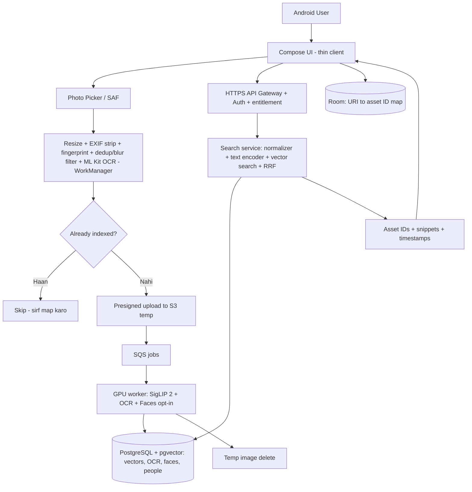

### 6.2 Kya kahan rehta hai (data placement)

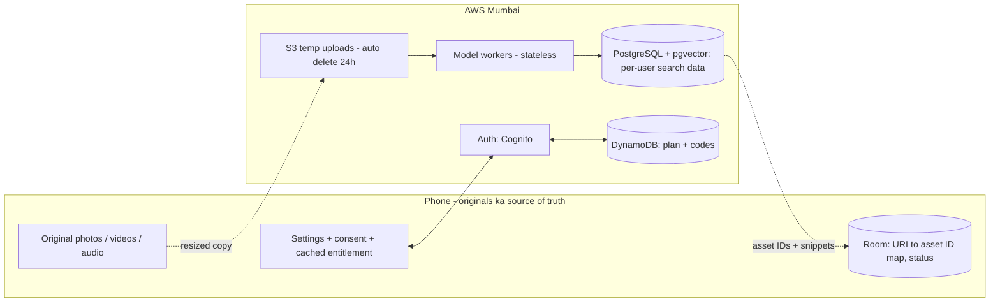

| Data | Phone | AWS |
|---|---|---|
| Original photo/video/audio | ✅ **Source of truth** | Sirf temporary resized copy, max 24h, phir delete |
| URI + local mapping | ✅ Room | ❌ |
| Vectors (image / video frame / transcript) | ❌ | ✅ PostgreSQL, per-user, encrypted |
| OCR text | ✅ Banta hai yahin (ML Kit), sensitive patterns upload se pehle mask | ✅ Search ke liye store |
| Face vectors + Person names | ❌ | ✅ **Sirf face grouping ON hone par**, alag consent, per-user isolated |
| Model weights | ❌ | ✅ Hosted |
| Account / activation | Cached signed entitlement | ✅ Source of truth |

> ⚠️ **Multi-device / reinstall:** index ab account par hai, to reinstall par embeddings dobara nahi banane padte. Original files har device par alag hain, isliye app fingerprint se photos ko dobara match karta hai (user wahi photos dobara select kare).

### 6.3 Photo indexing sequence

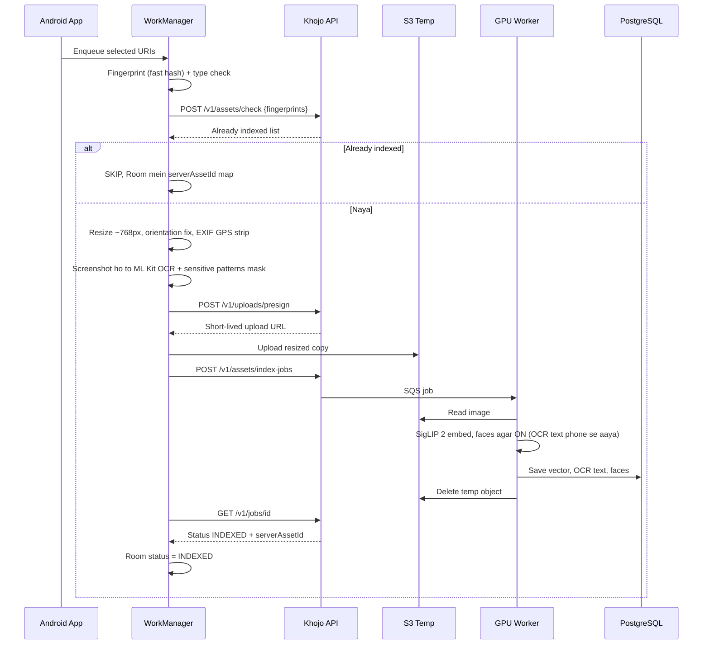

### 6.4 Search sequence

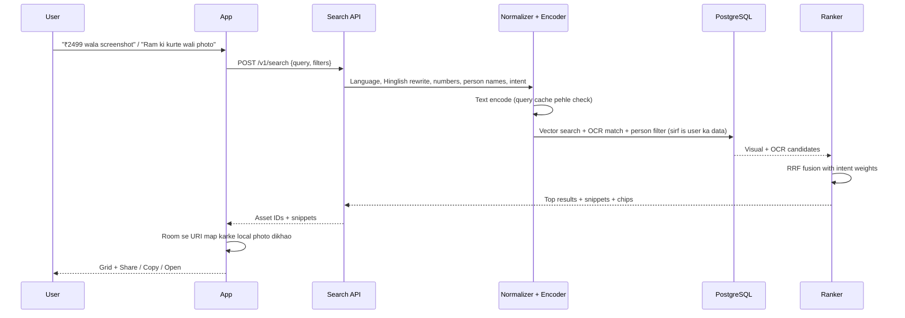

### 6.5 AWS deployment (growth stage)

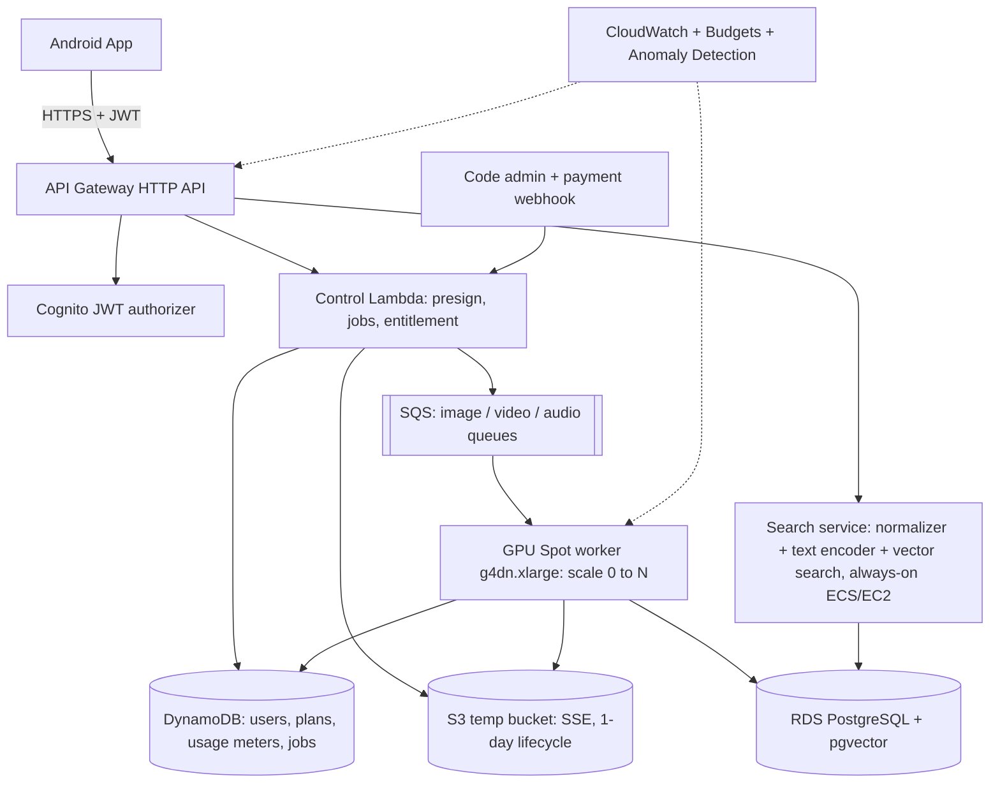

### 6.6 Video + audio pipelines (Stage 3–4)

> ⏸️ **Phase 4–5 — abhi nahi.**


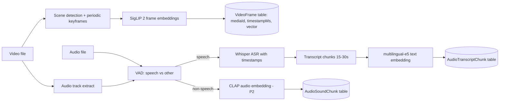

### 6.7 Activation code / entitlement flow

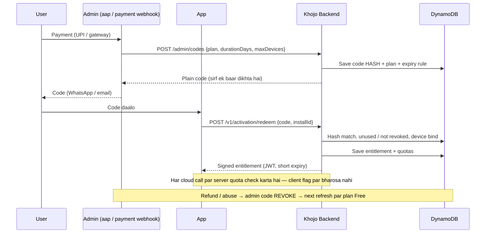

---

## 7. AI models — selection aur reasoning

### 7.1 Model summary

> **Phase 1 mein sirf:** SigLIP 2 Base (image + text) + ML Kit OCR. Video, Whisper, e5, CLAP, face models wali rows **baad ke phases** ke liye hain.


| Kaam | Model | Kyu ye | Kahan chalega | Stage |
|---|---|---|---|---|
| Image ↔ Text search | **SigLIP 2 So400m** (`google/siglip2-so400m-patch14-384`) | Accuracy-first; image aur text same vector space; multilingual training | Cloud | 1 (sirf agar Base kharab lage) |
| Image ↔ Text (baseline) | **SigLIP 2 Base** (`google/siglip2-base-patch16-384`) | ~3x chhota, sasta, tez; **default** | Cloud | 1 (default) |
| Screenshot text | **ML Kit Text Recognition v2** (Latin + Devanagari) | Free, chhota, Hindi support; sensitive text phone se bahar jaane se pehle mask | Phone | 1 |
| Screenshot text (fallback) | **PaddleOCR** | Sirf slow/fail hone par | Cloud GPU | Baad mein |
| Face detection + recognition | **YuNet (MIT) + AuraFace-v1 (Apache 2.0)** | Commercial-safe; InsightFace/SCRFD weights non-commercial | Cloud GPU/CPU | 2B |
| Video moments | Same SigLIP 2 image encoder on keyframes | Naya model nahi, same space, kam cost | Cloud | 3 |
| Speech → text | **Whisper** (size benchmark se: `large-v3-turbo` / `small`) | Multilingual, Hindi/Hinglish support, open source (MIT) | Cloud GPU | 4 |
| Transcript search | **multilingual-e5-base** (`intfloat/multilingual-e5-base`) | Hindi + English text retrieval, chhota model | Cloud | 4 |
| Sound events | **CLAP** (LAION) | "Rain", "barking" jaise descriptions | Cloud | 5 |

### 7.2 SigLIP 2 — important technical facts

| Property | So400m-patch14-384 | Base-patch16-384 |
|---|---|---|
| Input image | 384 × 384 | 384 × 384 |
| Embedding dimension | **1,152** | **768** |
| FP32 checkpoint size | ~4.5–4.6 GB | ~1.5 GB |
| License (model repo) | Apache 2.0 | Apache 2.0 |
| Phone par? | ❌ (cloud-first design) | ❌ (cloud-first design) |

**Implementation rules (ye galat hua to search kharab hoga):**

1. Image aur text **dono same checkpoint** se encode honge. Kabhi mix nahi.
2. Text tokenization model card / HF docs ke hisaab se: SigLIP family `padding="max_length"` aur `max_length=64` ke saath train hui hai — **wahi settings use karo**, warna embeddings drift karengi.
3. Har vector ko **L2-normalize** karo (cosine search ke liye).
4. Model revision + checksum + preprocessing version **pin** karo. Model badla = poora reindex.
5. CLIP aur SigLIP vectors kabhi same index mein nahi — alag spaces, alag dimensions.
6. Quantization (INT8/FP16) ke baad apni photos par search dobara try karo ki result kharab to nahi hue.

### 7.3 Hindi / Hinglish strategy

| Query type | Example | Approach |
|---|---|---|
| English | "red saree with golden border" | Direct SigLIP 2 |
| Devanagari Hindi | "लाल साड़ी" | Direct SigLIP 2 (multilingual) + test |
| Roman Hinglish | "laal saree golden border wali" | **Normalizer**: dictionary (laal→red, ped→tree, wali/dikhao→stopwords) → English rewrite; **original + rewrite dono embed**, RRF se merge |

- Dictionary-based normalizer pehle (sasta, predictable, ~500 common seller words).
- LLM-based rewrite sirf tab jab dictionary fail kare aur benchmark sudhaar dikhaye (extra cost + latency).
- Original query hamesha save (debug + "Did you mean" chip).

### 7.4 Model choice (formal benchmark nahi)

Formal benchmark / labelled dataset **nahi** banayenge. Model ka faisla simple rakha hai:

1. **Default = SigLIP 2 Base** (sasta, tez, aage phone pe bhi chalega).
2. Founder **apne phone ki photos** par khud search karke dekhega ki top results sahi aa rahe hain ya nahi (English / Hindi / Hinglish queries).
3. Result kharab lage tabhi **So400m** try karo, aur wo bhi sirf cloud par chalega.
4. Jo model final ho, uska revision + checksum pin karo.

### 7.5 Overclaim se bachna

- Bada model hamesha best nahi — aapki photos par test hi faisla karega.
- HNSW "approximate" hai — semantic relevance ki guarantee nahi.
- "Tree wali image" → kai trees aa sakte hain; refine chips do.
- Keyframes movement poori tarah nahi samajhte.
- Whisper naam, dialect, noisy voice notes miss kar sakta hai.

---

## 8. Indexing aur search pipelines

### 8.1 Photo indexing

```text
URI selected (phone)
  → readable? type, size, orientation check
  → fingerprint (fast hash)
  → server check: (fingerprint, modelVersion) already INDEXED? → SKIP, bas map karo
  → near-duplicate / bahut blurry photo skip (perceptual hash + blur score, phone par)
  → resize ~768px (screenshot ~512px), EXIF orientation fix, EXIF/GPS strip
  → screenshot ho to **ML Kit OCR phone par** → ocr_text + normalized tokens, sensitive patterns upload se pehle mask
  → presigned upload to S3 temp (Wi-Fi + charging default)
  → server worker: SigLIP 2 embedding + L2 normalize
  → server worker: phone se aaya ocr_text ko dobara mask-check karke store (defense in depth)
  → server worker: faces (sirf agar face grouping ON)
  → PostgreSQL upsert (vector + modelVersion + processingVersion); temp image delete
  → status: INDEXED / FAILED(reason) / RETRYABLE → phone Room mein update
```

**Batching:** phone 16–32 images ek job mein bhejta hai; server GPU batch mein process karta hai.
**Phone resources:** resize + upload + chhota OCR (sirf screenshots; charging + Wi-Fi par); koi bhari ML model nahi. Low-end phone (jaise RAM < 3 GB) par OCR ek-ek karke, timeout ke saath; slow/fail hone par cloud fallback.

### 8.2 Search query

```text
user text / voice (phone)
  → POST /v1/search
  → server: language detect + normalization (Hinglish → English rewrite)
  → person name detect (agar People ON)
  → intent detect (amount/number? → OCR heavy; visual words? → vision heavy)
  → query cache check (same normalized query → same vector, 30 din)
  → SigLIP 2 text encoder (SAME checkpoint) → L2 normalize
  → per-user vector search (exact; HNSW sirf zaroorat par) top 50
  → OCR exact + fuzzy candidates, metadata filters (date, source, type)
  → Reciprocal Rank Fusion (intent weights)
  → optional rerank (sirf agar validated)
  → asset IDs + snippets; confidence words ("Best match"), fake % nahi
```

### 8.3 Video indexing

> ⏸️ **Phase 4 — abhi nahi.**

- Metadata: `duration, mime, width, height`.
- **Phone sirf keyframes (chhoti JPEG) nikalke upload karta hai** — poori video upload nahi hoti.
- **Adaptive sampling:** scene change + har ~2–3s ek frame (5s fixed universal nahi).
- Save `(mediaId, timestampMs, vector, modelVersion)`.
- Search → **group by mediaId** → top 3 timestamps per video.
- Candidate moment ke aaspaas **re-sample** (±2s, 0.5s interval) precision ke liye.
- Video ka audio alag se transcribe (agar spoken search chahiye).

### 8.4 Audio indexing

> ⏸️ **Phase 5 — abhi nahi.**

- VAD se speech vs non-speech.
- Whisper → segments with timestamps → 15–30s chunks (thoda overlap).
- Chunks → multilingual-e5 embeddings → alag index.
- Non-speech → CLAP (P2) → alag index.
- Query router: transcript / sound / dono.
- Result: user ka original audio URI + `startMs`. **Voice kabhi logs mein permanent copy nahi.**

### 8.5 Dedup, updates, deletions
- Dedup key: fast fingerprint → conflict par `SHA-256(file bytes)`.
- Model version + preprocessing version alag fields.
- URI lost / file deleted → vector deactivate, UI mein "File not found — re-select?".
- Model switch → background full reindex (purane vectors tab tak active).
- Settings: **"Delete my data"** (server par vectors, OCR text, faces, collections sab) + local cache clear.

---

## 9. Database design (server + phone)

Cloud-first: **sab searchable data server ke PostgreSQL (pgvector) mein**, phone par sirf chhota Room mapping.

### 9.1 ER diagram (server)

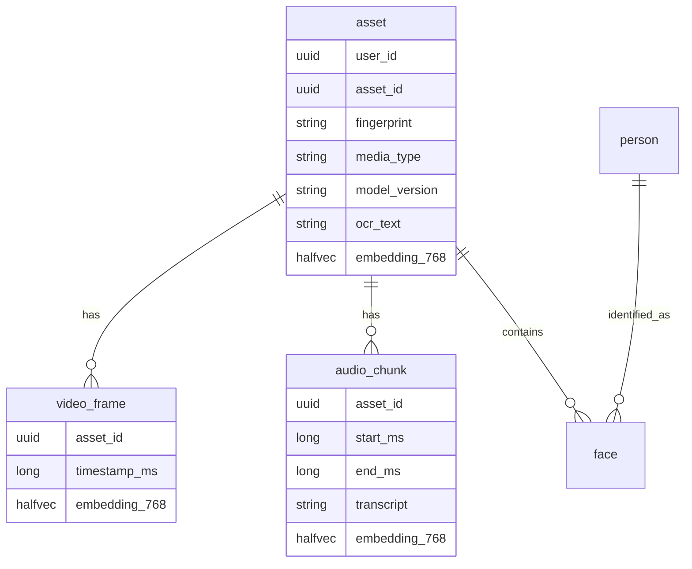

### 9.2 Main table (illustrative SQL)

```sql
CREATE EXTENSION IF NOT EXISTS vector;
CREATE EXTENSION IF NOT EXISTS pg_trgm;

CREATE TABLE asset (
  user_id       uuid NOT NULL,
  asset_id      uuid NOT NULL,
  fingerprint   text NOT NULL,            -- phone-side hash
  media_type    text NOT NULL,            -- IMAGE / SCREENSHOT / VIDEO / AUDIO
  taken_at      timestamptz,
  caption       text,                     -- optional
  ocr_text      text,
  ocr_tokens    text,                     -- normalized: "2499 upi paid"
  model_version text NOT NULL,            -- e.g. siglip2-base-p16-384-v1
  status        text NOT NULL,            -- PENDING / INDEXED / FAILED / STALE
  embedding     halfvec(768),
  PRIMARY KEY (user_id, asset_id),
  UNIQUE (user_id, fingerprint, model_version)
);
CREATE INDEX asset_ocr_trgm ON asset USING gin (ocr_text gin_trgm_ops);

-- Per-user isolation: row-level security
ALTER TABLE asset ENABLE ROW LEVEL SECURITY;
```

> **Schema rule:** vector dimension fixed hai. Base = 768, So400m = 1152. Model badalne par **naya column + full reindex**. Kabhi pad/truncate karke "fit" mat karo. `halfvec` (2 bytes per number) storage aadha kar deta hai.

### 9.3 Baaki tables

| Table | Fields |
|---|---|
| `video_frame` | user_id, asset_id, timestamp_ms, embedding, model_version |
| `audio_chunk` | user_id, asset_id, start_ms, end_ms, transcript, language, embedding, model_version |
| `audio_sound_chunk` (P2) | user_id, asset_id, start_ms, end_ms, embedding (CLAP; dimension checkpoint se confirm) |
| `person`, `face` | Section 10A.4 |
| `collection` | user_id, collection_id, name, created_at, asset_ids (server par, taaki reinstall par bachi rahe) |
| `index_job` | user_id, job_id, pipeline_type, attempts, state, error_code |
| `query_cache` | normalized_query, model_version, vector, created_at (30-day TTL; pilot mein DynamoDB TTL) |

### 9.4 Vector search (per-user, exact)

```sql
SELECT asset_id, embedding <=> $1 AS dist
FROM asset
WHERE user_id = $2 AND status = 'INDEXED' AND media_type = ANY($3)
ORDER BY embedding <=> $1
LIMIT 50;
```

Ek user ki library chhoti hoti hai (≤ 50,000), isliye **exact scan** (bina ANN index ke) tez aur 100% accurate hai. HNSW index sirf tab jab latency maange.

### 9.5 Phone ka local DB (Room)

```kotlin
@Entity(tableName = "local_asset")
data class LocalAsset(
    @PrimaryKey(autoGenerate = true) val id: Long = 0,
    val uri: String,                 // user-authorized content URI
    val fingerprint: String,
    val serverAssetId: String? = null,
    val mediaType: String = "IMAGE",
    val status: String = "PENDING",  // PENDING / UPLOADING / INDEXED / FAILED
    val errorCode: String? = null,
    val addedAtMs: Long = 0
)
```

Phone par ~0.5 KB per asset: 20,000 photos ≈ 10 MB. URI lost / file deleted → "File not found — re-select?".

### 9.6 Server storage calculation

| Library size | Vector (halfvec 768) | Note |
|---|---|---|
| 1,000 images | ~1.5 MB | |
| 20,000 images | ~30 MB | |
| 50,000 images | ~75 MB | Seller Pro max |
| 1,000 users × 10,000 images | ~15 GB | + OCR text, index, backup (≈ 2–3x) |

*(Formula: images × 768 × 2 bytes. Ye server DB ke RAM aur cost ka sabse bada driver hai — Section 14.)*

---

## 10. Search ranking engineering

### 10.1 Retrieval stages
1. **Intent routing** — image / OCR text / video / speech / sound / All.
2. **Query understanding** — language, objects, colors, amounts, dates.
3. **Candidate retrieval** — per-user vector search + OCR + metadata alag-alag (server par).
4. **Fusion** — **Reciprocal Rank Fusion (RRF)**; alag models ke raw scores directly compare nahi.
5. **Optional rerank** — top 20 par, sirf agar gain proven.
6. **Presentation** — highlights, source, timestamp.

### 10.2 Starting weights (hypothesis — tune karna hai)

| Query type | Visual | Metadata | OCR/Exact | Transcript |
|---|---|---|---|---|
| Visual ("red kurti") | 75% | 15% | 10% | — |
| Payment/receipt ("₹2499") | 20% | 20% | 60% | — |
| Spoken ("deadline wali meeting") | — | — | 20% keyword | 80% semantic |

> "98% match" jaisa kuch bhi tab tak nahi dikhayenge jab tak ground-truth par calibrate na ho. Use "Best match", "Similar".

### 10.3 Failure cases jo cover karne hain

| Case | Solution |
|---|---|
| "Wo tree wali" → bahut trees | Refine chips (date, source), top choices |
| "Golden kurti" → golden color vs golden embroidery | Attribute-wise test bucket |
| "₹2,499" vs "₹2499" vs "2,499.00" | OCR number normalization |
| "ped" vs "tree" | Hinglish dictionary + dual embedding |
| "Dog jumps into pool" → before/after frames | Dense re-sampling |
| Same screenshots, alag amounts | OCR exact match dominate kare |

---

## 10A. People & Faces — face grouping aur naming

> ⏸️ **Phase 3 — abhi nahi.** Ye pura section Phase 1 complete hone ke baad ka plan hai.


> **Feature ek line mein:** Photos mein jitne bhi chehre (faces) hain, app unhe **apne aap group** karega ("Person 1", "Person 2"...). Ek alag **People** section mein user har group ko naam dega ("Ram", "Mummy", "Priya Didi"). Phir search mein "**Ram ki kurte wali photo**" bolne par app pehle *Ram ki photos* filter karega, phir unme se *kurta* wali dikhayega.

### 10A.1 Ye kaise kaam karega (simple flow)

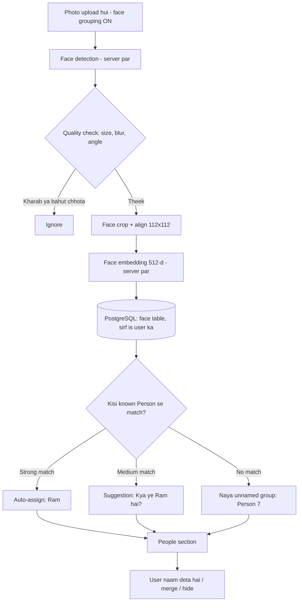

**Design decision (v2.5):** app halka rakhne ke liye face detection, embedding aur grouping ab **cloud par** hoti hai (v2.4 mein on-device thi). Isse risk badh gaya hai, isliye rules sakht hain (10A.7).

| Pehlu | Detail |
|---|---|
| 🔒 Privacy | Chehre ka data **biometric** hota hai — sabse sensitive category. Server par rakhne se leak ka asar bada hai, isliye default OFF, alag consent, per-user isolation, encryption |
| ⚖️ Legal lesson | Google Photos ki face grouping par US (Illinois BIPA) mein case hua aur Google ne **$100 million** settlement diya; Texas ne bhi Google par case kiya ki bystanders (background ke log) ka face data bina consent bana. Hum isse seekh kar opt-in + consent + delete rakhenge, aur launch se pehle lawyer review karayenge |
| 💰 Cost | Server GPU ~₹0.001–₹0.005 per photo (estimate) |
| 📶 Offline | People filter bhi ab internet par depend karta hai |

**Baad mein optimize (optional):** face detection phone par (ML Kit, chhota) aur sirf face crops upload — poori photo bhejne ki zaroorat nahi. AuraFace jaisa bhari embedding model cloud par hi rahega.

### 10A.2 Models — kya use karenge aur license kyu important hai

| Kaam | Model / Library | License | Note |
|---|---|---|---|
| Face detection ⭐ | **YuNet** (OpenCV Zoo) server par | MIT; 5 keypoints alignment ke liye, commercial OK |
| Face embedding ⭐ | **AuraFace-v1** (fal.ai, ArcFace-style ResNet100) server par | **Apache 2.0 — commercial use allowed** | 512-d embedding; GPU/CPU par chalta hai, phone ke liye quantize karne ki zaroorat nahi |
| ❌ **Use NAHI karna** | InsightFace pretrained packs (`buffalo_l`, `antelopev2`, SCRFD weights) | **Non-commercial only** | Code MIT hai lekin **model weights paid app mein bina commercial license ke illegal** |
| ❌ Unclear | Random GitHub "FaceNet .tflite" files | Training data (VGGFace2/MS-Celeb) ka license unclear | Provenance verify kiye bina mat use karo |

> ⚠️ **License trap:** AuraFace ki repo mein InsightFace ka SCRFD detector bhi bundled aata hai jo non-commercial hai — **sirf recognition model lo, detector YuNet (MIT) ka use karo.**

### 10A.3 Grouping (clustering) logic

**Step 1 — Quality filter** (bekar faces ko group mein jaane se roko):
- Face size ≥ ~60×60 px (chhote background chehre skip → bystander privacy bhi)
- Head angle (yaw) bahut zyada side nahi (YuNet landmarks se estimate)
- Blur score + detection confidence threshold

**Step 2 — Embedding:** face crop → 5 landmarks se align → 112×112 → AuraFace → **L2 normalize** → 512 floats.

**Step 3 — Incremental clustering** (har nayi photo par poora re-cluster nahi):

```text
naya face vector v
  → HNSW: nearest 10 faces nikalo
  → har known Person ke liye: similarity(v, person ke representative vectors)
  → best ≥ T_high (e.g. 0.55)   → auto-assign
  → T_low ≤ best < T_high        → "Kya ye Ram hai?" suggestion (user confirm)
  → best < T_low (e.g. 0.40)     → unnamed cluster mein (ya naya cluster)
```

- **Thresholds (0.55 / 0.40) sirf starting guess hain** — apne test set par tune karne hain.
- Pehli baar bulk import par: **agglomerative clustering** server par background job mein (upload ke baad), har user ke liye alag.
- Har Person ke liye **5–10 representative vectors** rakho (alag age, angle, lighting) — ek "average" vector se better match.
- User ka har correction (confirm / "Ye Ram nahi hai" / merge) → **future matching ka hissa** (rejected pairs yaad rakho).

### 10A.4 Database (server — PostgreSQL)

```sql
CREATE TABLE person (
  user_id       uuid NOT NULL,
  person_id     uuid NOT NULL,
  display_name  text,               -- NULL = "Person 7" (unnamed)
  aliases       text,               -- "ram,raam,राम,ram bhaiya"
  cover_face_id uuid,
  is_hidden     boolean DEFAULT false,
  face_count    int DEFAULT 0,
  created_at    timestamptz,
  PRIMARY KEY (user_id, person_id)
);

CREATE TABLE face (
  user_id       uuid NOT NULL,
  face_id       uuid NOT NULL,
  asset_id      uuid NOT NULL,      -- kis photo mein
  person_id     uuid,               -- NULL = abhi assign nahi
  box_left real, box_top real, box_right real, box_bottom real,   -- normalized 0..1
  quality       real,
  assignment    text DEFAULT 'AUTO',  -- AUTO / USER_CONFIRMED / SUGGESTED / REJECTED
  model_version text DEFAULT 'auraface-v1-1',
  embedding     halfvec(512),
  PRIMARY KEY (user_id, face_id)
);
```

**Storage:** 512 × 2 bytes ≈ **1 KB per face** (halfvec). 20,000 photos × ~2 faces ≈ 40,000 faces ≈ **~40 MB** per heavy user (server par). Quality filter se kaafi kam hoga. Phone par kuch store nahi hota; face thumbnails phone par original photo se box ke hisaab se banaye jaate hain.

### 10A.5 Search: "Ram ki kurte wali photo" kaise solve hoga

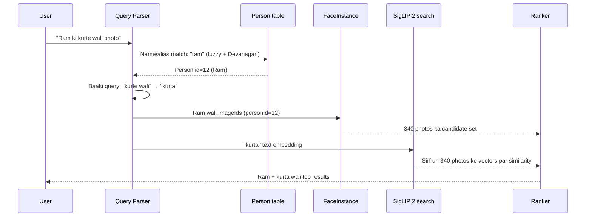

**Query parsing rules:**

| Query | Person filter | Visual query |
|---|---|---|
| "Ram ki kurte wali photo" | Ram | "kurta" |
| "Ram aur Priya beach par" | Ram **AND** Priya (dono ek photo mein) | "beach" |
| "Mummy ki saari photos" | Mummy | — (sirf person filter, date-wise sort) |
| "राम की फोटो" | Ram (Devanagari alias) | — |
| "Ram jaisa dikhne wala" | ❌ Support nahi — sirf named People se filter |

**Technical approach:**
1. **Name detection:** query tokens ko `Person.displayName + aliases` se match (exact → fuzzy edit-distance ≤ 1 → transliteration ram↔राम). Grammar words "ki / ka / ke / wali / wala / photo / dikhao" hata do.
2. **Ambiguity:** agar "Ram" naam ke 2 Person hain → chip dikhao "Ram (Bhaiya) / Ram (Office)".
3. **Filtered vector search:** Person ki photos chhoti list hoti hai (aam taur par < 5,000), isliye un photos ke SigLIP vectors par **exact cosine (brute-force)** — fast aur 100% accurate. Badi list par HNSW top-K bada lekar intersect.
4. **Fallback:** agar naam kisi Person se match nahi hua → normal search + chip "Ram naam ka koi Person nahi mila — People mein naam do".
5. Multi-person: "Ram aur Priya" → dono ke imageId sets ka **intersection**.

### 10A.6 People section — UI screens

| Screen | Kya hoga |
|---|---|
| **People grid** | Saare face groups (bade group pehle), naam wale upar; "Add name" button |
| **Person detail** | Us person ki saari photos · Rename · Aliases add (Ram / Raam / राम) · Cover photo choose |
| **Name a face** | Photo mein face par tap → naam likho / existing person chuno |
| **Review suggestions** | "Kya ye Ram hai?" — ✅ Haan / ❌ Nahi (swipe cards, fast) |
| **Merge** | Do groups ek hi insaan ke → "Merge" |
| **Remove / Not this person** | Galat photo hatao — model seekhta hai |
| **Hide person** | Ex/stranger/bystander — People mein nahi dikhega, search mein nahi aayega |
| **Settings → Face grouping** | ON/OFF toggle · "Delete all face data" · data size |
| Search result chip | "👤 Ram" chip — tap karke filter hatao/badlo |

*Face thumbnails phone par original photo se server ke diye box se crop hote hain — server crop store nahi karta.*

### 10A.7 Privacy aur consent rules (strict)

Face data ab server par hai, isliye ye rules v2.4 se **zyada sakht** hain:

1. **Default OFF.** Alag, clear consent screen: "Khojo aapki chuni hui photos mein chehre **hamare server par** group karega. Ye data sirf aapke account mein rahega, kabhi share nahi hoga."
2. Face vectors aur naam **sirf us user ke account mein**; **cross-user matching kabhi nahi**; model training, ads ya kisi aur kaam mein use nahi.
3. Encryption at rest (KMS) + in transit; face tables par alag access policy; logs / analytics / crash reports mein face data kabhi nahi.
4. **Turn OFF = server se saara face data turant delete** (`face` + `person` tables) + local cache clear; backups se bhi retention window ke baad hat jaata hai.
5. Upload ki hui photo ki copy 24h mein delete — server par sirf vector + box rehta hai.
6. Sirf user ke chune hue media par — koi web search, celebrity recognition, ya "is insaan ko pehchano" feature **nahi**.
7. Naam sirf user deta hai — app khud kabhi kisi ka naam guess nahi karta.
8. Chhote/background faces skip (bystander protection); "Hide person" option.
9. Face data export/share feature **nahi**.
10. Privacy policy mein clearly disclose: server-side face processing, retention, deletion.
11. **DPDP Act (India) ke hisaab se lawyer review launch se pehle zaroori** — photos mein doosre logon ka data bhi hota hai. Biometric laws wale regions (jaise Illinois/Texas) mein feature region-wise band.

### 10A.8 Performance aur cost

| Item | Estimate (real use mein verify karna) |
|---|---|
| Face detection + embedding (server GPU) | ~0.05–0.2 s / photo |
| 5,000 photos ka pehla scan | Upload ke saath parallel; upload speed par depend (kuch minute se ghante) |
| Person filter search | < 300 ms (server, network ke saath) |
| Cloud cost | ~₹0.001–₹0.005 / photo |
| Phone par app size | Koi face model nahi → 0 MB extra |

### 10A.9 Edge cases

| Case | Handling |
|---|---|
| Bachpan vs ab ki photo (age gap) | Multiple representative vectors; user merge |
| Judwaa / milte-julte bhai-behen | Auto-assign threshold strict; suggestion mode |
| Mask, sunglasses, side face | Quality filter skip ya low-confidence suggestion |
| Group photo (20 faces) | Sabhi detect, chhote skip; "Ram aur Priya" intersection search |
| Poster/TV/statue mein chehra | Quality + user "Hide" |
| Same naam ke 2 log | Aliases + disambiguation chip |
| Model update | `modelVersion` change → face vectors reindex; **user ke naam aur confirmations preserve** (Person table safe) |

### 10A.10 Testing & metrics

| Metric | Matlab | Initial target (validate) |
|---|---|---|
| Cluster purity | Ek group mein sirf ek insaan | ≥ 95% |
| False merge rate | Do alag log ek group mein | < 2% (sabse kharab error) |
| Person recall | Ram ki kitni photos Ram group mein | ≥ 85% (baaki suggestions mein) |
| "Person + object" query success | "Ram ki kurta photo" sahi | ≥ 80% top-5 |
| Indian faces / skin tones / lighting | Bias check | Har group mein similar accuracy |

Test set: consented family/friends photos (alag age, lighting, festivals, group photos). **Fairness test zaroori** — face models kuch skin tones/ages par kam accurate ho sakte hain.

---

## 11. Backend API contract

Base URL: `https://api.<aapka-domain>/v1` (aapke existing domain ka subdomain) · Auth: `Authorization: Bearer <JWT>` · Har write call par `Idempotency-Key` header.

| Method | Endpoint | Kaam |
|---|---|---|
| POST | `/v1/search` | Query → ranked asset IDs + snippets (sab server par) |
| POST | `/v1/uploads/presign` | Temp S3 upload URL (short-lived, scoped) |
| POST | `/v1/assets/index-jobs` | Batch index job: embedding + OCR (+ faces agar ON) |
| POST | `/v1/assets/check` | Fingerprints bhejo; jo already indexed hain unhe skip karo |
| GET/PATCH | `/v1/people`, `/v1/people/{id}` | People list, naam, merge, hide (face grouping ON hone par) |
| DELETE | `/v1/people` | Saara face data delete (face grouping OFF) |
| GET | `/v1/jobs/{jobId}` | Job status |
| POST | `/v1/transcribe-jobs` | Audio/video ASR job (P1) |
| GET | `/v1/me/entitlement` | Plan, expiry, quotas, usage |
| POST | `/v1/activation/redeem` | Activation code redeem + device bind, signed entitlement wapas |
| POST | `/admin/codes` (internal, public nahi) | Codes generate / revoke — sirf admin key se |
| DELETE | `/v1/me/data` | Saara server-side data delete (vectors, OCR text, faces, collections) |
| DELETE | `/v1/me` | Account deletion |

**Example — search**

```json
// Request
{ "query": "black kurti with golden design", "language": "en",
  "mediaTypes": ["IMAGE"], "limit": 50 }

// Response
{ "modelVersion": "siglip2-base-p16-384-v1",
  "results": [ {"assetId": "a001", "rank": 1, "snippet": null, "timestampMs": null},
               {"assetId": "a017", "rank": 2, "snippet": null, "timestampMs": null} ],
  "chips": ["Black", "Last week"], "requestId": "req_x" }
```

**Example — index job**

```json
// Request
{ "media": [ {"clientAssetId": "a001", "temporaryObjectKey": "uploads/s1/a001", "kind": "IMAGE"},
             {"clientAssetId": "a002", "temporaryObjectKey": "uploads/s1/a002", "kind": "SCREENSHOT", "ocrText": "Paid ₹2,499 UPI ..."} ],
  "faceGrouping": false }

// Response
{ "jobId": "job_x", "status": "QUEUED", "accepted": 2 }
```

**Error format:** `{ "error": { "code": "QUOTA_EXCEEDED", "message": "...", "retryAfterSec": 3600 } }`
Codes: `UNAUTHORIZED`, `QUOTA_EXCEEDED`, `RATE_LIMITED`, `INVALID_MEDIA`, `MODEL_UNAVAILABLE`, `JOB_NOT_FOUND`.

**API protections:**
- Identity + entitlement server pe verify; client ke "isPro" flag par kabhi bharosa nahi.
- Rate limit: per user/device, batch size, daily compute.
- Image decode limits (size, dimension, decompression bomb), MIME check.
- EXIF/GPS strip **upload se pehle** (phone pe).
- Tokens / URIs / payloads logs mein redact.
- Temp uploads: 24h lifecycle + processing ke turant baad delete.

---

## 12. Android project structure

```text
KhojoAI/
├── app/
│   └── src/main/java/com/khojoai/app/
│       ├── MainActivity.kt
│       ├── KhojoApplication.kt
│       ├── navigation/
│       ├── ui/
│       │   ├── onboarding/   ├── home/        ├── importmedia/
│       │   ├── search/       ├── results/     ├── player/
│       │   ├── collections/  ├── subscription/└── settings/
│       ├── data/
│       │   ├── local/room/          # LocalAsset, DAOs, migrations
│       │   ├── remote/api/          # Retrofit services, DTOs
│       │   ├── media/               # Photo Picker, SAF, URI lifecycle
│       │   └── repository/
│       ├── domain/
│       │   ├── model/
│       │   └── usecase/             # IndexMedia, Search, ShareResults...
│       ├── indexing/
│       │   ├── UploadWorker.kt      # resize, EXIF strip, fingerprint, upload (WorkManager)
│       │   ├── OcrWorker.kt         # ML Kit OCR + number normalize + sensitive mask (screenshots)
│       │   ├── DedupFilter.kt       # perceptual hash + blur score
│       │   └── KeyframeExtractor.kt # video: sirf keyframes JPEG
│       ├── search/
│       │   └── SearchRepository.kt  # /v1/search call + result mapping
│       ├── people/                  # People UI + API calls (koi ML nahi)
│       └── activation/              # code entry, redeem, entitlement cache, updater
├── inference-service/      # FastAPI: search service + model workers (SigLIP, OCR, faces)
│   ├── app/main.py  ├── app/models/siglip.py  ├── app/workers/
│   └── Dockerfile
├── infrastructure/         # Terraform: API GW, Lambda, SQS, S3, DynamoDB, ECS, RDS
├── docs/                   # ADRs, openapi.yaml, security, runbooks
└── README.md
```

Library versions implementation ke time pin karna. Android media permissions OS version ke hisaab se badalte hain — Android OS ke media permission rules follow karo.

---

## 13. AWS deployment design

### 13.1 Stage-wise infra evolution

| Stage | Users | Compute design | Kyu |
|---|---|---|---|
| **Pilot** | ≤ 50 | **Search service:** 1 t3.medium always-on · **Indexing:** SQS + 1 GPU Spot worker (scale 0) · **RDS PostgreSQL (chhota, pgvector)** · S3 temp; Cognito; DynamoDB | Pilot mein ~1 lakh images index hote hain, GPU chahiye; credits use |
| **Growth** | ~1,000 | **Search service:** 1 small always-on instance (warm text model, <1s) · **Indexing:** SQS + GPU Spot worker (embedding + OCR + faces) · **RDS PostgreSQL (mid instance)** | Lambda cold start search ko slow karega; GPU batch sasta |
| **Scale** | ~10,000+ | Search: 2+ instances behind autoscaling · Indexing: GPU Spot pool (0→N) + on-demand fallback · **RDS bada instance + read replica** · Savings Plan | HA + cost per user kam |
| **Optimized** | any | **Vector storage optimize:** halfvec / binary quantization, cold users ke vectors S3 par, per-user shard cache | DB cost kam, margin badhta hai |

### 13.2 Lambda caveat (important)

So400m FP32 checkpoint ~4.5–4.6 GB hai. Lambda max memory **10,240 MB** aur max timeout **15 min** hai — kaagaz par fit hota hai, lekin **cold start (model load) kai seconds** le sakta hai. Isliye:
- Pilot mein bhi search ke liye chhota always-on instance rakho (Lambda cold start tester ka pehla impression kharab karega); Lambda sirf control plane (presign, jobs, entitlement) ke liye.
- Search latency target (<1.5s p95) ke liye growth stage par **warm always-on text server**.
- Real deployed container ka benchmark karke hi final decision.

### 13.3 Operational guardrails

- **AWS Budgets alerts:** ₹500 / ₹1,500 / ₹5,000 (pilot), baad mein revenue ka % .
- **Emergency kill switch:** cloud indexing pause flag (DynamoDB config).
- Max concurrent workers, per-user daily quota, max upload size.
- Timeouts, cancellation, exponential backoff + jitter.
- Metrics: p50/p95 latency, errors, cold starts, queue depth, **spend per user**.
- **NAT Gateway / ALB avoid** pilot mein (fixed monthly cost badhate hain).
- Region: **ap-south-1 (Mumbai)**.


---

# PART C — BUSINESS

## 14. Cost — one-time aur monthly

> **Assumptions (Nov 2026 snapshot, verify before launch):** 1 USD ≈ **₹95** · AWS par 18% GST (GST-registered business input credit claim kar sakta hai) · Lambda x86 ≈ $0.0000166667 / GB-second · g4dn.xlarge (1× T4 GPU) Mumbai on-demand ≈ **$0.579/hr** (~₹55/hr), Spot ≈ $0.20/hr · Indicative Mumbai EC2: t3.medium ≈ ₹2,500/mo, m6i.large ≈ ₹5,800/mo, m6i.xlarge ≈ ₹11,700/mo (always-on).
> Model speed numbers (seconds per image) **abhi estimate hain** — real use ke baad is table ko update karna hai.

### 14.0 Aapke AWS credits aur domain ka asar ✅

Aapke paas **AWS credits** aur **domain** dono pehle se hain, isliye shuruaati kharcha kaafi kam ho jaata hai:

| Item | Pehle (plan) | Ab |
|---|---|---|
| Domain | ₹700–₹1,500/yr | ✅ Already hai — bas renewal date yaad rakho |
| Pilot AWS bill (₹5,000–₹12,500/mo) | Card se | **Credits se ≈ ₹0** |
| Growth AWS bill (₹16,000–₹34,000/mo) | Card se | Credits khatam hone tak ≈ ₹0 |
| Model ko GPU/CPU par chalana (phone test ke liye) | ₹1,000–₹3,000 | **Credits se** |

**Runway formula:** `Credits kitne mahine chalenge = Credit balance (₹) ÷ Monthly AWS bill (₹)`

| Example: $1,000 credit (~₹95,000) | Monthly bill | Credits kitne chalenge |
|---|---:|---|
| Pilot (50 users) | ₹5,000–₹12,500 | ~8–15 mahine (ya expiry, jo pehle aaye) |
| Growth (1,000 users) | ₹16,000–₹34,000 | ~3–6 mahine (ya expiry, jo pehle aaye) |
| Scale (10,000 users) | ₹60,000–₹1,35,000 | ~1–2 mahine |

*(Ye sirf example hai — aapke asli credit amount se dobara calculate karna hai.)*

**Credits ke saath dhyan rakhne wali baatein:**
1. **Expiry date** — credits ki ek expiry hoti hai; Billing → Credits page par balance, expiry aur kin services par lagte hain, check karo.
2. **Har service cover nahi hoti** — kuch cheezein (jaise AWS Marketplace purchases, kuch support plans) credits se bahar ho sakti hain; aur pehle bill par dekh lo ki tax bhi cover ho raha hai ya nahi.
3. **Budget alerts phir bhi lagao** — credits khatam hote hi charge seedha card par aata hai, koi warning nahi.
4. **GPU quota** — naye accounts mein Mumbai par GPU (G-instances) aur Spot ka vCPU quota aksar bahut kam ya 0 hota hai. **Stage 0 mein hi Service Quotas se increase request daal do** — approval mein din lag sakte hain.
5. Credits hain isliye over-provision mat karo — architecture aisa rakho jo **credits ke baad bhi affordable** ho (scale-to-zero, Spot, cache).

### 14.1 One-time (launch se pehle)

| Item | Approx cost | Note |
|---|---:|---|
| ~~Google Play Developer account~~ | ₹0 | Play Store par nahi jaayenge, isliye nahi chahiye |
| Trademark filing "Khojo AI" (Class 9 + 42) | ~₹9,000 (₹4,500/class, individual/startup/MSME e-filing) | Attorney optional: +₹5,000–₹15,000 |
| Domain | ✅ ₹0 (already hai) | Sirf yearly renewal |
| Privacy policy + terms legal review | ₹10,000–₹50,000 | DPDP compliance ke liye recommended |
| Stage 0 model testing (GPU/CPU hours) | ✅ AWS credits se | ~20–50 instance-hours |
| Test devices (2–3 budget Android) | ₹0–₹40,000 | Optional, purane phones bhi chalenge |
| **Total (lean)** | **~₹19,000–₹55,000** | Domain + model testing already covered; Play fee nahi; development time (salary) alag |

### 14.2 Monthly cost — Stage 1: Pilot (50 users)

Workload: 50 testers × max 2,000 photos ≈ **1,00,000 images** (ek baar index) + ~10,000 searches/month.

| Item | Monthly |
|---|---:|
| Search service (t3.medium, always-on) | ~₹2,500 |
| RDS PostgreSQL (chhota, pgvector) | ₹2,000–₹3,000 |
| GPU indexing (g4dn.xlarge, ~100 GPU-hrs pehle mahine; Spot ~₹19/hr, on-demand ~₹55/hr) | ₹2,000–₹5,500 (sirf pehle mahine; baad mein ~₹500) |
| S3 temp + data transfer | ₹200–₹500 |
| API Gateway + Lambda control plane | ₹50–₹300 |
| CloudWatch | ₹200–₹500 |
| ECR, Cognito + DynamoDB, email, misc | ₹100–₹300 |
| **Total** | **Pehla mahina ~₹7,000–₹12,500 · baad mein ~₹5,000–₹8,000 → AWS credits se ≈ ₹0** |

*(GPU-hours ye maan kar hain ki ~1,000 images/ghanta process hota hai — conservative; asli speed pehle test mein dekho. Credits/free-tier rules July 2025 se badle hain — apna account check karo, zero bill ka promise mat karo.)*

### 14.3 Monthly cost — Stage 2: Growth (~1,000 active users)

Workload assumption: 200,000 naye images/month index + 100,000 searches/month.

| Item | Monthly |
|---|---:|
| Text encoder server (1 × t3.medium–m6i.large, always-on) | ₹2,500–₹5,800 |
| GPU indexing worker (20–60 GPU-hrs, on-demand; Spot isse sasta) | ₹1,100–₹3,300 |
| S3 temp + data transfer | ₹200–₹500 |
| API Gateway + Lambda control plane | ₹50–₹300 |
| CloudWatch | ₹300–₹800 |
| DynamoDB + Cognito | ₹100–₹300 |
| ECR, domain, email, misc | ₹300–₹500 |
| RDS PostgreSQL + pgvector (mid instance, storage, backup) | ₹10,000–₹20,000 |
| OCR + face GPU extra | ₹1,000–₹3,000 |
| **Total** | **~₹16,000–₹34,000** |

### 14.4 Monthly cost — Stage 3: Scale (~10,000 active users)

Workload: 2,000,000 naye images/month + 1,000,000 searches/month.

| Item | Monthly |
|---|---:|
| Text encoder (2 × m6i.large ya 1 × m6i.xlarge; Savings Plan se ~30–60% kam) | ₹11,000–₹12,000 |
| GPU indexing (100–200 hrs; Spot use karke ₹2,000–₹4,000) | ₹2,000–₹11,000 |
| S3 + transfer | ₹1,000–₹2,000 |
| CloudWatch | ₹1,000–₹2,000 |
| DynamoDB + Cognito (free tier ke upar ho sakta hai) | ₹500–₹3,000 |
| RDS PostgreSQL (bada instance + replica, storage) | ₹40,000–₹90,000 |
| OCR + face GPU extra | ₹5,000–₹15,000 |
| **Total** | **~₹60,000–₹1,35,000** |

*(RDS ke numbers rough estimate hain — AWS Pricing Calculator se verify karo. halfvec / quantization / cold users ko S3 par rakhne se ye kaafi kam ho sakta hai.)*

### 14.5 Per-unit cost (pricing decide karne ke liye)

| Unit | Estimate | Kaise nikala |
|---|---:|---|
| 1 image embedding (GPU batch) | **₹0.001–₹0.02** | ₹55/GPU-hr ÷ (50 se 3,600 img/hr conservative range) |
| 1 text search | **~₹0.01–₹0.06** | Always-on server cost ÷ searches (zyada searches = sasta per search) |
| 1 hour video (≈1,440 keyframes) | **₹8–₹24** | Frames × per-image cost (worst case) |
| 1 hour audio (Whisper GPU) | **₹1.5–₹3** | ~1.5–3 GPU-min per audio-hour (estimate) |
| OCR | **₹0** | Phone par ML Kit (cloud fallback ~₹0.001–₹0.005) |
| Face detect + embed (cloud, per photo) | **₹0.001–₹0.005** | GPU worker par (estimate) |

**Sabse bada cost ab:** vector DB (RAM + storage). Levers: halfvec / binary quantization, cold users ke vectors S3 par, per-user shard cache, per-plan library limits.

### 14.6 Cost control checklist
- ✅ Query cache (same query = no new inference)
- ✅ Batch indexing 16–32 images
- ✅ GPU Spot + scale-to-zero
- ✅ Monthly new-index quotas per plan (one-time bade imports ko control)
- ✅ Budget alerts + kill switch
- ✅ Unlimited video/audio **kabhi nahi**
- ✅ Separate meters: `image_embeddings`, `text_queries`, `video_frames`, `audio_minutes`

---

## 15. Subscription plans aur pricing

> **Phase 1 mein koi paid plan nahi** — 50 testers ko free activation codes. Ye plans Phase 2 ke liye hain.


### 15.1 Final plan structure (launch par test karna hai)

| | **Free** | **Plus** | **Seller Pro** ⭐ | **Media Pro** (Stage 3–4) |
|---|---|---|---|---|
| **30 din ka code** | ₹0 | **₹99** | **₹249** | **₹399** |
| **365 din ka code** | — | ₹899 (~24% off) | ₹2,249 (~25% off) | ₹3,599 (~25% off) |
| Target | Try karne wale | Personal users | Sellers / small business | Creators |
| Library size (indexed photos) | 500 | 10,000 | 50,000 | 50,000 |
| Naye photos index / month | 200 | 2,000 | 10,000 | 10,000 |
| Cloud AI searches | 20/day | Unlimited (fair use 200/day) | Unlimited (fair use 500/day) | Unlimited |
| Screenshot OCR search (on-device) | ✅ Unlimited | ✅ | ✅ | ✅ |
| Hinglish / Hindi search | ✅ Basic | ✅ | ✅ | ✅ |
| Collections | 1 | Unlimited | Unlimited + catalogue mode | Unlimited |
| Batch share (multi-select) | 5 at a time | 20 | **50 + saved share sets** | 50 |
| Price/amount OCR filters | — | ✅ | ✅ | ✅ |
| Priority indexing queue | — | — | ✅ | ✅ |
| Video moment search | — | — | — | **5 hrs/month** |
| Audio transcript search | — | — | — | **20 hrs/month** |
| 👤 People & Faces (cloud, opt-in) | ✅ Grouping + 3 named people | ✅ Unlimited | ✅ Unlimited | ✅ Unlimited |
| Devices | 1 | 1 | 2 | 2 |

**Free trial:** Seller Pro ka **7-day trial code** (ek account/device par ek hi). Ye table ke prices ab **code ki keemat** hain: 30 din / 365 din ke code ki keemat. Auto-renew nahi hota.

### 15.2 Ye prices kyu?

- **Cloud-first ka asar:** server par vector DB, OCR aur face processing aati hai, isliye v2.4 ke ₹79 / ₹199 / ₹349 se prices thode badhaye (₹99 / ₹249 / ₹399).
- **₹99 Plus** — phir bhi "chai se kam"; personal users ke liye sabse kam commitment.
- **₹249 Seller Pro** — business tool; ek din mein 1 extra sale bhi time bachne se hoti hai to value clear. Net ~₹206.
- **₹399 Media Pro** — video/audio ka asli GPU cost zyada hai, isliye fixed hours ke saath.
- **Yearly ~25% off** — cash flow upfront + churn kam.

### 15.3 Price experiments (Stage 2 pilot mein)
- Plus: **₹99 vs ₹129**
- Seller Pro: **₹249 vs ₹299**
- Fake-door test: "Upgrade" button → interest measure (bina paise liye, honest disclosure ke saath)
- Measure: conversion, D7/D30 retention, churn, refunds.

### 15.4 Activation code architecture

App Play Store par nahi hai, isliye **Play Billing, purchase token aur RTDN use nahi honge**. Plan activation code se chalta hai (flow: Section 6.7).

**Code design**
- Format `KHJ-XXXX-XXXX-XXXX-XXXX` — 16 random characters (secure random), confusing characters (0/O, 1/I) nahi.
- DynamoDB mein sirf **hash** (SHA-256 + server-side secret), plain code kabhi nahi.
- Fields: `codeHash, plan, durationDays, maxDevices, status (UNUSED / REDEEMED / REVOKED / EXPIRED), redeemedAt, boundAccountId, deviceIds, expiresAt, orderId, note`.
- **Single-use** — redeem hote hi account se bind. Code leak hua to doosra use nahi kar paayega.
- **Brute-force protection:** per-IP/device attempt limit, lockout, generic error message.

**Device binding:** app-generated `installId` (random UUID) + login account. Seller Pro = 2 devices. Reinstall par same account se login, code dobara redeem nahi karna padta.

**Expiry / renewal:** auto-renew nahi. Naya code redeem karne par expiry mein din add hote hain. Expiry se 3 din pehle in-app reminder. Expire hone par plan Free limits par aata hai (Section 24 #10), local index delete nahi hota.

**Offline / grace:** signed entitlement phone par cached; expiry ke baad chhota grace period (jaise 3 din).

**Refund / abuse:** admin code **revoke** karta hai, agle entitlement refresh par plan Free ho jaata hai.

**Admin side:** pilot mein ek chhota admin script / Lambda (ya Google Sheet + script) jo codes generate aur revoke kare. Admin endpoint kabhi public nahi — sirf admin key se.

**Payment:** pilot mein manual (user UPI se pay kare, aap code bhejo). Scale par payment gateway webhook se code auto-issue. GST invoice ka treatment CA se confirm karna.

### 15.5 Distribution (Play Store ke bina)
- **APK apne domain se:** S3 + CloudFront par host, `download.<aapka-domain>` jaisa page. Page par **SHA-256 checksum**, install guide (screenshots) aur short demo video.
- **Install friction:** user ko "Install unknown apps" allow karna hoga aur Play Protect warning dikh sakti hai. Sellers non-technical hain, isliye step-by-step guide aur WhatsApp support zaroori.
- **In-app updater:** app launch / roz ek baar `version.json` (`versionCode, apkUrl, sha256, minSupported, notes`) check kare, APK download kare, checksum verify kare, phir system installer khole (`REQUEST_INSTALL_PACKAGES`). Breaking API change par `minSupported` se force update.
- **Signing key:** hamesha ek hi key; encrypted backup 2 jagah. Key kho gayi to users ko update nahi mil payega.
- **Play Integrity** jaisa Play-based check sideloaded app par bharosemand nahi, isliye abuse rokne ke liye server-side checks (code, quota, rate limit) par hi bharosa karo.

---

## 16. Unit economics aur break-even

### 16.1 Ek paying user se kitna milega?

Assumption: price **GST inclusive** (18%) + payment gateway fee **~2%** of price (assumption, jo gateway chuno uski fee verify karo). Manual UPI par fee lagbhag 0 hoti hai, to net thoda aur zyada milega. Play Store ki 15% fee nahi lagti.

| Plan | Price | GST hatake | Gateway fee ~2% ke baad (**net**) |
|---|---:|---:|---:|
| Plus (30 din) | ₹99 | ₹83.9 | **₹81.9** |
| Plus (₹129 test) | ₹129 | ₹109.3 | ₹106.7 |
| Seller Pro | ₹249 | ₹211.0 | **₹206.0** |
| Seller Pro (₹299 test) | ₹299 | ₹253.4 | ₹247.4 |
| Media Pro | ₹399 | ₹338.1 | **₹330.2** |
| Plus yearly | ₹899 | ₹761.9 | ₹743.9 (~₹62/mo) |
| Seller Pro yearly | ₹2,249 | ₹1,905.9 | ₹1,861.0 (~₹155/mo) |

*(GST aur payout treatment apne CA se confirm karna — ye legal/tax advice nahi hai.)*

### 16.2 Break-even

Fixed monthly cost ₹16,000 (cloud-first infra ka growth-stage floor, Section 14.3 ka lower end) cover karne ke liye:
- Sirf Seller Pro: 16,000 ÷ 206.0 ≈ **78 paying sellers**
- Sirf Plus: 16,000 ÷ 81.9 ≈ **196 paying users**

### 16.3 Scenarios

| Scenario | Active users | Conversion | Paying mix | Net revenue/mo | Infra cost/mo | Result |
|---|---:|---:|---|---:|---:|---|
| Pilot | 50 | 0% (free pilot) | — | ₹0 | ₹5,000–₹12,500 | Investment phase |
| Growth (optimistic) | 1,000 | 8% | 55 Plus + 25 Seller | ~₹9,700 | ₹16,000–₹34,000 | Ghata (infra floor se kam revenue) |
| Scale (conservative) | 10,000 | 3% | 200 Plus + 100 Seller | ~₹37,000 | ₹60,000–₹1,35,000 | Ghata |
| Scale (optimistic) | 10,000 | 8% | 550 Plus + 250 Seller | ~₹96,500 | ₹60,000–₹1,35,000 | **Gross margin −40% se +38%** |

**Seekh:** cloud-first par economics tabhi chalti hai jab (1) sellers ka share zyada ho, (2) vector storage optimize ho (halfvec, cold users S3 par, shard cache), aur (3) Seller Pro ₹249–₹299 par tike. DB ke numbers rough estimate hain — pilot mein asli bill dekhkar dobara nikalna; infra ka asli floor isse kam bhi nikal sakta hai.

> Sirf **paying** customers count hote hain — 50 registered users ≠ 50 subscribers. Marketing par bada kharcha tab tak nahi jab tak relevance + retention proven na ho.

---

# PART D — EXECUTION

## 17. Security, privacy, compliance

### 17.1 Users se jo promises karenge (sach aur accurate)
- ✅ "Aapki original photos / videos / audio aapke phone par hi rehti hain. Processing ke liye chhoti copy server par jaati hai aur 24 ghante mein delete ho jaati hai."
- ✅ "Search ke liye hum photos se bana **search data** (embeddings, screenshot ka text, aur agar aap face grouping ON karo to face data) aapke account ke saath store karte hain. 'Delete my data' se aap sab hata sakte ho."
- ✅ "Face grouping default OFF hai aur alag consent ke baad hi chalti hai."
- ✅ "Search ke liye internet chahiye."
- ❌ "Data kabhi phone se bahar nahi jaata" — **ye nahi bolenge.**
- ❌ "Fully offline" — **nahi bolenge.**

### 17.2 Controls
1. Photo Picker / SAF — sirf chuni hui files ka access.
2. Explicit, informed consent before upload; kabhi bhi revoke.
3. TLS in transit; S3 SSE encryption; 24h lifecycle + processing ke baad turant delete.
4. Per-user isolation; presigned URLs scoped + short-lived.
5. Analytics mein filenames, GPS, faces, transcripts, images **nahi**.
6. Logs mein tokens, URIs, EXIF, payloads, transcripts redact.
7. "Clear local cache", "Delete my server data", "Delete account" — teeno in-app.
8. Signed entitlements; replay/spam/runaway bill protection.
9. Saare dependencies + AI model licenses ka commercial-use audit.
10. **DPDP Act (India)** + rules, privacy policy (apne domain par), retention, consent flows — lawyer se review. *(Ye document legal advice nahi hai.)*
11. **Face data:** cloud par, default OFF, alag consent, per-user isolation, OFF karte hi delete, kabhi analytics/logs mein nahi — poore rules Section 10A.7.
12. **Server par derived data (OCR text, vectors):** encryption at rest (KMS), per-user isolation (row-level security), card/OTP/Aadhaar jaise sensitive patterns **upload se pehle phone par hi mask** (server par dobara check), minimal staff access, access logs.

### 17.3 Sensitive media
Photos, screenshots (UPI, bank, OTP) aur voice recordings mein personal details hoti hain. Cloud-first design mein ye processing server par hoti hai, isliye: cloud processing hamesha **visible** (consent screen + indexing progress), upload sirf user ke chune hue media ka, aur poori library silently upload **kabhi nahi**. Screenshot OCR text mein sensitive patterns mask hote hain.

---

## 18. UI/UX screens

| # | Screen | Kya hoga |
|---|---|---|
| 1 | Splash | Logo + "Bas bolo. Khojo." |
| 2 | Onboarding (3 slides) | Search kaise kaam karta hai · caption optional · phone vs cloud processing |
| 3 | Permission + Consent | Photo access (picker), mic (optional), **Cloud processing consent (zaroori — iske bina search nahi)** |
| 4 | Home | Bada search bar + 🎤 mic · tabs: All / Photos / Screenshots / Videos / Audio · recent collections |
| 5 | Import media | Source, count, pending/indexed/failed |
| 6 | Indexing progress | Resumable queue, pause/cancel, failure reasons |
| 7 | Search results | Grid, OCR snippets highlighted, filter chips, refine chips, multi-select |
| 8 | Photo detail | Image, optional caption, source, Copy text / Share / Add to collection |
| 9 | Video player | Thumbnail strip + auto-seek to matched timestamp |
| 10 | Audio player | Transcript snippet, waveform (optional), seek to match |
| 11 | Collections | Group + batch share (seller catalogue mode) |
| 12 | Search settings | Language, indexing quality, Wi-Fi + charging only (default), upload data usage |
| 13 | Activation + plan | Code daalo, plan + expiry, usage meters (photos used / limit), renewal reminder |
| 14 | Account & privacy | Clear index, delete data, delete account, activation / plan status, help |
| 15 | Empty/Error states | No match · offline · not indexed · file missing · model timeout · quota khatam |
| 16 | **People** 👤 | Face groups, naming, merge, suggestions, hide (Section 10A.6) |

**Results behavior examples:**
- "Vo tree wali image dikhao" → tab All → top photo matches → refine chips: "Green tree", "Last week" (sirf jo metadata me ho — GPS/date invent nahi).
- "Jisme meeting mein deadline discuss hui" → audio result → snippet + `02:35` → wahin se play.

**Design notes:** Hindi + English UI strings (i18n), bade touch targets, dark mode, low-end phones (2–3 GB RAM) par smooth grid (Coil thumbnails, paging).

---

## 19. Testing aur quality

### 19.1 Quality check (founder phone test)
- Formal dataset, labels aur Recall/MRR jaise metrics **nahi** banayenge.
- Founder apne phone par khud search chalake dekhega: English / Hindi / Hinglish queries, screenshots mein amounts, kurti jaise product photos.
- Jo query fail ho use note karo aur Hinglish dictionary / ranking weights tune karo.
- Latency (text search p95 < 1.5s on 4G) ko real phone par stopwatch se dekho.

### 19.2 Technical tests
- Room migrations + server model-switch reindex
- URI revoked/deleted, process killed, restart → work resume
- No internet → kya chalta hai clearly dikhe
- Timeout/retry/idempotency, duplicate uploads
- Image/text embedding consistency (dimension, normalization)
- Large/corrupt images, EXIF orientation, HEIC, GIF, unsupported formats
- VFR videos, long audio, device thermal conditions
- Activation code expiry, reuse, revoke, brute-force lockout + adversarial client manipulation; APK updater (checksum mismatch, interrupted download)
- S3 temp delete verification
- Multi-user isolation + upload fuzzing

---

## 20. Roadmap — kya-kya karenge, step by step

> **Abhi sirf Stage 0 + Stage 1 (Phase 1).** Baaki stages ⏸️ hain aur Phase 1 complete hone ke baad shuru honge. Milestones M0–M6 upar "Abhi ka scope" mein hain.


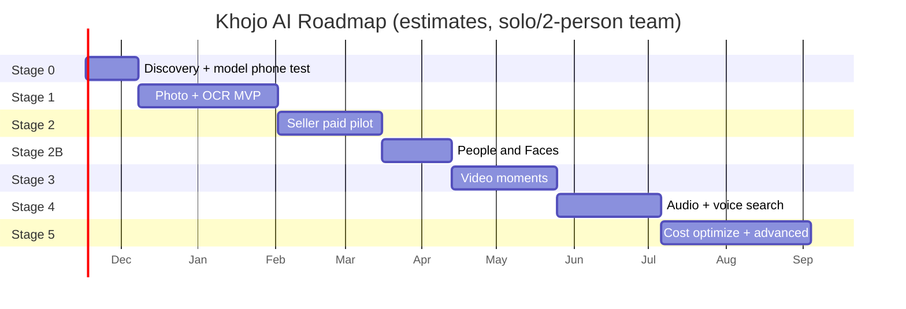

*(Dates sirf planning ke liye — team size aur benchmark results se badlenge.)*

### Stage 0 — Discovery + model proof (~2–3 hafte)
- [ ] 10–15 sellers/creators ke interviews (kaise search karte hain, kitna time jaata hai, kitna denge)
- [ ] Trademark check: "Khojo AI" (domain ✅ already hai)
- [ ] AWS credits: balance + expiry + eligible services note karo
- [ ] Mumbai mein **GPU (G-instance) + Spot vCPU quota increase** request daalo
- [ ] SigLIP 2 **Base** ko g4dn par chalao aur apne phone par search quality khud test karo
- [ ] Lambda vs EC2 vs GPU cold start + cost test
- [ ] Hinglish dictionary v0 (~500 words) + test
- [ ] ML Kit OCR Hindi + Hinglish screenshots par **low-end phone** par check karo; fail ho to PaddleOCR fallback decide karo
- [ ] Consent UX + retention policy final

**Exit:** Phone par search ka result acceptable lage; backend budget mein.

### Stage 1 — Photo + OCR MVP (~6–8 hafte) ← **Phase 1 (abhi)**
- [ ] Compose shell, navigation, onboarding, consent
- [ ] Photo Picker, URI lifecycle, import state
- [ ] Room (local mapping) + server schema (PostgreSQL + pgvector) + migrations
- [ ] FastAPI inference service + Docker + Lambda deploy
- [ ] Presign upload + image job + batch worker
- [ ] ML Kit OCR phone par + number normalization + sensitive-pattern masking (upload se pehle) + low-end throttle (charging, ek-ek karke, timeout)
- [ ] Dedup + blur filter (perceptual hash) phone par
- [ ] Search service (QueryNormalizer + vector search + RRF) server par
- [ ] Results grid, detail, share/copy, multi-select
- [ ] Failure handling, log redaction, privacy settings
- [ ] Opt-in aggregate telemetry (raw media kabhi nahi)
- [ ] Direct APK testers (Firebase App Distribution ya domain par APK) + in-app updater

**Exit:** Bina caption wali photos import karke users useful results paa rahe hain.

### Stage 2 — Seller-focused paid pilot (~4–6 hafte)
> Phase 1 mein sirf activation codes + entitlements + usage limits + 50-tester pilot. Collections, plans / paywall, price experiments = **Phase 2**.
- [ ] Collections + batch share + catalogue mode
- [ ] Auth (Cognito/Google Sign-In), entitlements, **activation code redeem + admin script (manual codes)**
- [ ] Plans, limits, usage meters, plan screen + "code kaise milega" guide
- [ ] Growth infra: always-on text server + SQS + GPU Spot worker
- [ ] 30–50 seller pilot + weekly feedback calls
- [ ] Clothing/color/pattern + Hinglish relevance tuning
- [ ] Price experiments (₹99 vs ₹129, ₹249 vs ₹299)

**Exit:** Weekly repeat use + willingness-to-pay ka credible saboot → **public release (APK + activation codes)**; phir payment gateway se auto code issue.

### Stage 2B — People & Faces 👤 (~3–4 hafte) ⏸️ Phase 3
- [ ] AuraFace server par deploy (ONNX, GPU/CPU) + speed/accuracy check
- [ ] License final check (AuraFace Apache 2.0; InsightFace weights avoid)
- [ ] YuNet (MIT) face detection + quality filter + alignment (server)
- [ ] `person` + `face` tables (pgvector, 512-d)
- [ ] Bulk clustering + incremental assignment + thresholds tuning
- [ ] People grid, naming, merge, suggestions, hide
- [ ] PersonQueryParser ("Ram ki kurta photo") + filtered search
- [ ] Consent screen, OFF = delete, privacy policy update, **lawyer review (biometric) launch se pehle**
- [ ] Fairness + purity tests on Indian family photo set

### Stage 3 — Video moments (~4–6 hafte) ⏸️ Phase 4
- [ ] Video import + scene/keyframe extraction
- [ ] Frame embeddings, timestamp index, group-by-video
- [ ] Thumbnail strip + seek-to-match (Media3)
- [ ] Video quotas + cost protection

### Stage 4 — Audio + voice search (~4–6 hafte) ⏸️ Phase 5
- [ ] Audio import, VAD, Whisper ASR jobs, timestamped chunks
- [ ] multilingual-e5 transcript retrieval
- [ ] Audio player jump-to-passage
- [ ] Voice query (SpeechRecognizer) with confirm/edit
- [ ] Media Pro plan launch

### Stage 5 — Cost optimize + advanced (~2 mahine+) ⏸️ Phase 6
- [ ] **Vector storage optimize** (halfvec / binary quantization, cold users ke vectors S3 par, per-user shard cache)
- [ ] CLAP sound search
- [ ] Dedup / smart albums
- [ ] Reranker / temporal models (sirf measured need par)
- [ ] Phone-side models sirf tab jab future mein offline mode ki demand ho (abhi scope se bahar)

---

## 21. Team, timeline aur tools

### 21.1 Team options

| Setup | Kaun | Stage 2 (paid pilot) tak estimate |
|---|---|---|
| **Solo** | 1 full-stack dev (Android + Python) | ~5–7 mahine |
| **Lean team** ⭐ | 1 Android dev + 1 ML/backend dev (+ part-time designer) | ~3–4 mahine |
| **Fast** | 2 Android + 1 ML + 1 backend + designer + PM | ~2–3 mahine |

### 21.2 Daily tools

| Kaam | Tool |
|---|---|
| Code | Android Studio, VS Code / PyCharm |
| Version control | GitHub (private repo) + GitHub Actions |
| Design | Figma |
| Tasks | GitHub Projects / Notion / Linear |
| ML experiments | Jupyter / Colab |
| Infra | Terraform + AWS Console (read-only debugging) |
| Monitoring | CloudWatch, Firebase Crashlytics |
| Beta | Direct APK + Firebase App Distribution |

### 21.3 Repo deliverables (Stage 0 ke end tak)
- `README.md` — setup, architecture overview
- `docs/adr/` — Architecture Decision Records (ADR-001 Hybrid architecture, ADR-002 PostgreSQL + pgvector, ADR-003 Model choice, ADR-004 Lambda vs EC2)
- `docs/openapi.yaml` — formal API contract
- `app/` — Android skeleton
- `inference-service/` — FastAPI + SigLIP 2 worker
- `infrastructure/` — Terraform

---

## 22. Risks aur mitigations

| Risk | Impact | Mitigation |
|---|---|---|
| Google Photos/Ente pehle se AI search dete hain | Log paise nahi denge | Seller workflow + actions + Hinglish par focus |
| So400m CPU par slow/mehenga | Latency + bill | Base default, GPU batch, Spot |
| Hinglish queries fail | Bura experience | Normalizer + dual embedding + language-wise tests + "Did you mean" |
| Bina samjhe photos upload | Trust/privacy failure | Explicit opt-in, clear copy, auto-upload nahi |
| Video mein short action miss | Galat moment | Scene detection, dense re-sampling |
| Speech naam/noise par fail | Passage miss | ASR benchmark, language hints, keyword search |
| Model version mismatch | Search corrupt | Version fields, dimension enforcement, full reindex |
| AWS bill shock | Paisa doob | Budgets, quotas, kill switch, Spot, cache, no unlimited media |
| URI revoked | File gayab | Stale detect + re-select prompt |
| Activation code leak / sharing / brute-force | Revenue leak | Code ka hash store, single-use + device binding, attempt lockout, revoke, rate limits |
| Kam paid conversion | Business fail | Interviews + pilot pehle, marketing baad mein |
| Fake confidence UI | Distrust | Ranking dikhao, fake % nahi |
| APK install friction ("Install unknown apps", Play Protect warning) | Sellers install nahi karenge | Website par step-by-step guide + screenshots, demo video, WhatsApp support, signed APK + checksum |
| Signing key kho jaye / update fail | Users ko update nahi mil payega | Key ka encrypted backup (2 jagah), updater mein same-key check, update channel test |
| Brand/trademark conflict | Rename cost | Stage 0 mein search + filing |
| Face model license galat (non-commercial weights) | Legal notice / app removal | Sirf AuraFace (Apache 2.0) ya paid license; har model ka license file repo mein |
| Face data privacy / biometric laws | Trust + legal risk | **Cloud par hone se risk badha:** default OFF, alag consent, per-user isolation, delete on OFF, region-wise disable, lawyer review launch se pehle |
| Galat face merge (do log ek group) | Galat search results, embarrassment | Strict auto-assign threshold, suggestion mode, easy split/remove |
| Server par sensitive data (OCR text, face vectors) leak | Bahut bada trust + legal risk | Encryption at rest, per-user isolation, sensitive-pattern masking, minimal access, delete-all, security review |
| Internet nahi / slow → search nahi chalega | Bura experience | Clear offline state, last results cache, retry, chhote payloads |
| Low-end phone par OCR slow / garam | Bura experience, battery | OCR sirf screenshots par, charging + Wi-Fi par, ek-ek karke + timeout, RAM < 3 GB par cloud fallback |
| Vector DB cost scale par bahut badh jaye | Margin khatam | halfvec / quantization, cold users S3 par, library quotas, price ₹249–₹299 |

---

## 23. Launch checklist aur KPIs

### 23.1 Engineering
- [ ] Signed production build; crash/ANR monitoring
- [ ] Model files pinned + checksums; license notices app mein
- [ ] Import → upload → server index → search pipeline fully tested
- [ ] DB migration + index rebuild tested
- [ ] Load test: concurrent users + largest supported media
- [ ] S3 temp files expire + delete verified; logs redacted
- [ ] Server DB (vectors, OCR, faces, entitlement) ka backup + restore tested
- [ ] Budget alerts + emergency rate-limit switch

### 23.2 Policy & trust
- [ ] Privacy policy + terms (saare processing modes)
- [ ] Permission flows Android OS rules ke against audit (Photo Picker, mic)
- [ ] Account deletion flow + privacy policy page live
- [ ] Activation terms, expiry, renewal code, revoke tested; APK download page + checksum + install guide live
- [ ] Trademark final (domain ✅ already hai; DNS, HTTPS certificate, privacy policy URL live)

### 23.3 KPIs

| KPI | Matlab | Pilot target (hypothesis) |
|---|---|---|
| Activation | Pehla import + successful search | ≥ 60% installs |
| Search success | Search ke baad result open/share | ≥ 50% searches |
| Time-to-find | Gallery scroll ke comparison mein | ≥ 3x faster |
| D7 / D30 retention | Wapas aaye | D7 ≥ 30%, D30 ≥ 15% |
| Free → Paid | Conversion | 3–8% |
| Churn | Monthly cancel | < 10% |
| Infra cost / active user | Margin health | < 30% of ARPU |
| Language-wise success | En / Hi / Hinglish | Har group ≥ 80% of English |

### 23.4 Go / No-go gate
30–50 real testers se poochho "paise denge?" — aur **unka recurring use observe karo**. Search success + willingness-to-pay ke saboot ke bina infra scale ya paid marketing nahi.

---

## 24. Final decisions

v1 ke 12 open questions — meri recommended default decisions (Stage 0 data se badal sakti hain):

| # | Sawal | Decision |
|---|---|---|
| 1 | Pehla audience? | **Sellers first.** Personal users Free/Plus par allowed, lekin features seller ke liye optimize |
| 2 | Cloud consent kis level par? | **Zaroori hai** (cloud-first; iske bina search nahi chalta). Onboarding par clear consent; kabhi bhi revoke + "Delete my data" |
| 3 | Kaun sa SigLIP 2? | **Base (default).** Phone test mein result kharab lage tabhi So400m try karo (Base sasta, tez, phone-ready) |
| 4 | Business/customer media cloud par? | Consent ke saath, processing copy 24h auto-delete; search data server par; **local-only mode ab nahi hai** |
| 5 | Fully offline search chahiye? | **Nahi.** Cloud-first: search ke liye internet zaroori; phone par model / vector index nahi |
| 6 | 1,000 images = pilot ya limit? | **Pilot dataset total.** Product limits Section 15 ke plans se |
| 7 | Hinglish method? | **Dictionary normalizer + dual embedding (original + rewrite) + RRF.** LLM rewrite sirf proven gain par |
| 8 | Latency targets? | Text search **p95 < 1.5s (4G)**; indexing **≥ 300 images/min** batch (validate) |
| 9 | Video/audio limits? | **Media Pro: 5 hrs video + 20 hrs audio / month** |
| 10 | Subscription expire hone par? | Phone ka local index **delete nahi**; cloud features Free limits par; server data already temporary; account deletion request par 30 din mein |
| 11 | Domain/trademark? | **Domain already hai ✅** — `api.`, `www.` subdomains use karo; privacy policy bhi isi domain par. Trademark Class **9 + 42** filing Stage 0 mein |
| 12 | Backup/sync? | Sirf **end-to-end encrypted** design + alag pricing ke saath, Stage 5+ |
| 13 | Face grouping kahan aur kaise? | **Cloud par (server-side)**, default OFF, alag consent, per-user isolation, Free mein 3 named people, Plus+ unlimited. Model: YuNet + AuraFace-v1. **Lawyer review launch se pehle zaroori** |
| 14 | Distribution kaise? | **Play Store par nahi.** APK apne domain se, **activation code** se plan activate (Ultron jaisa). In-app updater zaroori |
| 15 | Codes kaise bechein? | **Assumption (confirm karna):** pilot mein manual — user UPI se pay kare, aap code generate karke do. Baad mein payment gateway webhook se auto-issue |
| 16 | Renewal? | Auto-renew nahi. Plan = 30 / 365 din ka code. Expiry se 3 din pehle in-app reminder; naya code expiry mein add hota hai |
| 17 | Phone par kitna kaam? | Picker, resize + EXIF strip, fingerprint, dedup/blur filter, **ML Kit OCR (screenshots)**, upload, UI. **Koi bhari ML model / vector DB nahi** |
| 18 | Price? | Plus ₹99, Seller Pro ₹249, Media Pro ₹399 (cloud cost ke karan thoda badhaya) |
| 19 | Phone par kaun se models? | Sirf chhote: **ML Kit OCR** + classical dedup/blur. SigLIP, AuraFace, Whisper jaise bhari models cloud par (low-end phone par nahi chalte) |
| 20 | Pehle kya banega? | **Phase 1: sirf Android app + Image search** (photos + screenshots). Collections, faces, video, audio, voice baad mein |

---

## 25. v1 se v2 mein kya badla

- ➕ **TL;DR summary** aur Hinglish "kya/kyu" tables
- ➕ Poora **tech stack with reasoning + alternatives** (Hilt, FastAPI, SQS, DynamoDB, Terraform etc.)
- ➕ **7 architecture diagrams**: system, data placement, indexing sequence, search sequence, AWS deployment, video/audio pipeline, billing flow + ER diagram + roadmap Gantt
- 🔧 Cost model **₹95/USD** par update (pehle ₹93.70); **growth aur scale stage** ke monthly costs add; per-unit costs add
- 🔧 Architecture: growth stage par **always-on text server + GPU Spot batch worker** (Lambda cold-start problem solve)
- ➕ **Final pricing table** — 4 plans, yearly prices, limits, trial; Media Pro ₹299 → **₹349** (video/audio margin ke liye)
- ➕ **Unit economics + break-even + scenarios**
- ➕ SigLIP 2 implementation rules (same checkpoint, `max_length=64` padding, L2 norm, Base = 768 dim)
- ➕ Team options, tools, repo deliverables, one-time launch costs
- ➕ Saare 12 open decisions ke **recommended answers**
- 🔧 Typo fix: "uncaptained" → "uncaptioned"

**v2.8 — Phase 1: sirf Images:**
- 🔧 Scope section dobara: Phase 1 = Android app + Image search; Collections, People & Faces, Video, Audio, Voice = baad ke phases (⏸️)
- ➕ Milestones M0–M6, "Phase 1 kab complete" criteria
- 🔧 Features, journeys, roadmap, models table par ⏸️ markers (content hataya nahi, sirf order badla)

**v2.7 — Chhote models phone par:**
- 🔧 **ML Kit OCR phone par** wapas (screenshots), card/OTP patterns upload se pehle phone par mask; perceptual-hash dedup + blur filter (koi model nahi)
- 🔧 PaddleOCR ab sirf cloud fallback; screenshot upload chhota (~512px), cloud OCR cost ₹0
- ➕ Low-end phone ke liye throttle (charging, ek-ek karke, timeout) + naya risk
- ℹ️ SigLIP, AuraFace, Whisper cloud par hi (bhari hain)

**v2.6 — Abhi sirf 50 users:**
- ➕ Naya "Abhi ka scope" section: pilot mein kya banana hai, kya nahi (People & Faces, video/audio, payment gateway baad mein)
- 🔧 Pilot infra: always-on search + 1 GPU Spot worker + chhota RDS (50 × 2,000 photos ≈ 1 lakh images, Lambda-only plan kaafi nahi tha)
- 🔧 Pilot cost ₹7,000–₹12,500 pehla mahina, phir ~₹5,000–₹8,000; manual activation codes, go/no-go criteria

**v2.5 — Cloud-first thin client:**
- 🔧 App halka: phone par sirf UI, picker, resize + upload. ObjectBox/HNSW, ML Kit OCR, on-device face models aur Stage 5 on-device models hata diye
- 🔧 Server par: SigLIP 2 + **PaddleOCR** + **YuNet/AuraFace** + **PostgreSQL (pgvector)**; naye endpoints `/v1/search`, `/v1/assets/check`, `/v1/people`
- ⚠️ Face grouping ab cloud par — privacy rules sakht (10A.7), lawyer review zaroori
- 🔧 Costs dobara (RDS add), prices ₹99 / ₹249 / ₹399, break-even ~78 Seller Pro; economics ab tight (Section 16)
- 🔧 Offline search / local-only mode scope se bahar; search ke liye internet zaroori

**v2.4 — Play Store nahi, activation code:**
- 🔧 Play Billing, purchase token, RTDN hataye; **activation code** system (Section 6.7, 15.4), `/v1/activation/redeem` + admin endpoint
- ➕ Section 15.5: APK distribution, in-app updater (F21), signing key, install friction
- 🔧 Play fee 15% hati; unit economics gateway fee ~2% par dobara (Seller Pro net ~₹165, break-even ~61 sellers)
- 🔧 Play Console, Data safety, Feature Delivery, $25 fee hataye; naye risks aur decisions #14–16
- ⚠️ Codes manual bechne ka assumption (decision #15) — confirm karna

**v2.3 — Formal evaluation hataya:**
- 🔧 Base vs So400m benchmark, labelled dataset, Recall/MRR metrics, experiment log aur `eval/` folder hata diye; model ka test founder khud phone par karega
- 🔧 Default model = SigLIP 2 Base (So400m sirf agar Base kharab lage)

**v2.2 — AWS credits + domain:**
- ➕ Section 14.0: credits runway formula, dhyan rakhne wali baatein, GPU quota tip
- 🔧 One-time cost, pilot cost, API base URL, decision #11, roadmap aur launch checklist update

**v2.1 — People & Faces update:**
- ➕ Naya **Section 10A**: face detection → grouping → naming → "Ram ki kurte wali photo" search (3 naye diagrams)
- ➕ Feature F20, Journey 6, People UI screens, `Person` + `FaceInstance` entities
- ➕ Face model license analysis (AuraFace ✅, InsightFace weights ❌)
- ➕ Face privacy rules, risks, Stage 2B roadmap, decision #13
- 🔧 TL;DR mein Media Pro price ₹299 → ₹349 (Section 15 ke saath match)

---

## 26. Reference links

> 10 November 2026 ko planning ke liye check kiye. Prices, quotas, licenses aur policies badalte rehte hain — implementation aur launch ke time dobara confirm karo.

**AI models**
- SigLIP 2 So400m: https://huggingface.co/google/siglip2-so400m-patch14-384
- SigLIP 2 Base: https://huggingface.co/google/siglip2-base-patch16-384
- SigLIP 2 docs: https://huggingface.co/docs/transformers/model_doc/siglip2
- Whisper: https://github.com/openai/whisper
- LAION CLAP: https://github.com/LAION-AI/CLAP
- Multilingual E5: https://huggingface.co/intfloat/multilingual-e5-base
- AuraFace-v1 (Apache 2.0 face recognition): https://huggingface.co/fal/AuraFace-v1
- YuNet face detector (OpenCV Zoo): https://github.com/opencv/opencv_zoo
- InsightFace model licensing (non-commercial weights): https://www.insightface.ai/solutions/face-recognition-licensing
- Google Photos BIPA settlement: https://www.diyphotography.net/?p=189324
- Texas lawsuit on Google face grouping: https://www.courthousenews.com/texas-sues-google-over-its-collection-of-biometric-data/

**Android + Database**
- Photo Picker: https://developer.android.com/training/data-storage/shared/photo-picker
- Room: https://developer.android.com/training/data-storage/room
- pgvector: https://github.com/pgvector/pgvector
- PaddleOCR: https://github.com/PaddlePaddle/PaddleOCR
- Shared media permissions: https://developer.android.com/training/data-storage/shared/media
- WorkManager: https://developer.android.com/topic/libraries/architecture/workmanager

**AWS**
- Lambda pricing: https://aws.amazon.com/lambda/pricing/
- Lambda quotas: https://docs.aws.amazon.com/lambda/latest/dg/gettingstarted-limits.html
- API Gateway pricing: https://aws.amazon.com/api-gateway/pricing/
- ECR pricing: https://aws.amazon.com/ecr/pricing/
- Free Tier changes (July 2025): https://aws.amazon.com/about-aws/whats-new/2025/07/aws-free-tier-credits-month-free-plan/
- g4dn.xlarge Mumbai pricing snapshot: https://www.doit.com/compute/spot/ap-south-1/g4dn.xlarge
- AWS India indicative EC2/S3 INR rates: https://precisiontech.in/cloud/amazon-aws-cloud/aws-pricing/
- AWS Pricing Calculator: https://calculator.aws/

**Competitors**
- Ente: https://ente.io/ · Immich: https://immich.app/ · Google Photos: https://www.google.com/photos/about/

---

## ✅ Final recommendation

**Khojo AI ko "halka, tez search + action app" ki tarah banao, ek aur gallery ki tarah nahi.**

1. **Pehle 3 hafte:** sellers se baat + SigLIP 2 Base ko phone par khud test.
2. **Agle 2 mahine:** Photo + Screenshot (OCR) search MVP.
3. **Phir:** 30–50 sellers ke saath paid pilot — Seller Pro ₹249.
4. **Saboot milne par:** public launch → **People & Faces** → Video → Audio → cost optimize.

Original media phone par, search data (vectors, OCR) AWS ke PostgreSQL mein per-user encrypted, aur app bilkul halka. Paid plans tab jab real customers value dikhayein.

*— Khojo AI Blueprint v2.5 · Bas bolo. Khojo. 🔎*
