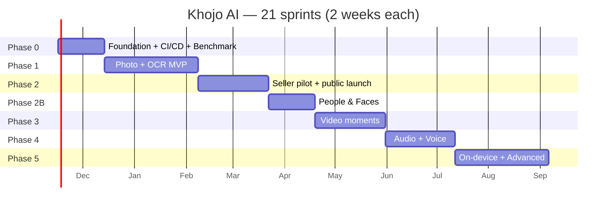
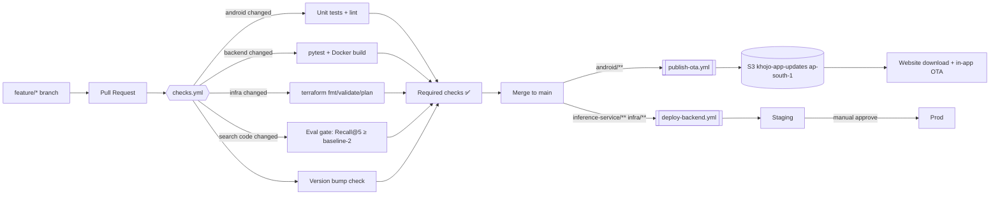
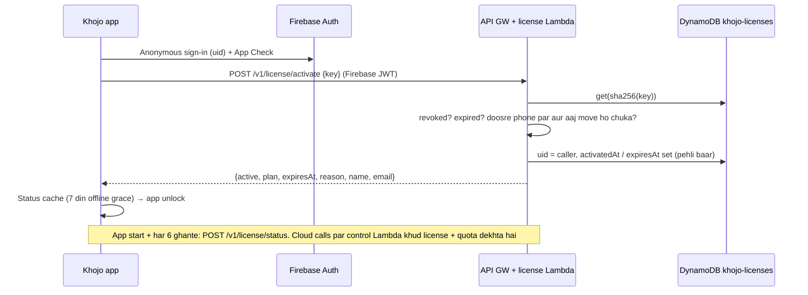

# 🚀 KHOJO AI — Delivery Plan (Phases → Sprints → Mini-sprints + CI/CD + AWS OTA)

> **Base document:** `Khojo_AI_Final_Blueprint_v2.2.md` (product, architecture, cost — sab wahan hai). Ye document sirf **"kab, kis order mein, aur kaise ship karenge"** batata hai.
> **Delivery model:** `ultron-android` repo jaisa — har merge to `main` → GitHub Actions → signed APK → private S3 (AWS) → app khud update dikhata hai → SHA-256 verify → install. **Play Store nahi:** APK website se, app **activation key** se unlock hoti hai ([ADR-002](adr/ADR-002-no-play-store-activation-keys.md)).
> **Version:** 1.1 (no Play Store, activation keys) · **Date:** 10 November 2026 · **Start:** Mon 16 Nov 2026 · **Team assumption:** Lean team (1 Android + 1 ML/backend). Solo ho to har phase ~1.5x.

---

## ⚡ TL;DR

| Sawal | Jawab |
|---|---|
| **Kitne phases?** | 7 — Phase 0 (Foundation + CI/CD + Benchmark) → 1 (Photo+OCR MVP) → 2 (Seller paid pilot + public launch) → 2B (People & Faces) → 3 (Video) → 4 (Audio + Voice) → 5 (On-device + Advanced) |
| **Sprint kitna lamba?** | **2 hafte** (10 working days). Total **21 sprints** → 16 Nov 2026 se 5 Sep 2027 |
| **Mini-sprint kya hai?** | Har sprint ke andar **3 mini-sprints × 3 din** + day 10 = review/retro. **Har mini-sprint ka end = ek PR merge = testers ke phone par automatic OTA update** |
| **Delivery kaise?** | GitHub Actions: PR par `Checks` → `main` par `Publish OTA` (APK → S3 Mumbai → `latest.json`) + `Deploy Backend` (Docker → ECR → Lambda/ECS). Play Store / AAB pipeline **nahi** |
| **Install + update kaise?** | **Sabke liye** (team, pilot, public): website se APK → phir **AWS OTA** se automatic updates (Ultron jaisa). Ek hi build, koi flavor nahi |
| **App unlock kaise?** | **Activation key** `KHOJ-XXXX-XXXX-XXXX-XXXX` (Ultron jaisa). Key = plan + validity, ek phone par ek waqt. Kharidari app ke bahar (website / payment link / admin), app sirf key check karti hai |
| **Pehla tester build kab?** | **Sprint 2 end (13 Dec 2026)** — "hello world" + OTA pipeline live. Pehla useful search build: **Sprint 4 end (10 Jan 2027)** |
| **Public launch?** | **Sprint 9 end (21 Mar 2027)** — website download + paid keys, agar Phase 2 go/no-go gate pass ho |

---

## 📑 Contents

1. [Working model — phases, sprints, mini-sprints](#1-working-model)
2. [Master calendar (21 sprints)](#2-master-calendar)
3. [CI/CD + AWS OTA design (Ultron-style)](#3-cicd--aws-ota-design)
4. [Phase 0 — Foundation, CI/CD, Benchmark](#phase-0--foundation-cicd-benchmark-s1s2)
5. [Phase 1 — Photo + OCR MVP](#phase-1--photo--ocr-mvp-s3s6)
6. [Phase 2 — Seller paid pilot + public launch](#phase-2--seller-paid-pilot--public-launch-s7s9)
7. [Phase 2B — People & Faces](#phase-2b--people--faces-s10s11)
8. [Phase 3 — Video moments](#phase-3--video-moments-s12s14)
9. [Phase 4 — Audio + Voice search](#phase-4--audio--voice-search-s15s17)
10. [Phase 5 — On-device + Advanced](#phase-5--on-device--advanced-s18s21)
11. [Definition of Done, rituals, tracking](#11-definition-of-done-rituals-tracking)
12. [Release, rollback aur risk rules](#12-release-rollback-aur-risk-rules)

---

## 1. Working model

```text
PHASE  (ek business goal + exit gate, 2–8 hafte)
 └── SPRINT  (2 hafte, ek demo-able outcome)
      ├── Mini-sprint A  (Day 1–3)  → PR → merge → OTA build #1 testers ke phone par
      ├── Mini-sprint B  (Day 4–6)  → PR → merge → OTA build #2
      ├── Mini-sprint C  (Day 7–9)  → PR → merge → OTA build #3
      └── Day 10: Sprint review (demo on real phone) + eval report + retro + next sprint plan
```

**Rules:**
1. **Ek mini-sprint = ek chhota, poora vertical slice** (UI + data + test) — adha kaam `main` par nahi jaata. Bada kaam hai to **feature flag** ke peeche merge karo (flag OFF = testers ko dikhega nahi).
2. Har mini-sprint ke end par `changelog.md` mein naya version (`## 0.4.2`) — CI isi se version + release notes banata hai (Ultron jaisa).
3. ML/backend kaam bhi same cadence — backend PR merge → staging auto-deploy → prod manual approve.
4. **Phase gate pass nahi hua to agla phase shuru nahi** — pehle fix sprint.
5. Har sprint ka 10–15% time **buffer / bugs / tech debt** ke liye.

**Versioning:**
- `versionName` = `MAJOR.MINOR.PATCH` → Phase = MINOR, mini-sprint = PATCH. Example: Phase 1 Sprint 4 Mini-B = `0.1.5`.
- `versionCode` = **minutes since Unix epoch** (Ultron jaisa) → hamesha badhta hai, collisions nahi.
- `1.0.0` = public launch (website + paid keys, end of Phase 2).

---

## 2. Master calendar

| Sprint | Dates | Phase | Sprint goal | Release |
|---|---|---|---|---|
| S1 | 16 Nov – 29 Nov 2026 | 0 | Repo + CI checks + AWS base + benchmark dataset | — (internal) |
| S2 | 30 Nov – 13 Dec 2026 | 0 | **OTA pipeline live** + single build (no `play` flavor) + model benchmark decision | `0.0.x` OTA (shell app) |
| S3 | 14 Dec – 27 Dec 2026 | 1 | App shell, onboarding, Photo Picker, ObjectBox | `0.1.0–0.1.2` |
| S4 | 28 Dec 2026 – 10 Jan 2027 | 1 | Inference service + **activation keys** + image indexing end-to-end | `0.1.3–0.1.5` **first real search** |
| S5 | 11 Jan – 24 Jan 2027 | 1 | OCR + Hinglish normalizer + RRF ranker | `0.1.6–0.1.8` |
| S6 | 25 Jan – 07 Feb 2027 | 1 | Results UX, share/copy, failures, privacy → **MVP gate** | `0.1.9–0.1.11` |
| S7 | 08 Feb – 21 Feb 2027 | 2 | Collections + batch share + **key admin web app** | `0.2.0–0.2.2` |
| S8 | 22 Feb – 07 Mar 2027 | 2 | Plan quotas + **key sales (payment → key email)** + growth infra | `0.2.3–0.2.5` |
| S9 | 08 Mar – 21 Mar 2027 | 2 | Seller pilot tuning + download site → **Go/No-go** | **`1.0.0` public (website)** |
| S10 | 22 Mar – 04 Apr 2027 | 2B | Face detection + embedding + clustering (on-device) | `1.1.0–1.1.2` |
| S11 | 05 Apr – 18 Apr 2027 | 2B | People UI + "Ram ki kurta photo" search | `1.1.3–1.1.5` |
| S12 | 19 Apr – 02 May 2027 | 3 | Video import + keyframes + frame embeddings | `1.2.0–1.2.2` |
| S13 | 03 May – 16 May 2027 | 3 | Video search + group-by-video + seek-to-moment | `1.2.3–1.2.5` |
| S14 | 17 May – 30 May 2027 | 3 | Dense re-sample, quotas, cost guards → **Video gate** | `1.2.6–1.2.8` |
| S15 | 31 May – 13 Jun 2027 | 4 | Audio import + VAD + Whisper jobs | `1.3.0–1.3.2` |
| S16 | 14 Jun – 27 Jun 2027 | 4 | Transcript search + jump-to-passage | `1.3.3–1.3.5` |
| S17 | 28 Jun – 11 Jul 2027 | 4 | Voice query + **Media Pro plan launch** | `1.3.6–1.3.8` |
| S18 | 12 Jul – 25 Jul 2027 | 5 | SigLIP 2 Base INT8 on-device spike + benchmark | `1.4.0–1.4.2` |
| S19 | 26 Jul – 08 Aug 2027 | 5 | On-device image indexing rollout (flagged) | `1.4.3–1.4.5` |
| S20 | 09 Aug – 22 Aug 2027 | 5 | On-device text encoder → offline search | `1.4.6–1.4.8` |
| S21 | 23 Aug – 05 Sep 2027 | 5 | CLAP eval, dedup/smart albums, hardening | `1.5.0` |



---

## 3. CI/CD + AWS OTA design

### 3.1 Ultron se kya copy kar rahe hain (aur kya badal rahe hain)

| Ultron-android mein | Khojo AI mein | Kyu |
|---|---|---|
| `checks.yml` — change detection, version-bump check, Android test+lint, Lambda tests, `Required checks` gate | ✅ Same + **Terraform validate/plan** + **search-quality eval gate** + Docker build | Khojo ka asli risk "search kharab ho gaya" hai — CI mein pakdo |
| `publish-ota.yml` — preflight (sirf main, purana commit skip) → validate → build → publish | ✅ Same structure | Proven, safe ordering (APK pehle, `latest.json` baad mein) |
| `publish-update.ps1 -Mode Build/Publish` + `ota-manifest.json` (commit, sha256, size, version) | ✅ Same script, Khojo bucket/names | Local se bhi ek command mein publish |
| `changelog.md` = version + notes source | ✅ Same | Phone par jo dikhta hai wahi changelog |
| S3 bucket **us-east-1** + Transfer Acceleration | 🔧 **ap-south-1 (Mumbai)**, acceleration ki zaroorat nahi | Users India mein; blueprint ka region |
| `ultron-updates` Lambda — Firebase JWT + App Check, presigned link 30 min | ✅ `khojo-updates` Lambda — abhi `BETA_KEY`, Sprint 4B se **Firebase JWT** (anonymous) + App Check | Ultron jaisa; Cognito plan hata diya |
| `mcp/license` + `mcp/license-admin` + `ultronapp/` — activation keys, device binding, admin web app, Resend email | ✅ `lambdas/license` + `lambdas/license-admin` + `admin/` (Sprint 4B, 7C) | Play nahi, isliye unlock + paid plans key se |
| Sirf APK OTA; Lambda deploy manual | ➕ **`deploy-backend.yml`** — inference service + infra bhi CD se | Khojo ka backend (FastAPI + model) bada hai, manual deploy risky |
| — | ➕ `rolloutPercent` + `minSupportedVersionCode` in `latest.json` | Staged rollout + force update jab API badle |
| Purane APK: last 3 rakho | ✅ Same | Storage sasta, rollback ke liye source available |

### 3.2 ⚠️ Distribution — Play Store nahi, website APK + activation key

Faisla aur wajah: [ADR-002](adr/ADR-002-no-play-store-activation-keys.md). Short mein:

| Cheez | Kaise |
|---|---|
| Build | **Ek hi build** (`play` flavor hatana, Sprint 2). `applicationId = com.khojoai.app` (abhi koi install nahi hua, isliye badalna free) |
| Install | Website par "Download" button → `GET /v1/releases/download` (public, throttled) → APK. Install guide (unknown sources) screenshots ke saath |
| Updates | Sabke liye **AWS OTA** (`AppUpdater`, Ultron jaisa). `REQUEST_INSTALL_PACKAGES` main manifest mein |
| Unlock | Pehli screen = **Activation** (key daalo). Bina valid key ke app locked; updates phir bhi milte hain |
| Identity | Firebase Anonymous Auth (uid) + App Check (Play Integrity, sirf device integrity). Har API call par Firebase JWT |
| Key | `KHOJ-XXXX-XXXX-XXXX-XXXX` (Crockford base32, 80 bit). DynamoDB `khojo-licenses` mein sirf SHA-256 |
| Device | Ek key ek phone par ek waqt. Naye phone par activate = key move, purana phone lock. Din mein max 1 move (admin "allow move" se reset) |
| Expiry | `durationDays` pehli activation se, `0` = lifetime. Offline 7 din grace, expiry ke baad nahi. Expire par local index delete **nahi** |
| Plans | Key ka `plan` → quota (blueprint section 15): `free` (₹0, website par email se), `trial`, `pilot`, `plus`, `seller_pro`, `media_pro`. **Har cloud call par server license + quota check karta hai** |
| Keys kaun banata hai | Admin web app (`admin/`, Ultronapp jaisa) → key buyer ko Resend email. Baad mein website payment success → auto key |
| Signing | Ek OTA key, hamesha wahi (GitHub secret + offline backup 2 jagah). Android developer verification ke liye yahi key + package register karna hai |

### 3.3 Repo layout (monorepo, Ultron jaisa)

```text
khojo-ai/
├── .github/
│   ├── workflows/
│   │   ├── checks.yml            # har PR (+ reusable)
│   │   ├── publish-ota.yml       # main push, android/** changes
│   │   ├── deploy-backend.yml    # main push, inference-service/** ya infrastructure/**
│   │   └── nightly-eval.yml      # roz raat: full eval + cost report (optional, Phase 1 se)
│   └── actions/gradle-memory/action.yml
├── android/                      # app (ek hi build) — blueprint section 12 ka structure
│   └── app/src/{main,test}/
│       └── main/assets/changelog.md
├── inference-service/            # FastAPI + SigLIP 2 + workers + Dockerfile + tests/
├── lambdas/
│   ├── khojo-updates/            # OTA "latest" + presigned download
│   ├── license/                  # activate + status (Ultron mcp/license jaisa)
│   ├── license-admin/            # admin: keys create/edit/revoke/reissue/allow-move + Resend email
│   └── control/                  # presign, jobs, license + quota check
├── admin/                        # key admin web app (Ultronapp jaisa, static HTML + ES modules)
├── infrastructure/               # Terraform: envs/staging, envs/prod, modules/*
├── eval/                         # dataset manifest, queries.csv, run_eval.py, baseline.json
├── scripts/
│   ├── ci_changes.py             # kaunse jobs chalane hain (Ultron se)
│   ├── check_version_bump.py     # changelog version bada hua? (Ultron se)
│   └── publish-update.ps1        # Build / Publish / BuildAndPublish (Ultron se)
├── tests/ci/                     # workflow logic ke tests
└── docs/  (CI_CD.md, adr/, openapi.yaml, runbooks/)
```

### 3.4 Pipelines



#### A) `checks.yml` — har PR par (Ultron + Khojo extras)

| Job | Kab chalega | Kya karta hai |
|---|---|---|
| `changes` | Hamesha | `scripts/ci_changes.py` → outputs `android`, `backend`, `infra`, `eval`, `publish` |
| `version` | PR + APK-affecting change | `check_version_bump.py` — `changelog.md` top version base se bada hona chahiye |
| `ci` | Hamesha | Workflow logic + publish-script regression tests |
| `android` | `android == true` | `./gradlew testDebugUnitTest lintDebug -PappVersionCode=1 --build-cache` (flavor hatne ke baad) |
| `backend` | `backend == true` | Python 3.11+: `pytest`, `ruff`, Docker image build (push nahi), embedding shape/normalization test |
| `infra` | `infra == true` | `terraform fmt -check`, `validate`, `tflint`, **`plan` comment PR par** (read-only OIDC role) |
| `eval` | `eval == true` (search/, ranker, normalizer, model config badla) | Small eval set (200 images / 50 queries, cached embeddings) → **Recall@5 aur MRR@10 baseline se 2 points se zyada gire to fail** |
| `required` | `if: always()` | Ultron jaisa single gate — branch protection sirf isko require karta hai |

#### B) `publish-ota.yml` — `main` push (android/**, scripts/publish-update.ps1, workflow, actions)

Ultron jaisa hi order — **kuch bhi live tab tak nahi jab tak sab pass na ho:**
1. **preflight** — sirf `main` allowed; agar naya commit aa chuka hai to ye purana run skip.
2. **validate** — `checks.yml` reuse (`workflow_call`).
3. **build** (parallel with validate) — signing key + `google-services.json`/config secrets restore → `publish-update.ps1 -Mode Build` → `app-ota.apk` + `ota-manifest.json` (commit, sha256, size, versionCode, versionName, notes) → artifact upload.
4. **publish** (validate + build dono pass) — GitHub **OIDC → AWS role** (`AWS_OTA_PUBLISH_ROLE_ARN`, koi long-lived key nahi) → `-Mode Publish`: manifest verify, live se bada version check, freshness recheck → **pehle APK upload, phir `latest.json`** → last 3 APK rakho, baaki delete.
5. `concurrency: publish-ota, cancel-in-progress: false` — upload beech mein kabhi cancel nahi.

`latest.json` (Ultron fields + Khojo extras):
```json
{
  "versionCode": 29881440, "versionName": "0.1.5",
  "notes": "Search: pehli baar photo search live...",
  "sha256": "…", "sizeBytes": 31457280,
  "apkKey": "apk/khojo-29881440.apk", "sourceCommit": "…", "publishedAt": "…",
  "rolloutPercent": 100,
  "minSupportedVersionCode": 29700000
}
```
- `rolloutPercent` — Lambda `hash(userId) % 100 < rolloutPercent` par hi naya version batata hai (pehle 20% → phir 100%).
- `minSupportedVersionCode` — isse purana app → "Update required" screen (jab backend API breaking change ho).

#### C) `deploy-backend.yml` — `main` push (inference-service/**, lambdas/**, infrastructure/**)

1. Validate (checks reuse).
2. Docker build → **ECR push, tag = git SHA** (`latest` tag kabhi nahi).
3. `terraform apply` **staging** (image tag variable) → Lambda alias `staging` / ECS service update.
4. **Smoke tests** staging par: `/v1/embeddings/text` dimension + L2 norm, image job round-trip, S3 temp delete, 401 bina token, 403 bina active key.
5. **GitHub Environment `prod` — manual approval** (aap khud approve) → `terraform apply` prod.
6. Lambda: alias shift (pehle 10% weighted, CloudWatch error alarm OK to 100%). ECS: rolling + circuit breaker auto-rollback.
7. **Model change = alag rule:** model revision/checksum `inference-service/models.lock` mein; ye badla to deploy **naye `modelVersion` endpoint ke saath** hota hai, purana bhi chalta rehta hai jab tak apps reindex na kar lein (blueprint 7.2 rule #4).

#### D) Activation keys (Ultron `mcp/license` jaisa) — Sprint 4B se



- `reason` values (Ultron jaisa): `unknown_key`, `expired`, `revoked`, `moved`, `moved_recently`. Malformed request hi 4xx; baaki sab 200 + `active:false`.
- Throttle: activate 1 rps / burst 5 (key guessing rokne ke liye; 80-bit key waise bhi guess nahi hoti).
- Test keys: `python scripts/create-license-key.py --plan pilot --days 30` (admin app aane tak).

#### E) `nightly-eval.yml` (Phase 1 se, optional par recommended)
- Full eval set (1,000 images / 100+ queries, En/Hi/Hinglish) → Recall@5, MRR@10, latency → `eval/reports/` mein commit nahi, artifact + trend.
- AWS Cost Explorer se kal ka spend → threshold cross ho to GitHub issue.

### 3.5 AWS resources (OTA + CI ke liye)

| Resource | Naam / config | Note |
|---|---|---|
| S3 bucket | `khojo-app-updates-<accountId>` · ap-south-1 · **Block Public Access ON** · SSE-S3 · versioning ON | `apk/khojo-<versionCode>.apk` + `latest.json` |
| Lambda | `khojo-updates` (Python) · `GET /v1/releases/latest` (JWT) · `GET /v1/releases/download` (public, throttled, website button) | 30-min presigned URL; rollout % logic yahin |
| Lambda | `khojo-license` (`/v1/license/activate`, `/v1/license/status`) + `khojo-license-admin` (`/v1/admin/licenses*`, `ADMIN_EMAILS` check) | Sprint 4B / 7C |
| DynamoDB | `khojo-licenses` · PK `keyHash` · GSI `uid` · PITR ON · `DeletionPolicy`/`prevent_destroy` | Sirf key ka SHA-256, asli key kabhi nahi |
| SSM | `/khojo/resend-api-key` (SecureString) | Key emails (Resend, `no-reply@<domain>`) |
| API Gateway | Same HTTP API jo baaki `/v1/*` serve karta hai · **Firebase JWT** authorizer (issuer `securetoken.google.com/<project>`) | `api.<aapka-domain>` |
| IAM role (OIDC) | `gh-khojo-ota-publish` — trust: `repo:<owner>/khojo-ai:ref:refs/heads/main` | Sirf `s3:GetObject/PutObject` on `latest.json` + `apk/*`, `s3:ListBucket`, `s3:DeleteObject` on `apk/*` |
| IAM role (OIDC) | `gh-khojo-backend-deploy` — trust: `environment:prod` + `environment:staging` | ECR push, Lambda/ECS update, Terraform state access |
| IAM role (OIDC) | `gh-khojo-plan-readonly` — trust: pull_request | `terraform plan` ke liye read-only |
| Terraform state | S3 `khojo-tf-state-<accountId>` + DynamoDB lock table | Staging aur prod alag state keys |
| Budgets | ₹500 / ₹1,500 / ₹5,000 alerts (blueprint 13.3) | Credits ke bawajood lagao |

### 3.6 App-side OTA update flow (Ultron `AppUpdater` jaisa)

```mermaid
sequenceDiagram
  participant App as Khojo app
  participant API as API GW + khojo-updates Lambda
  participant S3 as S3 (private)
  App->>API: GET /v1/releases/latest (Firebase JWT; abhi BETA_KEY)
  API->>S3: read latest.json
  API->>API: rolloutPercent check (hash userId)
  API-->>App: latest.json + apkUrl (presigned, 30 min)
  App->>App: versionCode > BuildConfig.VERSION_CODE ?
  App->>App: "Update available" card + notes (changelog)
  App->>S3: Download APK (progress %)
  App->>App: SHA-256 == manifest sha256 ? warna delete
  App->>App: FileProvider → Android package installer
  Note over App: Android khud signing key match karta hai — tampered APK install nahi hoga
```

- Check kab: app open par (max 1 baar / 6 ghante) + Settings → "Check for update".
- Wi-Fi only option (bade APK).
- `UpdatedReceiver` (`MY_PACKAGE_REPLACED`) → "What's new" sheet + WorkManager indexing jobs reschedule.

### 3.7 GitHub secrets / variables

| Name | Type | Kahan use |
|---|---|---|
| `KHOJO_OTA_KEYSTORE` (base64) + `KHOJO_OTA_KEYSTORE_PASSWORD` + `KHOJO_OTA_KEY_ALIAS` | secret | OTA APK signing |
| `GOOGLE_SERVICES_JSON` (base64) | secret | Firebase Auth + App Check + Crashlytics |
| `APP_CONFIG_PROPERTIES` | secret | `API_BASE_URL`, `STORE_URL` (activation screen ka "key kharido" link), `BETA_KEY` (Sprint 4B tak) |
| `AWS_OTA_PUBLISH_ROLE_ARN`, `AWS_BACKEND_DEPLOY_ROLE_ARN`, `AWS_PLAN_ROLE_ARN` | variable | OIDC roles (secrets nahi — ARN sensitive nahi) |
| `AWS_REGION` = `ap-south-1` | variable | — |

> 🔐 Signing key ka **offline backup** (2 jagah). OTA key kho gayi = **har user** ko uninstall/reinstall karna padega (Play App Signing jaisa koi bachav nahi).

### 3.8 Branch protection (Ultron `docs/CI_CD.md` jaisa)
`main`: PR required · `Required checks` status required · branch up-to-date · conversations resolved · admins bhi enforce · force-push/delete OFF · sole maintainer ho to approval count 0. **GitHub API se verify karo ki ye actually active hai.**

---

## Phase 0 — Foundation, CI/CD, Benchmark (S1–S2)

**Goal:** Pehle din se "merge = phone par update" chalne lage, aur model ka faisla data se ho.
**Exit gate:** (1) OTA pipeline se kam se kam 2 updates testers ke phone par successfully install hue · (2) SigLIP 2 Base vs So400m decision + `models.lock` pinned · (3) Recall@5 + latency target acceptable · (4) 10+ seller interviews done.

### S1 · 16 Nov – 29 Nov 2026 — Repo, CI checks, AWS base, dataset

| Mini | Days | Build | Ship / Done |
|---|---|---|---|
| **1A** | 16–18 Nov | Private repo `khojo-ai` (monorepo layout 3.3) · Android skeleton (Compose, Hilt, flavors `ota`/`play` — S2 mein ek build bana diya) · `changelog.md` · `ci_changes.py` + `check_version_bump.py` Ultron se port | `checks.yml` PR par green · branch protection ON |
| **1B** | 19–23 Nov | AWS: credits balance/expiry note · Budgets alerts · **GPU + Spot vCPU quota increase request (Mumbai)** · Terraform state bucket + lock · OIDC provider + 3 roles · `infra` CI job (plan on PR) | `terraform plan` PR comment mein dikhe |
| **1C** | 24–26 Nov | ML: 1,000 image eval dataset (consented) + 100 queries En/Hi/Hinglish + labels · `eval/run_eval.py` skeleton · Business: 5 seller interviews | `eval/queries.csv` v1 · interview notes |
| Day 10 | 27 Nov | Review + retro | — |

### S2 · 30 Nov – 13 Dec 2026 — OTA pipeline live + model decision

| Mini | Days | Build | Ship / Done |
|---|---|---|---|
| **2A** | 30 Nov – 2 Dec | S3 `khojo-app-updates` · `khojo-updates` Lambda + API GW route · `publish-update.ps1` port · `publish-ota.yml` · OTA signing key generate + backup | **First OTA `0.0.1`** — empty shell app, testers ke phone par install |
| **2B** | 3–7 Dec | `AppUpdater` + `UpdateManager` + Update card UI · SHA-256 verify · `UpdatedReceiver` · rollout % + min version logic · **`play` flavor hatao → ek build, `com.khojoai.app`** (pehle install se pehle) | `0.0.2` — phone khud "Update available" dikhaye aur `0.0.3` install kare ✅ |
| **2C** | 8–10 Dec | Benchmark: SigLIP 2 Base vs So400m (Recall@5, MRR@10, latency, RAM, ₹/1000) on GPU + CPU · Lambda vs EC2 cold start · Hinglish dictionary v0 (~500 words) · 5 more interviews | **ADR-003 Model choice** · `models.lock` · ADR-004 Lambda vs EC2 |
| Day 10 | 11 Dec | **Phase 0 gate review** | Go → Phase 1 |

---

## Phase 1 — Photo + OCR MVP (S3–S6)

**Goal:** Bina caption wali photos + screenshots import karke useful search results.
**Exit gate (blueprint Stage 1):** Recall@5 ≥ 90% pilot set par (ya agreed target) · text search p95 < 1.5s on 4G · index failure < 1% · 10 internal testers OTA par daily use.

### S3 · 14 Dec – 27 Dec 2026 — App shell + import + local DB

| Mini | Build | Ship |
|---|---|---|
| **3A** | Navigation, theme (Material 3, dark mode), Hindi + English strings, Splash + 3 onboarding slides | `0.1.0` onboarding |
| **3B** | Consent screen (cloud AI default OFF) · Photo Picker multi-select · URI persist · Import screen (counts) | `0.1.1` photos select ho sakein |
| **3C** | ObjectBox entities (`ImageAsset`, `IndexJob`, `UserSettings`, `QueryCache`) with chosen dim · fingerprint + `(fingerprint, modelVersion)` skip · migration test | `0.1.2` imported photos persist |

*(Holiday week buffer — 25 Dec ke aaspaas kam capacity plan karo.)*

### S4 · 28 Dec 2026 – 10 Jan 2027 — Image indexing end-to-end ⭐

| Mini | Build | Ship |
|---|---|---|
| **4A** | `inference-service`: FastAPI `/v1/embeddings/text` + image encode, same checkpoint, `max_length=64`, L2 norm · Docker · `deploy-backend.yml` staging | Backend `staging` live via CD |
| **4B** | `/v1/uploads/presign` + `/v1/embeddings/image-jobs` + `/v1/jobs/{id}` · S3 temp (1-day lifecycle + delete after process) · SQS · **Firebase anonymous auth + App Check · `khojo-licenses` table + `license` Lambda (activate/status) · Activation screen + 7-din offline cache · control Lambda par license check · `BETA_KEY` hatao** · `create-license-key.py` | Prod deploy (manual approve) · testers ko pilot keys |
| **4C** | Android: WorkManager `IndexWorker` (resize 384, EXIF strip, batch 16–32, retry/backoff) · text query → HNSW top-50 → simple grid | **`0.1.5` — pehli asli search testers ke phone par** 🎉 |

### S5 · 11 Jan – 24 Jan 2027 — OCR + Hinglish + ranking

| Mini | Build | Ship |
|---|---|---|
| **5A** | ML Kit OCR (Latin + Devanagari) · number normalization (₹2,499 → 2499) · `ocrTokens` | `0.1.6` screenshot text search |
| **5B** | `QueryNormalizer` (Hinglish dictionary, stopwords, intent: amount vs visual) · dual embedding (original + rewrite) · query cache | `0.1.7` Hinglish queries |
| **5C** | `ResultRanker` RRF with intent weights · **eval CI gate ON** (PR par Recall@5 check) · nightly eval | `0.1.8` hybrid ranking |

### S6 · 25 Jan – 07 Feb 2027 — Results UX + reliability → MVP gate

| Mini | Build | Ship |
|---|---|---|
| **6A** | Results grid (Coil, paging), filter chips (type/date/source), refine chips, photo detail, multi-select · Sharesheet · Copy text | `0.1.9` share/copy |
| **6B** | Indexing progress screen (pause/cancel/retry, failure reasons) · empty/error states (offline, quota, file missing) · stale URI handling | `0.1.10` |
| **6C** | Privacy settings (Clear local index, Delete server data) · log redaction · Crashlytics + opt-in telemetry · Settings → "Check for update" + Wi-Fi only | `0.1.11` |
| Day 10 | **Phase 1 gate** — eval report + latency report + tester feedback | Go → Phase 2 |

---

## Phase 2 — Seller paid pilot + public launch (S7–S9)

**Goal:** 30–50 sellers ka repeat use + willingness-to-pay proof → public launch.
**Exit gate (Go/No-go, blueprint 23.4):** Activation ≥ 60% · search success ≥ 50% · D7 ≥ 30% · pilot mein paid/pre-commit interest ka credible saboot · infra cost/active user < 30% ARPU.

### S7 · 08 Feb – 21 Feb 2027 — Collections + key admin

| Mini | Build | Ship |
|---|---|---|
| **7A** | `Collection` entity · save results as collection · collection screen | `0.2.0` |
| **7B** | Batch share (50 + saved share sets) · catalogue mode | `0.2.1` |
| **7C** | **Key admin web app** (`admin/`, Ultronapp port: Google sign-in, `ADMIN_EMAILS`, create/edit/revoke/reissue/allow-move, dashboard, CSV) + `license-admin` Lambda + Resend key email · Settings → Activation (plan, expiry, masked key, buyer name) · `DELETE /v1/me` + `/v1/me/data` · **pilot sellers onboard (first 15, pilot keys)** | `0.2.2` |

### S8 · 22 Feb – 07 Mar 2027 — Plan quotas + key sales + growth infra

| Mini | Build | Ship |
|---|---|---|
| **8A** | Plan → quota map (key ka `plan`) · usage meters (DynamoDB) · server-side quota on every cloud call · kill switch flag | Backend prod |
| **8B** | Key sales: website par plans page + payment link (Razorpay/UPI, app ke bahar) → payment webhook → key auto-create + email · 7-day `trial` key · renew = naya key ya admin extend · usage meter + "key expire hone wali hai" screen | `0.2.4` |
| **8C** | Growth infra: always-on text encoder (ECS/EC2) + GPU Spot batch worker (scale 0→N) · load test · CloudWatch dashboards · **pilot to 30–50 sellers** | `0.2.5` |

### S9 · 08 Mar – 21 Mar 2027 — Tuning + public launch

| Mini | Build | Ship |
|---|---|---|
| **9A** | Seller feedback se clothing/color/pattern + Hinglish dictionary tuning · eval baseline update | `0.2.6` |
| **9B** | Price experiments (₹79 vs ₹99, ₹149 vs ₹199) · **download website** (Download button, install guide, plans, privacy policy, terms, refund policy) · account deletion flow · **Android developer verification registration** (package + signing key) · launch checklist (blueprint 23) | `0.2.7` |
| **9C** | **Go/No-go meeting** → `1.0.0` OTA (`rolloutPercent` 20% → 100%) · website public · paid keys on | **`1.0.0` public (website)** 🚀 |

> Launch ke baad bhi ek hi channel: sab users OTA par. Beta features remote feature flags ke peeche (team/pilot keys ke liye ON).

---

## Phase 2B — People & Faces (S10–S11)

**Goal:** 100% on-device face grouping + naming + "Ram ki kurta photo".
**Exit gate (blueprint 10A.10):** cluster purity ≥ 95% · false merge < 2% · person+object query ≥ 80% top-5 · fairness check pass · battery/heat acceptable.

### S10 · 22 Mar – 04 Apr 2027 — Detection, embedding, clustering

| Mini | Build | Ship |
|---|---|---|
| **10A** | AuraFace-v1 INT8 conversion + phone benchmark vs FP32 · **license check** (sirf recognition model, InsightFace detector nahi) · model file on S3 (on-demand download) with checksum | ADR-005 Face model |
| **10B** | ML Kit face detection + quality filter (size, yaw, blur) + 5-landmark align 112×112 · `Person` + `FaceInstance` (512-d HNSW) · feature flag `faces` OFF | `1.1.1` (flag OFF) |
| **10C** | Bulk agglomerative clustering (charging + idle) + incremental assign (T_high/T_low) · purity tests on family photo set | `1.1.2` beta channel flag ON |

### S11 · 05 Apr – 18 Apr 2027 — People UI + person search

| Mini | Build | Ship |
|---|---|---|
| **11A** | Face consent screen · People grid · name/rename/aliases · OFF = delete all face data | `1.1.3` |
| **11B** | Merge, remove, hide, "Kya ye Ram hai?" swipe suggestions · corrections feed matching | `1.1.4` |
| **11C** | `PersonQueryParser` (name + alias + Devanagari, AND for 2 people) + filtered exact cosine · "👤 Ram" chip · privacy policy update · fairness report | **`1.1.5` OTA staged rollout** |

---

## Phase 3 — Video moments (S12–S14)

**Goal:** "Dog pool mein jump" → sahi video + sahi second.
**Exit gate:** video eval set par median temporal error agreed limit ke andar · per-hour video cost blueprint range mein · quotas enforced.

### S12 · 19 Apr – 02 May 2027 — Video import + keyframes

| Mini | Build | Ship |
|---|---|---|
| **12A** | `MediaAsset` + `VideoFrame` entities · video picker · metadata | `1.2.0` (flag OFF) |
| **12B** | Scene detection + adaptive sampling (~2–3s) · keyframe upload jobs · video SQS queue | `1.2.1` |
| **12C** | Worker: batch frame embeddings (same SigLIP 2) · Foreground Service for long videos · video eval set (clips + marked ranges) | `1.2.2` |

### S13 · 03 May – 16 May 2027 — Video search + player

| Mini | Build | Ship |
|---|---|---|
| **13A** | Frame search → group by mediaId → top-3 timestamps | `1.2.3` |
| **13B** | Media3 player seek-to-match · thumbnail strip | `1.2.4` |
| **13C** | Videos tab + "All" tab fusion with photos | `1.2.5` |

### S14 · 17 May – 30 May 2027 — Precision + cost guard

| Mini | Build | Ship |
|---|---|---|
| **14A** | Dense re-sample (±2s @ 0.5s) around candidates | `1.2.6` |
| **14B** | `video_frames` meter + quotas + kill switch · thermal/battery tests | `1.2.7` |
| **14C** | Video gate review · flag ON for beta → OTA staged | **`1.2.8`** |

---

## Phase 4 — Audio + Voice search (S15–S17)

**Goal:** "Client ne price kam karne ko kab bola" → transcript snippet + `02:35`.
**Exit gate:** speech passage recall language/noise-wise agreed target · Media Pro plan live with cost margin positive.

### S15 · 31 May – 13 Jun 2027 — Audio pipeline

| Mini | Build | Ship |
|---|---|---|
| **15A** | Audio import · `AudioTranscriptChunk` entity · audio queue | `1.3.0` (flag OFF) |
| **15B** | VAD + Whisper (size benchmark: large-v3-turbo vs small) GPU jobs · `/v1/transcribe-jobs` | `1.3.1` |
| **15C** | Timestamped 15–30s chunks + overlap · multilingual-e5 embeddings · video audio-track transcription | `1.3.2` |

### S16 · 14 Jun – 27 Jun 2027 — Transcript search

| Mini | Build | Ship |
|---|---|---|
| **16A** | Semantic + keyword transcript retrieval · query router (visual / transcript / both) | `1.3.3` |
| **16B** | Audio player jump-to-passage + snippet highlight | `1.3.4` |
| **16C** | Audio eval (noisy voice notes, Hinglish) + tuning | `1.3.5` |

### S17 · 28 Jun – 11 Jul 2027 — Voice query + Media Pro

| Mini | Build | Ship |
|---|---|---|
| **17A** | 🎤 SpeechRecognizer query with confirm/edit | `1.3.6` |
| **17B** | `audio_minutes` meter · Media Pro ₹349 (5 hrs video + 20 hrs audio) as `media_pro` key plan | `1.3.7` |
| **17C** | Phase 4 gate · OTA staged rollout | **`1.3.8`** |

---

## Phase 5 — On-device + Advanced (S18–S21)

**Goal:** Image indexing cost ≈ ₹0, photos phone se bahar hi nahi, offline search.
**Exit gate:** on-device Base INT8 quality drop ≤ agreed limit vs cloud · mid-range phone par indexing speed + battery acceptable.

| Sprint | Mini A | Mini B | Mini C |
|---|---|---|---|
| **S18** · 12 Jul – 25 Jul | SigLIP 2 Base → ONNX/LiteRT INT8 conversion | Phone benchmark (3 device classes): speed, RAM, battery | Ranking compare vs FP32 cloud → ADR-006 |
| **S19** · 26 Jul – 08 Aug | On-device `ImageIndexer` behind flag · model via on-demand download + checksum | Hybrid mode: device class wise local vs cloud | Reindex migration (naya `modelVersion`, purane vectors active tab tak) · beta rollout |
| **S20** · 09 Aug – 22 Aug | On-device text encoder | Fully offline search mode (marketing tabhi jab sach ho) | OTA staged rollout + cost report (cloud spend drop) |
| **S21** · 23 Aug – 05 Sep | CLAP sound search eval | Dedup / smart albums | Hardening, perf, tech debt → **`1.5.0`** + next-year roadmap |

*(Encrypted cross-device sync + reranker sirf tab jab demand + economics saboot dein — Phase 6 candidate.)*

---

## 11. Definition of Done, rituals, tracking

### 11.1 Mini-sprint Definition of Done
- [ ] PR mein code + unit tests + (UI ho to) screenshot
- [ ] `Required checks` green (eval gate bhi, agar search code chhua)
- [ ] `changelog.md` mein naya version + user-friendly notes (Hinglish/English)
- [ ] Merge → OTA build testers ke phone par install hua (ya backend staging → prod)
- [ ] Koi naya cost-heavy path ho to quota/meter + budget impact note
- [ ] Privacy check: naya data kahin log/analytics mein to nahi ja raha

### 11.2 Sprint rituals (lean team ke liye halke)

| Kab | Kya | Time |
|---|---|---|
| Day 1 | Sprint planning — 3 mini-sprints define, GitHub Project board | 45 min |
| Roz | Async standup (yesterday / today / blockers) | 5 min |
| Day 3, 6, 9 | Mini-sprint merge + phone par smoke test | 15 min |
| Day 10 | Demo on real phone · eval + cost report · retro · next plan | 90 min |
| Phase end | Gate review — exit criteria ✅/❌ | 60 min |

### 11.3 Tracking
- **GitHub Projects** board: columns `Backlog → Sprint → Mini A/B/C → In review → Shipped`.
- Labels: `phase:1`, `sprint:S4`, `mini:4C`, `area:android|backend|infra|ml`, `p0|p1|p2` (blueprint feature IDs F01–F20 issue titles mein).
- Milestone = Sprint (due date = sprint end).
- Har sprint end par `docs/sprints/S<n>.md`: kya ship hua, metrics, kya slip hua, kyu.

---

## 12. Release, rollback aur risk rules

| Situation | Kya karna hai |
|---|---|
| OTA build mein bug | Android downgrade allow nahi karta → **fix-forward**: fix ya revert commit → naya higher `versionCode` → auto publish (≈ 20–30 min). Urgent ho to `rolloutPercent: 0` turant (naye users ko update rukta hai) |
| Feature crash kar raha hai | Remote feature flag (DynamoDB config) OFF — release ki zaroorat nahi |
| Backend deploy kharab | Lambda alias pichhle version par / ECS circuit breaker auto-rollback · image tag = SHA, isliye exact purana image redeploy |
| Backend API breaking change | Naya version path (`/v2/...`) ya backward compatible; purane apps ke liye `minSupportedVersionCode` sirf last resort |
| Model change | Naya `modelVersion` side-by-side; app background reindex; purana endpoint tab tak jab tak active users migrate na ho jaayein |
| AWS bill spike | Budget alert → kill switch (cloud indexing pause) → investigate |
| Play Protect warning / install block | Hamesha ek hi signing key · Android developer verification registration (India date track karo) · website par install guide · dangerous permissions kam |
| Key leak / sharing | Admin revoke + reissue (bachi hui expiry ke saath) · device binding + 1 move/day · usage spike alarm |
| License Lambda down | App 7 din offline grace par chalti hai; cloud calls 403 ke bajay retry dikhayein |
| Signing key leak/lost | Offline backup se restore; leak ho to **sab users** ko naye key wale app par migrate (uninstall + reinstall) — isliye key ko secret + offline dono jagah hi rakho |

### Capacity reality check
- Ye plan **lean team (2 devs)** ke liye hai. **Solo** ho to: har sprint ke 3 mini-sprints mein se sirf 2 lo, ya sprint length 3 hafte karo → public launch ~June 2027.
- Phase 0 ki CI/CD investment (S1–S2) skip mat karo — baad ke 19 sprints mein har release isi par chalegi.

---

*— Khojo AI Delivery Plan v1.1 · Bas bolo. Khojo. 🔎*
