# 🔎 KHOJO AI — Final Project Blueprint (v2.2)

> **Tagline:** *Bas bolo. Khojo.*
> **Ek line mein:** Aapke phone ki photos, screenshots, videos aur audio mein se — sirf bol kar ya likh kar (English / Hindi / Hinglish) — sahi cheez dhoondho, aur turant use karo (share, copy, play-from-moment).
> **Platform:** Android first (Kotlin + Jetpack Compose)
> **Document:** PRD + Technical Architecture + Cost Model + Pricing + Roadmap — sab ek jagah
> **Version:** 2.3 (v2.2 + **no Play Store: website APK + AWS OTA + activation keys**, [ADR-002](adr/ADR-002-no-play-store-activation-keys.md)) · **Date:** 10 November 2026
> **Status:** Planning complete → Build ready. *Abhi tak koi model benchmark, legal review ya market test nahi hua hai — jo numbers "estimate" likhe hain unhe Stage 0 mein verify karna hai.*

---

## ⚡ TL;DR — 60 second mein poora project

| Sawal | Jawab |
|---|---|
| **Kya bana rahe hain?** | AI search app — "vo tree wali photo", "₹2,499 wala screenshot", "dog pool mein jump wala video moment" bolo, result turant mile |
| **Pehle kiske liye?** | Small sellers (WhatsApp/Instagram/Meesho sellers) jinke phone mein 1,000–20,000 product photos hain |
| **Kaise kaam karega?** | Photo → AI "embedding" (numbers ki list) → phone ke andar ObjectBox DB mein save → query bhi embedding banti hai → sabse milti-julti photos dikhti hain |
| **Main AI model** | **Google SigLIP 2** (image + text same space mein). Base vs So400m — benchmark karke jo jeete |
| **Screenshot text** | **Google ML Kit OCR** — phone pe hi, free, offline, Hindi (Devanagari) + English |
| **Video / Audio** | Video = keyframes + SigLIP 2; Audio = **Whisper** (speech → text) + text search; baad mein **CLAP** (baarish, kutta bhaunkna jaise sounds) |
| **People & Faces** 👤 | Photos ke chehre apne aap group → user naam de ("Ram") → "Ram ki kurte wali photo" search. **100% on-device, default OFF, cloud cost ₹0** |
| **Photos kahan rahengi?** | **Phone pe hi.** Cloud sirf optional AI processing ke liye, consent ke baad, temporary |
| **Backend** | AWS Mumbai — Lambda (pilot) → chhota always-on text server + GPU spot batch worker (growth) |
| **Distribution** | **Play Store nahi.** Website se APK, updates AWS OTA se, app **activation key** (`KHOJ-XXXX-XXXX-XXXX-XXXX`) se unlock — `ultron-android` jaisa |
| **Monthly cost** | Pilot (50 users): **~₹500–₹2,000** · Growth (1,000 users): **~₹5,000–₹11,000** · Scale (10,000 users): **~₹16,000–₹30,000** · ✅ **AWS credits se shuruaati mahino ka bill ≈ ₹0** |
| **Plans** | Free ₹0 · Plus ₹79/mo · Seller Pro ₹199/mo · Media Pro ₹349/mo (baad mein) · Yearly ~25% discount — **har plan ek activation key**, website / admin se |
| **Break-even** | ~₹10,000 fixed cost cover karne ke liye ≈ **61 Seller Pro** ya **~153 Plus** paying users (Play fee nahi, sirf ~2% payment gateway) |
| **Pehla release** | Photo + Screenshot search (Stage 1). Video/Audio baad mein jab core search users ko pasand aaye |

---

## 📑 Contents

**Part A — Product**
1. [Product overview](#1-product-overview)
2. [Problem, users aur competitors](#2-problem-users-aur-competitors)
3. [Features aur scope (P0/P1/P2)](#3-features-aur-scope)
4. [User journeys](#4-user-journeys)

**Part B — Technical**
5. [Tech stack — kya use karenge aur kyu](#5-tech-stack--kya-use-karenge-aur-kyu)
6. [Architecture diagrams](#6-architecture-diagrams)
7. [AI models — selection aur reasoning](#7-ai-models--selection-aur-reasoning)
8. [Indexing aur search pipelines](#8-indexing-aur-search-pipelines)
9. [Database design (ObjectBox)](#9-database-design-objectbox)
10. [Search ranking engineering](#10-search-ranking-engineering)
10A. [People & Faces — face grouping aur naming](#10a-people--faces--face-grouping-aur-naming)
11. [Backend API contract](#11-backend-api-contract)
12. [Android project structure](#12-android-project-structure)
13. [AWS deployment design](#13-aws-deployment-design)

**Part C — Business**
14. [Cost — one-time aur monthly](#14-cost--one-time-aur-monthly)
15. [Subscription plans aur pricing](#15-subscription-plans-aur-pricing)
16. [Unit economics aur break-even](#16-unit-economics-aur-break-even)

**Part D — Execution**
17. [Security, privacy, compliance](#17-security-privacy-compliance)
18. [UI/UX screens](#18-uiux-screens)
19. [Testing aur quality](#19-testing-aur-quality)
20. [Roadmap — kya-kya karenge, step by step](#20-roadmap--kya-kya-karenge-step-by-step)
21. [Team, timeline aur tools](#21-team-timeline-aur-tools)
22. [Risks aur mitigations](#22-risks-aur-mitigations)
23. [Launch checklist aur KPIs](#23-launch-checklist-aur-kpis)
24. [Final decisions (open questions ke jawab)](#24-final-decisions)
25. [v1 se v2 mein kya badla](#25-v1-se-v2-mein-kya-badla)
26. [Reference links](#26-reference-links)

---

# PART A — PRODUCT

## 1. Product overview

### 1.1 Khojo AI kya hai?

Khojo AI ek Android app hai jo users ko unke **chune hue media** (photos, screenshots, videos, audio) mein se content dhoondhne deta hai — **content ke basis par, filename ya date ke basis par nahi**.

Example queries jo kaam karni chahiye:

| Query | Media type | Kaun sa engine kaam karega |
|---|---|---|
| "Vo tree wali image dikhao" | Photo | SigLIP 2 visual search |
| "Black kurti with golden embroidery" | Product photo | SigLIP 2 visual search |
| "₹2,499 payment ka screenshot" | Screenshot | ML Kit OCR exact match + visual |
| "Dog swimming pool mein jump kar raha tha" | Video | Keyframe SigLIP 2 + timestamp |
| "Recording jisme deadline discuss hui" | Audio | Whisper transcript + text embedding |
| "Audio jisme baarish ki awaaz hai" | Audio (sound) | CLAP (Phase 5) |

### 1.2 Core idea — "Search + Action"

Sirf "AI gallery" nahi. Har result ke saath **turant action**:

- 📤 **Share** — multiple photos select karke WhatsApp/Instagram (Android Sharesheet)
- 📋 **Copy text** — screenshot ka OCR text copy
- ▶️ **Play from moment** — video/audio exactly matching timestamp se
- 📁 **Collection save** — "Diwali kurti collection" banao, baad mein ek tap mein share

### 1.3 Product principles (har decision inke against check hoga)

1. **Caption kabhi zaroori nahi** — bina caption ke bhi photo searchable.
2. **Accuracy first** — Top 3–5 results sahi hone chahiye; real user queries par test.
3. **Privacy by design** — original files phone pe; cloud optional + consent.
4. **Useful actions** — search ka result kuch kaam aaye (share/copy/play).
5. **Fair limits** — plans value ke basis par, sirf technical quota nahi.
6. **Predictable cost** — rate limits, caching, batching, budget alerts mandatory.
7. **Graceful failure** — permission missing, file deleted, model down → clear UI message.
8. **Incremental indexing** — same photo + same model version = dobara process nahi.
9. **Evidence-based claims** — "98% accurate" jaisa kuch bhi bina benchmark ke nahi bolenge.

### 1.4 Kya NAHI banayenge (MVP non-goals)

- ❌ Google Photos replacement (free cloud backup / unlimited storage)
- ❌ Anjaan logon / celebrities ko chehre se pehchanna, web par face search, ya face data cloud par bhejna *(user ki apni photos mein **on-device** face grouping + user ke diye naam allowed hain — Section 10A)*
- ❌ WhatsApp ke private chats ya kisi app ka storage chupke se padhna
- ❌ Poori gallery background mein bina permission upload karna
- ❌ Perfect Hinglish ya exact video moment ki guarantee

---

## 2. Problem, users aur competitors

### 2.1 Problem

Logon ke phone mein hazaron photos, screenshots, catalogue images, voice notes aur videos hote hain. Unhe **content yaad rehta hai** ("red lehenga with mirror work"), filename ya date nahi. Gallery scroll karna slow hai — aur seller ke liye slow = customer chala gaya.

### 2.2 Target users (personas)

| | Persona A — Small Seller ⭐ (pehla target) | Persona B — Creator / Photographer | Persona C — Personal user |
|---|---|---|---|
| Media | 500–20,000 product photos | Bahut saare clips + photos | Purani photos, receipts, voice notes |
| Search style | Color, pattern, fabric — Hinglish mein | Scene / moment | Description se |
| Pain | Customer chat mein turant photo bhejni hai | Sahi clip dhoondhne mein ghante | "Vo receipt kahan gayi" |
| Paise dega? | **Haan, agar time bache** (business tool) | Medium | Kam (free alternatives hain) |
| Plan fit | Seller Pro ₹199 | Media Pro ₹299 (baad mein) | Free / Plus ₹79 |

**Decision:** Persona A se shuru karenge. 30–50 testers se relevance + repeat usage + willingness-to-pay ka saboot milne ke baad hi B/C pe expand.

### 2.3 Competitors

| Product | Strength | Khojo AI ka mauka (test karna hai) |
|---|---|---|
| **Google Photos** | Mature, free, natural-language search | Backup mandatory nahi; seller workflows; Hinglish; screenshot OCR actions |
| **Ente Photos** | Privacy + on-device AI | Seller-specific features, OCR actions, media-type search |
| **Immich** | Self-hosted, ML features | Non-technical users ke liye zero setup |

> ⚠️ Ye **hypotheses** hain — launch se pehle live products dobara check karne hain. Sirf "photo similarity" ke liye koi subscription nahi dega; **seller workflow + actions** hi asli differentiator hai.

### 2.4 Positioning statement

> **"Khojo AI aapke chune hue media mein se sahi photo, screenshot, video moment ya audio passage dhoondhta hai — aur turant use karne mein madad karta hai."**

---

## 3. Features aur scope

Legend: **P0** = MVP (Stage 1–2) · **P1** = next release · **P2** = later

| ID | Feature | Priority | Acceptance criterion |
|---|---|---|---|
| F01 | Multiple images select (Photo Picker) | P0 | Broad gallery permission ke bina import; selected count dikhe |
| F02 | Bina caption image indexing | P0 | Har valid image ka embedding bane |
| F03 | Optional caption | P0 | Khaali chhodne par bhi searchable |
| F04 | English description se search | P0 | Labelled dataset par Top-5 ranked results |
| F05 | Hindi / Hinglish search | P0 | Normalization + optional rewrite; language-wise evaluation |
| F06 | Local ObjectBox storage | P0 | URI, metadata, vector, model version, status persist |
| F07 | Duplicate / reindex control | P0 | `(fingerprint, modelVersion)` same ho to skip |
| F08 | Screenshot OCR search | P0 | Latin + Devanagari text searchable, ₹ amounts exact |
| F09 | Filters + Sharing | P0 | Media type/date/source filter; Sharesheet kaam kare |
| F10 | Indexing status, retry, cancel | P0 | Failed items ka reason; safe recovery |
| F11 | Activation key + plan + usage meter | P1 | Bina valid key app locked; paid limits **server-side** enforce |
| F12 | Video visual search | P1 | Matching video + playable timestamp |
| F13 | Audio speech search | P1 | Matching passage + timestamp |
| F14 | Voice query (bol kar search) | P1 | Recognized text dikhe, edit ho sake |
| F15 | Sound-event search (rain, barking) | P2 | CLAP index |
| F16 | Smart collections + batch share | P1 | Multi-select, save, share |
| F17 | Optional cloud backup/sync | P2 | Alag opt-in + alag cost model |
| F18 | Fully offline search (on-device text encoder) | P2 | Device class wise tested |
| F19 | **On-device image encoder (Base, INT8)** | P2 | Cloud upload ke bina indexing; quality drop ≤ agreed limit |
| F20 | **People & Faces** — face grouping, naming, person filter in search | P1 | Default OFF opt-in; 100% on-device; "Ram ki kurta photo" top-5 ≥ 80% (Section 10A) |

**No-caption rule:** caption na hona indexing ko kabhi block ya visual ranking ko kam nahi karega.

---

## 4. User journeys

### Journey 1 — Pehli baar photo setup
1. Install → onboarding: "Photos phone pe rahengi, AI processing optional hai".
2. "Add photos" → Android **Photo Picker** (sirf chuni hui photos ka access).
3. App URIs save karta hai; caption optional.
4. User **cloud AI consent** deta hai (ya local-only mode chunta hai).
5. Embeddings + status ObjectBox mein save; progress resumable (WorkManager).
6. Search "tree ke paas red bike" → query embedding → local vector search → results.

### Journey 2 — Screenshot search
1. Selected screenshots ka **OCR phone pe hi** (ML Kit).
2. Text + normalized tokens (₹2,499 → `2499`) locally store.
3. Query "₹2499 transaction" → OCR exact/numeric match + visual search combine.
4. Result mein matched text highlight; "Copy text" / "Open image".

### Journey 3 — Video moment
1. Video select → scenes/keyframes extract (timestamps ke saath).
2. Har keyframe ka SigLIP 2 embedding → `VideoFrame` table.
3. Query "dog jumping into water" → frame vectors search → video ke hisaab se group.
4. Best timestamp highlight → **Media3 player us second se play**.

### Journey 4 — Spoken audio
1. Audio select → Whisper transcription (consent ke baad cloud, ya baad mein local).
2. Transcript ko timestamped chunks mein todna → multilingual text embedding.
3. Query "client ne price kam karne ko kab bola" → semantic + keyword search.
4. Transcript snippet + `02:35` → wahin se play.

### Journey 5 — Seller workflow ⭐ (main money journey)
1. Search `black kurti with golden design`.
2. 3 products select (folder filter optional).
3. "Share" → Sharesheet → WhatsApp/Instagram.
4. **Pro:** "Save as collection" → agle customer ko ek tap mein bhejo.

### Journey 6 — People & Faces 👤
1. Settings / onboarding mein **"Face grouping" ON** (alag consent screen).
2. Background mein (charging + idle) phone par hi chehre detect + group hote hain.
3. **People** tab: "Person 1, Person 2..." → user naam deta hai: "Ram", "Mummy".
4. "Kya ye Ram hai?" suggestions → ✅/❌ se groups sudharte hain.
5. Search: **"Ram ki kurte wali photo"** → Ram ki photos filter → unme "kurta" visual search → results + "👤 Ram" chip.


---

# PART B — TECHNICAL

## 5. Tech stack — kya use karenge aur kyu

### 5.1 Android app

| Layer | Kya use karenge | Kyu | Alternative (agar zaroorat pade) |
|---|---|---|---|
| Language | **Kotlin** | Android ki official language, coroutines, null-safety | — |
| UI | **Jetpack Compose + Material 3** | Modern declarative UI, kam code, fast iteration | XML Views (purana) |
| Architecture | **MVVM + Clean (ui / domain / data)** | Testable, AI/search logic UI se alag | MVI |
| DI | **Hilt** | Android ke liye standard dependency injection | Koin |
| Local DB + Vector search | **ObjectBox (HNSW index)** | Ek hi DB mein metadata + vector search, phone pe, fast, offline | SQLite + sqlite-vec, Room + brute-force |
| Background work | **WorkManager** | App band ho / phone restart ho — indexing resume ho jaye | Foreground Service (sirf long video jobs) |
| Media access | **Photo Picker + SAF** | Minimum permission → Play Protect / user trust | READ_MEDIA_IMAGES (sirf zaroorat par) |
| OCR | **ML Kit Text Recognition v2** (Latin + Devanagari) | Free, on-device, offline, Hindi support | Tesseract (slow, kam accurate) |
| Face detection | **ML Kit Face Detection** | Free, on-device, landmarks + head angle | YuNet (MIT) |
| Face embedding | **AuraFace-v1 INT8** via ONNX Runtime Mobile | Apache 2.0 (commercial OK), 512-d, on-device | Paid MobileFaceNet SDK (lighter) |
| Video/Audio player | **Media3 (ExoPlayer)** | Timestamp seek, sab formats | — |
| Thumbnails | **Coil** | Compose-friendly, lightweight | Glide |
| Networking | **Retrofit + OkHttp** | Mature, retries, interceptors | Ktor client |
| Async | **Coroutines + Flow** | Progress streams, cancellation | RxJava |
| Unlock / plans | **Activation key** (Ultron jaisa) + license API | Play Store nahi, isliye app mein billing library nahi; kharidari app ke bahar | — |
| App updates | **In-app OTA updater** (S3 + presigned URL + SHA-256 verify) | Sideloaded app ke liye ek hi update raasta | — |
| Voice input | **Android SpeechRecognizer** (P1) | Free, Hindi support, zero cost | Whisper on-device (P2) |
| Crash/Analytics | **Firebase Crashlytics** + opt-in aggregate analytics | Free, raw media kabhi nahi bhejte | Sentry |
| On-device ML (P2) | **ONNX Runtime Mobile / LiteRT** | SigLIP 2 Base INT8 phone pe chalane ke liye | — |

### 5.2 Backend (inference + accounts)

| Component | Kya use karenge | Kyu |
|---|---|---|
| Inference language | **Python 3.11+ + PyTorch + Hugging Face Transformers** | SigLIP 2, Whisper sab yahin officially supported |
| API framework | **FastAPI** | Fast, async, auto OpenAPI docs |
| Model optimization | **ONNX Runtime / INT8 quantization** (benchmark ke baad) | CPU par 2–4x tez ho sakta hai; ranking change check karna zaroori |
| Region | **AWS Mumbai (ap-south-1)** | Indian users ke liye low latency, INR billing |
| Auth | **Firebase Anonymous Auth + App Check** (Ultron jaisa) | Login screen nahi; har phone ka uid, key isi uid se bandhti hai; free |
| License + quota DB | **DynamoDB (on-demand)** `khojo-licenses` (key ka sirf SHA-256) + usage meters | Bahut sasta |
| Temporary uploads | **S3 (private, encrypted, 1-day lifecycle)** | Badi files ke liye presigned upload; auto-delete |
| Queue | **SQS** | Image/video indexing jobs async; spikes absorb |
| Compute (pilot) | **Lambda container (ECR)** | Pay-per-use, idle cost ≈ 0 |
| Compute (growth) | **Small always-on EC2/ECS (text) + GPU Spot worker (batch)** | Fast search + sasta bulk indexing |
| Monitoring | **CloudWatch + AWS Budgets + Cost Anomaly Detection** | Bill surprise se bachav |
| IaC | **Terraform** (ya AWS CDK) | Infra reproducible, review-able |
| CI/CD | **GitHub Actions** | Android build + backend deploy free tier mein |

### 5.3 Kyu "on-device DB + cloud model" (hybrid)?

| Option | Fayda | Nuksaan | Decision |
|---|---|---|---|
| Sab cloud (photos + vectors server pe) | Multi-device sync easy | Privacy risk, storage bill, trust kam | ❌ |
| Sab on-device | Max privacy, zero server cost | Bada model phone pe nahi chalega, accuracy kam, battery | ⏳ Phase 5 (Base INT8) |
| **Hybrid: vectors + photos phone pe, model cloud pe (consent)** | Accuracy high, server pe kuch permanent nahi, cost controlled | Search ke liye internet chahiye (text encoder cloud pe) | ✅ **MVP** |

> 📌 **Honest offline note:** Agar text embedding AWS par banti hai, to **nayi search ke liye internet chahiye**, chahe ObjectBox search phone pe ho. OCR search aur filters offline chalenge. Is mode ko "fully offline" market **nahi** karenge.

---

## 6. Architecture diagrams

### 6.1 High-level system architecture

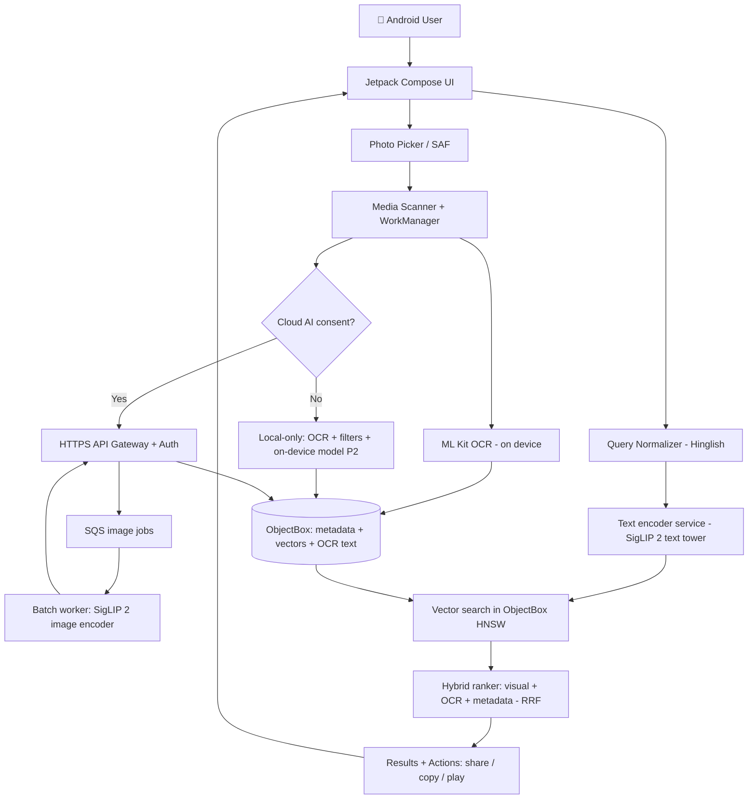

### 6.2 Kya kahan rehta hai (data placement)

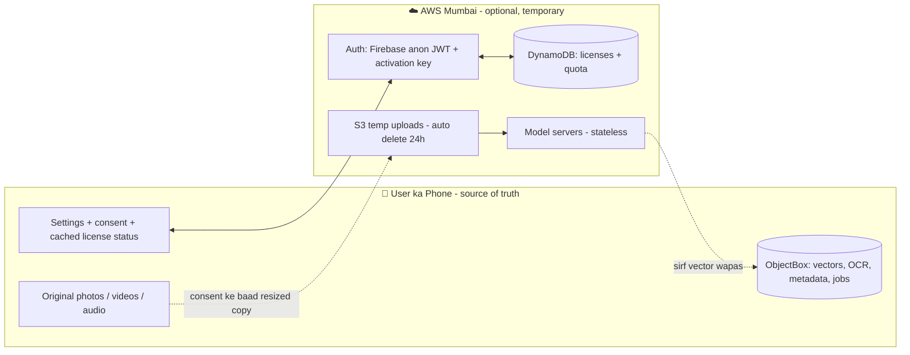

| Data | Phone | AWS |
|---|---|---|
| Original photo/video/audio | ✅ **Default source of truth** | Sirf temporary processing copy (consent ke baad), max 24h |
| Metadata + URI | ✅ ObjectBox | ❌ Nahi chahiye |
| Vectors / HNSW index | ✅ ObjectBox | ❌ Central vector DB nahi (MVP) |
| OCR text | ✅ Local | ❌ |
| Model weights | P2 mein Base INT8 | ✅ Hosted |
| Activation key / plan | Key + aakhri status (7 din offline) | ✅ Source of truth (sirf key ka hash) |
| Face vectors + Person names | ✅ **Sirf phone** | ❌ **Kabhi nahi** |

> ⚠️ **Single-device limitation:** vectors aur URIs doosre phone par automatically sync nahi honge. Reinstall par reindex lag sakta hai (P2 backup feature tak).

### 6.3 Photo indexing sequence

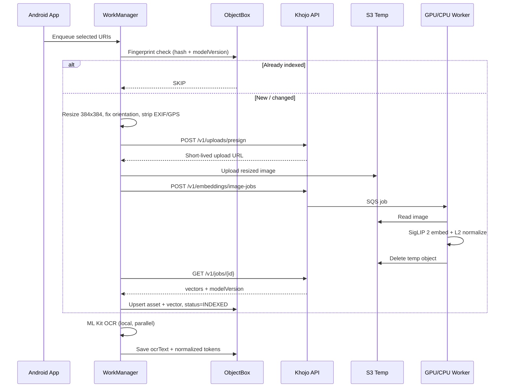

### 6.4 Search sequence

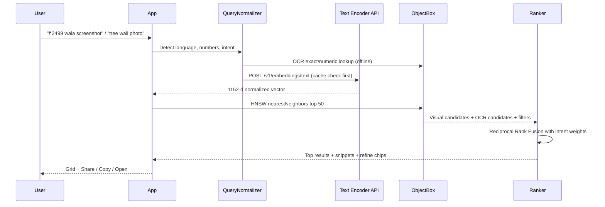

### 6.5 AWS deployment (growth stage)

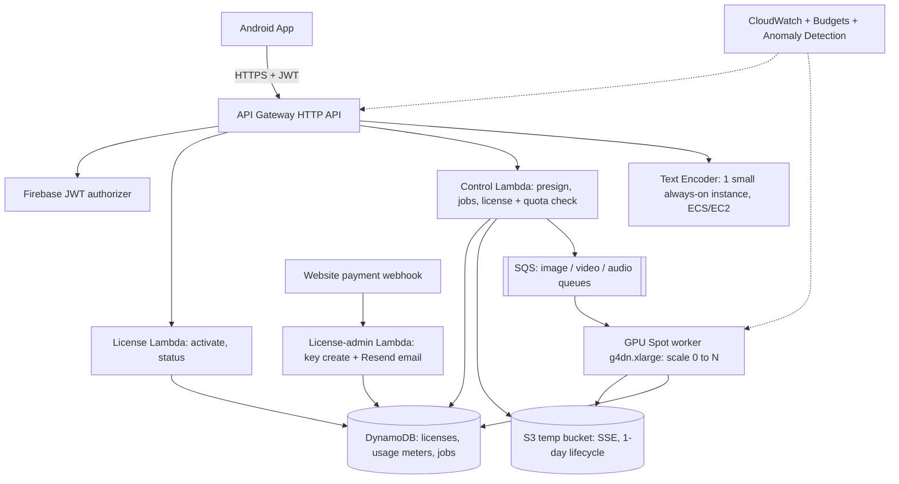

### 6.6 Video + audio pipelines (Stage 3–4)

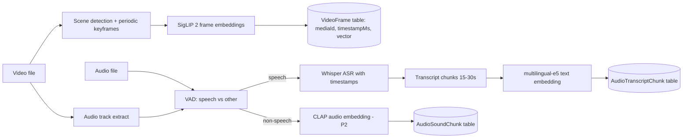

### 6.7 Activation key / plan flow (Play Billing ki jagah)

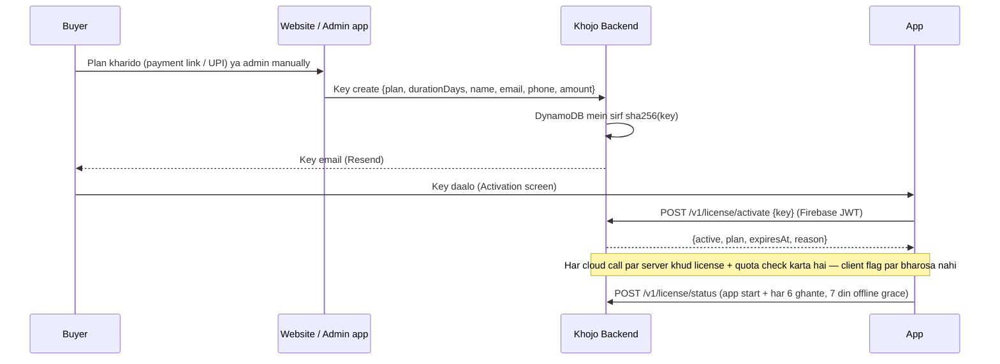

Detail aur Ultron se farq: [ADR-002](adr/ADR-002-no-play-store-activation-keys.md).

---

## 7. AI models — selection aur reasoning

### 7.1 Model summary

| Kaam | Model | Kyu ye | Kahan chalega | Stage |
|---|---|---|---|---|
| Image ↔ Text search | **SigLIP 2 So400m** (`google/siglip2-so400m-patch14-384`) | Accuracy-first; image aur text same vector space; multilingual training | Cloud | 1 (agar benchmark jeete) |
| Image ↔ Text (baseline) | **SigLIP 2 Base** (`google/siglip2-base-patch16-384`) | ~3x chhota, sasta, tez; phone pe bhi chal sakta hai (INT8) | Cloud → baad mein phone | 1 (comparison) / 5 (on-device) |
| Screenshot text | **ML Kit Text Recognition v2** | Free, offline, Devanagari | Phone | 1 |
| Video moments | Same SigLIP 2 image encoder on keyframes | Naya model nahi, same space, kam cost | Cloud | 3 |
| Speech → text | **Whisper** (size benchmark se: `large-v3-turbo` / `small`) | Multilingual, Hindi/Hinglish support, open source (MIT) | Cloud GPU | 4 |
| Transcript search | **multilingual-e5-base** (`intfloat/multilingual-e5-base`) | Hindi + English text retrieval, chhota model | Cloud / phone | 4 |
| Sound events | **CLAP** (LAION) | "Rain", "barking" jaise descriptions | Cloud | 5 |
| Fallback experiment | Quantized CLIP ViT-B/32 | Bahut halka | Phone | Sirf experiment |

### 7.2 SigLIP 2 — important technical facts

| Property | So400m-patch14-384 | Base-patch16-384 |
|---|---|---|
| Input image | 384 × 384 | 384 × 384 |
| Embedding dimension | **1,152** | **768** |
| FP32 checkpoint size | ~4.5–4.6 GB | ~1.5 GB |
| License (model repo) | Apache 2.0 | Apache 2.0 |
| Phone pe chalega? | ❌ Practically nahi | ✅ INT8 ke saath possible (test karna hai) |

**Implementation rules (ye galat hua to search kharab hoga):**

1. Image aur text **dono same checkpoint** se encode honge. Kabhi mix nahi.
2. Text tokenization model card / HF docs ke hisaab se: SigLIP family `padding="max_length"` aur `max_length=64` ke saath train hui hai — **wahi settings use karo**, warna embeddings drift karengi.
3. Har vector ko **L2-normalize** karo (cosine search ke liye).
4. Model revision + checksum + preprocessing version **pin** karo. Model badla = poora reindex.
5. CLIP aur SigLIP vectors kabhi same index mein nahi — alag spaces, alag dimensions.
6. Quantization (INT8/FP16) ke baad **FP32 baseline se ranking compare** karo.

### 7.3 Hindi / Hinglish strategy

| Query type | Example | Approach |
|---|---|---|
| English | "red saree with golden border" | Direct SigLIP 2 |
| Devanagari Hindi | "लाल साड़ी" | Direct SigLIP 2 (multilingual) + test |
| Roman Hinglish | "laal saree golden border wali" | **Normalizer**: dictionary (laal→red, ped→tree, wali/dikhao→stopwords) → English rewrite; **original + rewrite dono embed**, RRF se merge |

- Dictionary-based normalizer pehle (sasta, predictable, ~500 common seller words).
- LLM-based rewrite sirf tab jab dictionary fail kare aur benchmark sudhaar dikhaye (extra cost + latency).
- Original query hamesha save (debug + "Did you mean" chip).

### 7.4 Model decision gate (Stage 0 mein)

1. **1,000 item pilot dataset** — products, photos, screenshots (consented).
2. **100+ real queries** — English / Hindi / Hinglish, human relevance labels.
3. Compare: **Recall@5, Precision@5, MRR@10**, indexing time, query latency, RAM, **₹ per 1,000 inferences**.
4. **So400m tabhi choose karo** jab Base se improvement material ho (rule of thumb: Recall@5 mein ≥5 points) aur cost sustainable rahe.
5. Winner ka revision + checksum pin.

### 7.5 Overclaim se bachna

- Bada model hamesha best nahi — aapki photos par test hi faisla karega.
- HNSW "approximate" hai — semantic relevance ki guarantee nahi.
- "Tree wali image" → kai trees aa sakte hain; refine chips do.
- Keyframes movement poori tarah nahi samajhte.
- Whisper naam, dialect, noisy voice notes miss kar sakta hai.

---

## 8. Indexing aur search pipelines

### 8.1 Photo indexing

```text
URI selected
  → readable? type, size, orientation check
  → fingerprint (fast metadata hash; conflict par SHA-256)
  → (fingerprint, modelVersion) already INDEXED? → SKIP
  → resize to 384, EXIF orientation fix, EXIF/GPS strip
  → image embedding (cloud consent ke baad / P2: on-device)
  → L2 normalize
  → ObjectBox upsert (asset + vector + modelVersion + processingVersion)
  → OCR (screenshots / text-heavy images) → ocrText + normalized tokens
  → status: INDEXED / FAILED(reason) / RETRYABLE
```

**Batching:** 16–32 images per job → kam requests, GPU efficient.

### 8.2 Search query

```text
user text / voice
  → language detect + normalization (Hinglish → English rewrite)
  → intent detect (amount/number? → OCR heavy; visual words? → vision heavy)
  → query cache check (same normalized query → same vector, 30 din)
  → SigLIP 2 text encoder (SAME checkpoint) → L2 normalize
  → ObjectBox HNSW top 50
  → OCR exact + fuzzy candidates, metadata filters (date, source, type)
  → Reciprocal Rank Fusion (intent weights)
  → optional rerank (sirf agar validated)
  → results with snippets; confidence words ("Best match"), fake % nahi
```

### 8.3 Video indexing
- Metadata: `duration, mime, width, height`.
- **Adaptive sampling:** scene change + har ~2–3s ek frame (5s fixed universal nahi).
- Save `(mediaId, timestampMs, vector, modelVersion)`.
- Search → **group by mediaId** → top 3 timestamps per video.
- Candidate moment ke aaspaas **re-sample** (±2s, 0.5s interval) precision ke liye.
- Video ka audio alag se transcribe (agar spoken search chahiye).

### 8.4 Audio indexing
- VAD se speech vs non-speech.
- Whisper → segments with timestamps → 15–30s chunks (thoda overlap).
- Chunks → multilingual-e5 embeddings → alag index.
- Non-speech → CLAP (P2) → alag index.
- Query router: transcript / sound / dono.
- Result: user ka original audio URI + `startMs`. **Voice kabhi logs mein permanent copy nahi.**

### 8.5 Dedup, updates, deletions
- Dedup key: fast fingerprint → conflict par `SHA-256(file bytes)`.
- Model version + preprocessing version alag fields.
- URI lost / file deleted → vector deactivate, UI mein "File not found — re-select?".
- Model switch → background full reindex (purane vectors tab tak active).
- Settings: **"Clear local index"** + **"Delete all server job data"**.

---

## 9. Database design (ObjectBox)

### 9.1 ER diagram

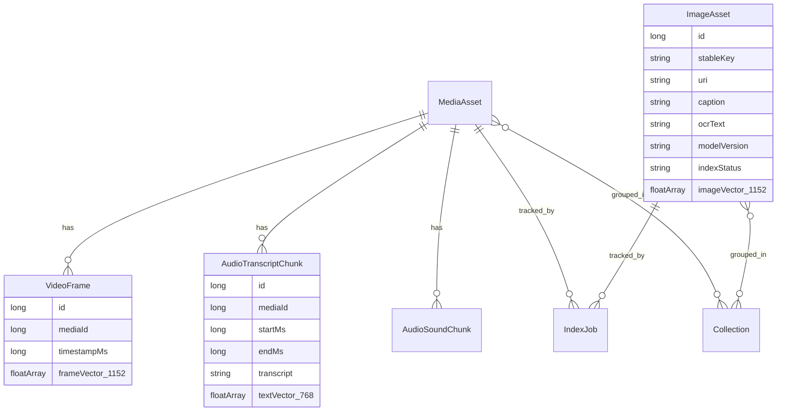

### 9.2 Image entity (illustrative Kotlin)

```kotlin
import io.objectbox.annotation.Entity
import io.objectbox.annotation.Id
import io.objectbox.annotation.Index
import io.objectbox.annotation.HnswIndex
import io.objectbox.annotation.VectorDistanceType

@Entity
data class ImageAsset(
    @Id var id: Long = 0,
    @Index var stableKey: String = "",     // fingerprint / hash
    var uri: String = "",                  // user-authorized content URI
    var caption: String? = null,           // optional, kabhi required nahi
    var mimeType: String = "image/jpeg",
    var addedAtMs: Long = 0,
    var takenAtMs: Long? = null,
    var folderLabel: String? = null,
    var ocrText: String? = null,
    var ocrTokens: String? = null,         // normalized: "2499 upi paid"
    var modelVersion: String = "siglip2-so400m-p14-384-v1",
    var processingVersion: Int = 1,
    var indexStatus: String = "PENDING",   // PENDING / INDEXED / FAILED / STALE
    var errorCode: String? = null,
    @HnswIndex(dimensions = 1152, distanceType = VectorDistanceType.COSINE)
    var imageVector: FloatArray? = null
)
```

> **Schema rule:** vector dimension fixed hai. So400m = 1152, Base = 768. Model badalne par **naya property/entity + full reindex**. Kabhi pad/truncate karke "fit" mat karo.
> **Tip:** Stage 0 ke baad agar Base jeete to `dimensions = 768` aur `modelVersion = "siglip2-base-p16-384-v1"`.

### 9.3 Baaki entities

| Entity | Fields |
|---|---|
| `MediaAsset` | id, stableKey, uri, type, mimeType, durationMs?, sizeBytes, addedAt, status |
| `VideoFrame` | id, mediaId, timestampMs, frameVector[1152]?, modelVersion, qualityFlags |
| `AudioTranscriptChunk` | id, mediaId, startMs, endMs, transcript, language, textVector[768]?, modelVersion |
| `AudioSoundChunk` | id, mediaId, startMs, endMs, soundVector[512]?, modelVersion |
| `IndexJob` | id, mediaId, pipelineType, attempts, state, updatedAt, errorCode? |
| `Collection` | id, name, createdAt, assetIds (ToMany) |
| `QueryCache` | normalizedQuery, modelVersion, vector, createdAt (30-day TTL) |
| `SearchHistory` (opt-in) | id, query, filters, createdAt |
| `UserSettings` | cloudConsent, ocrEnabled, language, retention, wifiOnly |

*(CLAP dimension checkpoint par depend karta hai — 512 common hai; chosen checkpoint se confirm karna.)*

### 9.4 Vector search (Kotlin)

```kotlin
val query = imageBox.query(
    ImageAsset_.imageVector.nearestNeighbors(normalizedQueryVector, 50)
).build()
try {
    val hits = query.findWithScores()   // nearest first
    val results = hits.map { it.get() to it.score }
} finally {
    query.close()
}
```

Quality check: 1,000 image test set par **HNSW vs exact brute-force cosine** compare karo (ANN recall measure).

### 9.5 Phone storage calculation

| Library size | Vector dim | Raw vector size |
|---|---|---|
| 1,000 images | 1,152 (So400m) | ~4.6 MB |
| 5,000 images | 1,152 | ~23 MB |
| 20,000 images | 1,152 | ~92 MB |
| 20,000 images | 768 (Base) | ~61 MB |

*(Formula: images × dim × 4 bytes. HNSW graph + metadata ka overhead alag. Video mein frames ki sankhya files se kai guna zyada hoti hai.)*

---

## 10. Search ranking engineering

### 10.1 Retrieval stages
1. **Intent routing** — image / OCR text / video / speech / sound / All.
2. **Query understanding** — language, objects, colors, amounts, dates.
3. **Candidate retrieval** — HNSW + OCR + metadata alag-alag.
4. **Fusion** — **Reciprocal Rank Fusion (RRF)**; alag models ke raw scores directly compare nahi.
5. **Optional rerank** — top 20 par, sirf agar gain proven.
6. **Presentation** — highlights, source, timestamp.

### 10.2 Starting weights (hypothesis — tune karna hai)

| Query type | Visual | Metadata | OCR/Exact | Transcript |
|---|---|---|---|---|
| Visual ("red kurti") | 75% | 15% | 10% | — |
| Payment/receipt ("₹2499") | 20% | 20% | 60% | — |
| Spoken ("deadline wali meeting") | — | — | 20% keyword | 80% semantic |

> "98% match" jaisa kuch bhi tab tak nahi dikhayenge jab tak ground-truth par calibrate na ho. Use "Best match", "Similar".

### 10.3 Failure cases jo cover karne hain

| Case | Solution |
|---|---|
| "Wo tree wali" → bahut trees | Refine chips (date, source), top choices |
| "Golden kurti" → golden color vs golden embroidery | Attribute-wise test bucket |
| "₹2,499" vs "₹2499" vs "2,499.00" | OCR number normalization |
| "ped" vs "tree" | Hinglish dictionary + dual embedding |
| "Dog jumps into pool" → before/after frames | Dense re-sampling |
| Same screenshots, alag amounts | OCR exact match dominate kare |

---

## 10A. People & Faces — face grouping aur naming

> **Feature ek line mein:** Photos mein jitne bhi chehre (faces) hain, app unhe **apne aap group** karega ("Person 1", "Person 2"...). Ek alag **People** section mein user har group ko naam dega ("Ram", "Mummy", "Priya Didi"). Phir search mein "**Ram ki kurte wali photo**" bolne par app pehle *Ram ki photos* filter karega, phir unme se *kurta* wali dikhayega.

### 10A.1 Ye kaise kaam karega (simple flow)

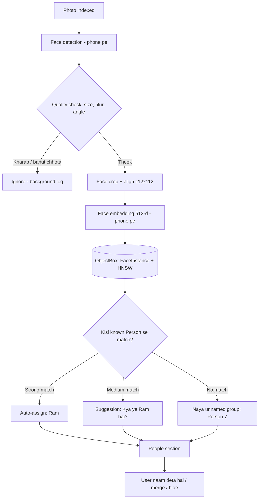

**Sabse important design decision:** face detection, face embedding, grouping aur naming — **sab kuch 100% phone par**. Face data kabhi AWS par nahi jaayega, chahe cloud AI mode on ho.

| Kyu on-device? | Detail |
|---|---|
| 🔒 Privacy | Chehre ka data **biometric** hota hai — sabse sensitive category. Server par rakha to leak/legal risk bahut bada |
| ⚖️ Legal lesson | Google Photos ki face grouping par US (Illinois BIPA) mein case hua aur Google ne **$100 million** settlement diya; Texas ne bhi Google par case kiya ki bystanders (background ke log) ka face data bina consent bana. Hum isse seekh kar on-device + opt-in rakhenge |
| 💰 Cost | Cloud cost **₹0** — har plan mein de sakte hain |
| 📶 Offline | Bina internet ke People filter chalega |

### 10A.2 Models — kya use karenge aur license kyu important hai

| Kaam | Model / Library | License | Note |
|---|---|---|---|
| Face detection | **Google ML Kit Face Detection** | Free (Google ML Kit terms) | On-device, landmarks + head angle (Euler) deta hai — quality filter ke liye perfect |
| Face detection (alternative) | **YuNet** (OpenCV Zoo) | MIT | Same 5 keypoints, alignment ke liye accha |
| Face embedding ⭐ | **AuraFace-v1** (fal.ai, ArcFace-style ResNet100) | **Apache 2.0 — commercial use allowed** | 512-d embedding; phone ke liye **INT8 quantize** karna padega (benchmark) |
| Face embedding (light option) | Commercially licensed MobileFaceNet SDK (e.g. InspireFace paid license) | Paid | <5 MB models, low-end phones par tez |
| ❌ **Use NAHI karna** | InsightFace pretrained packs (`buffalo_l`, `antelopev2`, SCRFD weights) | **Non-commercial only** | Code MIT hai lekin **model weights paid app mein bina commercial license ke illegal** |
| ❌ Unclear | Random GitHub "FaceNet .tflite" files | Training data (VGGFace2/MS-Celeb) ka license unclear | Provenance verify kiye bina mat use karo |

> ⚠️ **License trap:** AuraFace ki repo mein InsightFace ka SCRFD detector bhi bundled aata hai jo non-commercial hai — **sirf recognition model lo, detector ML Kit/YuNet ka use karo.**

### 10A.3 Grouping (clustering) logic

**Step 1 — Quality filter** (bekar faces ko group mein jaane se roko):
- Face size ≥ ~60×60 px (chhote background chehre skip → bystander privacy bhi)
- Head angle (yaw) bahut zyada side nahi (ML Kit Euler angles)
- Blur score + detection confidence threshold

**Step 2 — Embedding:** face crop → 5 landmarks se align → 112×112 → AuraFace → **L2 normalize** → 512 floats.

**Step 3 — Incremental clustering** (har nayi photo par poora re-cluster nahi):

```text
naya face vector v
  → HNSW: nearest 10 faces nikalo
  → har known Person ke liye: similarity(v, person ke representative vectors)
  → best ≥ T_high (e.g. 0.55)   → auto-assign
  → T_low ≤ best < T_high        → "Kya ye Ram hai?" suggestion (user confirm)
  → best < T_low (e.g. 0.40)     → unnamed cluster mein (ya naya cluster)
```

- **Thresholds (0.55 / 0.40) sirf starting guess hain** — apne test set par tune karne hain.
- Pehli baar bulk import par: **agglomerative clustering** (threshold-based) background mein, phone charging + idle par (WorkManager constraints).
- Har Person ke liye **5–10 representative vectors** rakho (alag age, angle, lighting) — ek "average" vector se better match.
- User ka har correction (confirm / "Ye Ram nahi hai" / merge) → **future matching ka hissa** (rejected pairs yaad rakho).

### 10A.4 Database entities

```kotlin
@Entity
data class Person(
    @Id var id: Long = 0,
    var displayName: String? = null,       // null = "Person 7" (unnamed)
    var aliases: String? = null,           // "ram,raam,राम,ram bhaiya"
    var coverFaceId: Long = 0,
    var isHidden: Boolean = false,         // user ne hide kiya
    var faceCount: Int = 0,
    var createdAtMs: Long = 0
)

@Entity
data class FaceInstance(
    @Id var id: Long = 0,
    @Index var imageAssetId: Long = 0,     // kis photo mein
    @Index var personId: Long = 0,         // 0 = abhi assign nahi
    var boxLeft: Float = 0f, var boxTop: Float = 0f,     // normalized 0..1
    var boxRight: Float = 0f, var boxBottom: Float = 0f,
    var qualityScore: Float = 0f,
    var assignment: String = "AUTO",       // AUTO / USER_CONFIRMED / SUGGESTED / REJECTED
    var modelVersion: String = "auraface-v1-int8-1",
    @HnswIndex(dimensions = 512, distanceType = VectorDistanceType.COSINE)
    var faceVector: FloatArray? = null
)
```

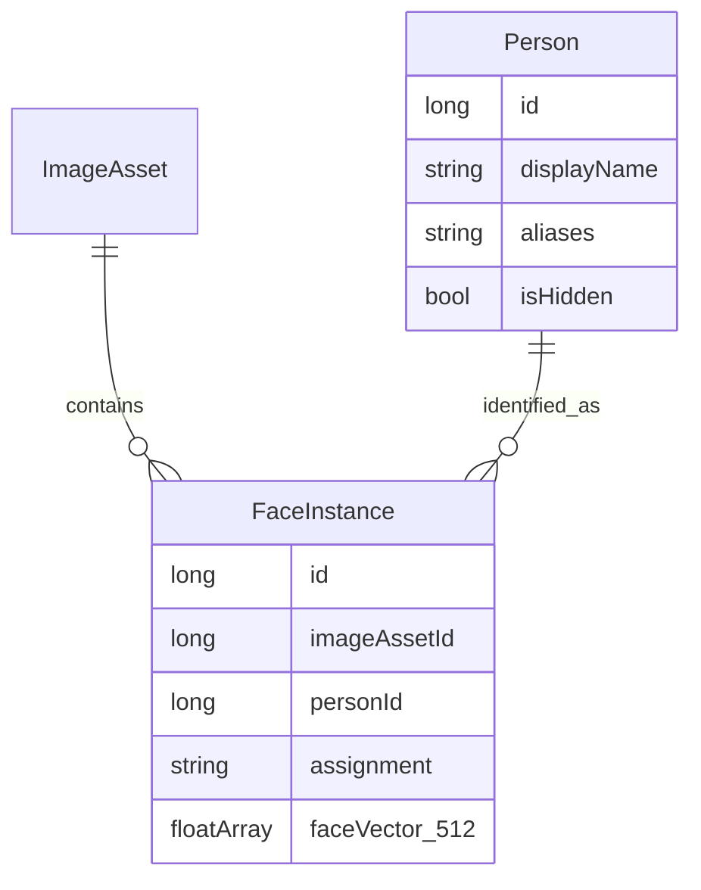

**Storage:** 512 × 4 bytes ≈ **2 KB per face**. 20,000 photos × ~2 faces avg ≈ 40,000 faces ≈ **~80 MB** (+ HNSW overhead). Quality filter se ye kaafi kam hoga. Settings mein "People data size" dikhao.

### 10A.5 Search: "Ram ki kurte wali photo" kaise solve hoga

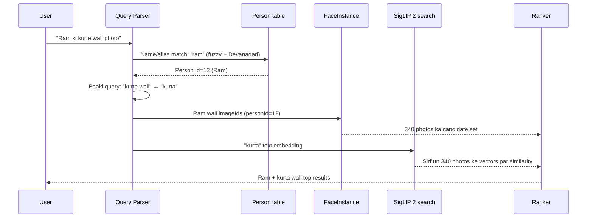

**Query parsing rules:**

| Query | Person filter | Visual query |
|---|---|---|
| "Ram ki kurte wali photo" | Ram | "kurta" |
| "Ram aur Priya beach par" | Ram **AND** Priya (dono ek photo mein) | "beach" |
| "Mummy ki saari photos" | Mummy | — (sirf person filter, date-wise sort) |
| "राम की फोटो" | Ram (Devanagari alias) | — |
| "Ram jaisa dikhne wala" | ❌ Support nahi — sirf named People se filter |

**Technical approach:**
1. **Name detection:** query tokens ko `Person.displayName + aliases` se match (exact → fuzzy edit-distance ≤ 1 → transliteration ram↔राम). Grammar words "ki / ka / ke / wali / wala / photo / dikhao" hata do.
2. **Ambiguity:** agar "Ram" naam ke 2 Person hain → chip dikhao "Ram (Bhaiya) / Ram (Office)".
3. **Filtered vector search:** Person ki photos chhoti list hoti hai (aam taur par < 5,000), isliye un photos ke SigLIP vectors par **exact cosine (brute-force)** — fast aur 100% accurate. Badi list par HNSW top-K bada lekar intersect.
4. **Fallback:** agar naam kisi Person se match nahi hua → normal search + chip "Ram naam ka koi Person nahi mila — People mein naam do".
5. Multi-person: "Ram aur Priya" → dono ke imageId sets ka **intersection**.

### 10A.6 People section — UI screens

| Screen | Kya hoga |
|---|---|
| **People grid** | Saare face groups (bade group pehle), naam wale upar; "Add name" button |
| **Person detail** | Us person ki saari photos · Rename · Aliases add (Ram / Raam / राम) · Cover photo choose |
| **Name a face** | Photo mein face par tap → naam likho / existing person chuno |
| **Review suggestions** | "Kya ye Ram hai?" — ✅ Haan / ❌ Nahi (swipe cards, fast) |
| **Merge** | Do groups ek hi insaan ke → "Merge" |
| **Remove / Not this person** | Galat photo hatao — model seekhta hai |
| **Hide person** | Ex/stranger/bystander — People mein nahi dikhega, search mein nahi aayega |
| **Settings → Face grouping** | ON/OFF toggle · "Delete all face data" · data size |
| Search result chip | "👤 Ram" chip — tap karke filter hatao/badlo |

### 10A.7 Privacy aur consent rules (strict)

1. **Default OFF.** Alag, clear consent screen: "Khojo aapke phone par photos mein chehre group karega. Ye data sirf aapke phone par rahega."
2. Face vectors **kabhi upload nahi**, analytics/logs/crash reports mein kabhi nahi, cloud backup (P2) mein bhi default exclude.
3. **Turn OFF = saara face data turant delete** (FaceInstance + Person tables wipe).
4. Sirf user ke chune hue media par — koi web search, celebrity recognition, ya "is insaan ko pehchano" feature **nahi**.
5. Naam sirf user deta hai — app khud kabhi kisi ka naam guess nahi karta.
6. Chhote/background faces skip (bystander protection); "Hide person" option.
7. Face data export/share feature **nahi** (ek user ka face DB doosre ko nahi).
8. Privacy policy (website) aur app ke consent screen mein face processing clearly disclose (on-device, not collected/shared).
9. **DPDP Act (India)** ke hisaab se lawyer review — photos mein doosre logon ka data bhi hota hai. Kuch regions (jaise US ke Illinois/Texas jahan biometric laws hain) mein launch karna ho to feature region-wise band rakhne ka option.

### 10A.8 Performance aur cost

| Item | Estimate (benchmark karna hai) |
|---|---|
| Face detection (ML Kit) | ~20–80 ms / photo (mid-range phone) |
| Face embedding (AuraFace INT8) | ~100–300 ms / face (heavy model; light SDK se ~20–50 ms) |
| 5,000 photos ka pehla scan | ~15–45 min background (charging + idle par) |
| Person filter search | < 100 ms (local) |
| Cloud cost | **₹0** |
| App size increase | ~60–70 MB (AuraFace INT8) — **on-demand download** karo (S3 se, checksum verify), sabke APK mein nahi |

### 10A.9 Edge cases

| Case | Handling |
|---|---|
| Bachpan vs ab ki photo (age gap) | Multiple representative vectors; user merge |
| Judwaa / milte-julte bhai-behen | Auto-assign threshold strict; suggestion mode |
| Mask, sunglasses, side face | Quality filter skip ya low-confidence suggestion |
| Group photo (20 faces) | Sabhi detect, chhote skip; "Ram aur Priya" intersection search |
| Poster/TV/statue mein chehra | Quality + user "Hide" |
| Same naam ke 2 log | Aliases + disambiguation chip |
| Model update | `modelVersion` change → face vectors reindex; **user ke naam aur confirmations preserve** (Person table safe) |

### 10A.10 Testing & metrics

| Metric | Matlab | Initial target (validate) |
|---|---|---|
| Cluster purity | Ek group mein sirf ek insaan | ≥ 95% |
| False merge rate | Do alag log ek group mein | < 2% (sabse kharab error) |
| Person recall | Ram ki kitni photos Ram group mein | ≥ 85% (baaki suggestions mein) |
| "Person + object" query success | "Ram ki kurta photo" sahi | ≥ 80% top-5 |
| Indian faces / skin tones / lighting | Bias check | Har group mein similar accuracy |

Test set: consented family/friends photos (alag age, lighting, festivals, group photos). **Fairness test zaroori** — face models kuch skin tones/ages par kam accurate ho sakte hain.

---

## 11. Backend API contract

Base URL: `https://api.<aapka-domain>/v1` (aapke existing domain ka subdomain) · Auth: `Authorization: Bearer <JWT>` · Har write call par `Idempotency-Key` header.

| Method | Endpoint | Kaam |
|---|---|---|
| POST | `/v1/embeddings/text` | Query → vector (sync, fast) |
| POST | `/v1/uploads/presign` | Temp S3 upload URL (short-lived, scoped) |
| POST | `/v1/embeddings/image-jobs` | Batch image embedding job |
| GET | `/v1/jobs/{jobId}` | Job status + results |
| POST | `/v1/transcribe-jobs` | Audio/video ASR job (P1) |
| POST | `/v1/license/activate` | Key is phone par bandho (move bhi), status lautao |
| POST | `/v1/license/status` | Key ka status (move nahi karta) |
| GET | `/v1/me/usage` | Plan quotas + usage |
| GET | `/v1/releases/latest` | OTA update info + 30-min presigned APK link |
| GET | `/v1/releases/download` | Public (website button), throttled |
| GET/POST/PATCH | `/v1/admin/licenses*` | Admin only (`ADMIN_EMAILS`): keys create / edit / revoke / reissue / allow-move |
| DELETE | `/v1/me/data` | Saare server-side job artifacts delete |
| DELETE | `/v1/me` | Account deletion |

**Example — text embedding**

```json
// Request
{ "query": "black kurti with golden design", "language": "en",
  "modelVersion": "siglip2-so400m-p14-384-v1" }

// Response (vector shortened; real = 1152 floats)
{ "modelVersion": "siglip2-so400m-p14-384-v1", "dimension": 1152,
  "normalized": true, "vector": [0.012, -0.004, 0.018], "requestId": "req_x" }
```

**Example — image job**

```json
// Request
{ "media": [ {"clientAssetId": "a001", "temporaryObjectKey": "uploads/s1/a001"},
             {"clientAssetId": "a002", "temporaryObjectKey": "uploads/s1/a002"} ],
  "modelVersion": "siglip2-so400m-p14-384-v1" }

// Response
{ "jobId": "job_x", "status": "QUEUED", "accepted": 2 }
```

**Error format:** `{ "error": { "code": "QUOTA_EXCEEDED", "message": "...", "retryAfterSec": 3600 } }`
Codes: `UNAUTHORIZED`, `QUOTA_EXCEEDED`, `RATE_LIMITED`, `INVALID_MEDIA`, `MODEL_UNAVAILABLE`, `JOB_NOT_FOUND`.

**API protections:**
- Identity + activation key server pe verify; client ke "isPro" flag par kabhi bharosa nahi.
- Rate limit: per user/device, batch size, daily compute.
- Image decode limits (size, dimension, decompression bomb), MIME check.
- EXIF/GPS strip **upload se pehle** (phone pe).
- Tokens / URIs / payloads logs mein redact.
- Temp uploads: 24h lifecycle + processing ke turant baad delete.

---

## 12. Android project structure

```text
KhojoAI/
├── app/
│   └── src/main/java/com/khojoai/app/
│       ├── MainActivity.kt
│       ├── KhojoApplication.kt
│       ├── navigation/
│       ├── ui/
│       │   ├── onboarding/   ├── home/        ├── importmedia/
│       │   ├── search/       ├── results/     ├── player/
│       │   ├── collections/  ├── activation/  └── settings/
│       ├── data/
│       │   ├── local/objectbox/     # entities, DAOs, migrations
│       │   ├── remote/api/          # Retrofit services, DTOs
│       │   ├── media/               # Photo Picker, SAF, URI lifecycle
│       │   └── repository/
│       ├── domain/
│       │   ├── model/
│       │   └── usecase/             # IndexMedia, Search, ShareResults...
│       ├── indexing/
│       │   ├── IndexWorker.kt   ├── OcrIndexer.kt   ├── ImageIndexer.kt
│       │   ├── VideoFrameIndexer.kt └── AudioIndexer.kt
│       ├── search/
│       │   ├── QueryNormalizer.kt   # Hinglish dictionary + intent
│       │   ├── VectorSearcher.kt
│       │   └── ResultRanker.kt      # RRF
│       ├── faces/                   # FaceDetector, FaceEmbedder, FaceClusterer, PersonQueryParser
│       ├── license/                 # LicenseKey, LicenseClient, AccessViewModel (Ultron jaisa)
│       └── update/                  # AppUpdater, SHA-256 verify, UpdatedReceiver
├── inference-service/      # FastAPI + model workers (Python)
│   ├── app/main.py  ├── app/models/siglip.py  ├── app/workers/
│   └── Dockerfile
├── infrastructure/         # Terraform: API GW, Lambda, SQS, S3, DynamoDB, ECS
├── eval/                   # dataset manifest, queries.csv, run_eval.py, notebooks
├── docs/                   # ADRs, openapi.yaml, security, runbooks
└── README.md
```

Library versions implementation ke time pin karna. Android media permissions OS version ke hisaab se badalte hain — Photo Picker use karo taaki broad media permission na maangni pade.

---

## 13. AWS deployment design

### 13.1 Stage-wise infra evolution

| Stage | Users | Compute design | Kyu |
|---|---|---|---|
| **Pilot** | ≤ 50 | Lambda container (ECR) for text + image; S3 temp; Firebase Auth; DynamoDB | Idle cost ≈ 0; Free tier/credits use |
| **Growth** | ~1,000 | **Text encoder:** 1 small always-on instance (warm model, <1s search) · **Image indexing:** SQS + GPU Spot worker jo jobs hone par hi chale | Lambda cold start (GBs ka model load) search ko slow karega; GPU batch bahut sasta per image |
| **Scale** | ~10,000+ | Text: 2 instances behind autoscaling · Indexing: GPU Spot pool (0→N) + on-demand fallback · Savings Plan | HA + cost per user kam |
| **Optimized** | any | **On-device Base INT8 image encoder** → cloud indexing cost ~0 | Privacy + margin dono badhte hain |

### 13.2 Lambda caveat (important)

So400m FP32 checkpoint ~4.5–4.6 GB hai. Lambda max memory **10,240 MB** aur max timeout **15 min** hai — kaagaz par fit hota hai, lekin **cold start (model load) kai seconds** le sakta hai. Isliye:
- Pilot mein Lambda theek hai (users kam, wait acceptable).
- Search latency target (<1.5s p95) ke liye growth stage par **warm always-on text server**.
- Real deployed container ka benchmark karke hi final decision.

### 13.3 Operational guardrails

- **AWS Budgets alerts:** ₹500 / ₹1,500 / ₹5,000 (pilot), baad mein revenue ka % .
- **Emergency kill switch:** cloud indexing pause flag (DynamoDB config).
- Max concurrent workers, per-user daily quota, max upload size.
- Timeouts, cancellation, exponential backoff + jitter.
- Metrics: p50/p95 latency, errors, cold starts, queue depth, **spend per user**.
- **NAT Gateway / ALB avoid** pilot mein (fixed monthly cost badhate hain).
- Region: **ap-south-1 (Mumbai)**.


---

# PART C — BUSINESS

## 14. Cost — one-time aur monthly

> **Assumptions (Nov 2026 snapshot, verify before launch):** 1 USD ≈ **₹95** · AWS par 18% GST (GST-registered business input credit claim kar sakta hai) · Lambda x86 ≈ $0.0000166667 / GB-second · g4dn.xlarge (1× T4 GPU) Mumbai on-demand ≈ **$0.579/hr** (~₹55/hr), Spot ≈ $0.20/hr · Indicative Mumbai EC2: t3.medium ≈ ₹2,500/mo, m6i.large ≈ ₹5,800/mo, m6i.xlarge ≈ ₹11,700/mo (always-on).
> Model speed numbers (seconds per image) **abhi estimate hain** — Stage 0 benchmark ke baad is table ko update karna hai.

### 14.0 Aapke AWS credits aur domain ka asar ✅

Aapke paas **AWS credits** aur **domain** dono pehle se hain, isliye shuruaati kharcha kaafi kam ho jaata hai:

| Item | Pehle (plan) | Ab |
|---|---|---|
| Domain | ₹700–₹1,500/yr | ✅ Already hai — bas renewal date yaad rakho |
| Pilot AWS bill (₹500–₹2,000/mo) | Card se | **Credits se ≈ ₹0** |
| Growth AWS bill (₹5,000–₹11,000/mo) | Card se | Credits khatam hone tak ≈ ₹0 |
| Stage 0 GPU/CPU benchmarking | ₹1,000–₹3,000 | **Credits se** — Base aur So400m dono ko properly test karo |

**Runway formula:** `Credits kitne mahine chalenge = Credit balance (₹) ÷ Monthly AWS bill (₹)`

| Example: $1,000 credit (~₹95,000) | Monthly bill | Credits kitne chalenge |
|---|---:|---|
| Pilot (50 users) | ₹500–₹2,000 | Expiry date tak poora cover |
| Growth (1,000 users) | ₹5,000–₹11,000 | ~8–19 mahine (ya expiry, jo pehle aaye) |
| Scale (10,000 users) | ₹16,000–₹30,000 | ~3–6 mahine |

*(Ye sirf example hai — aapke asli credit amount se dobara calculate karna hai.)*

**Credits ke saath dhyan rakhne wali baatein:**
1. **Expiry date** — credits ki ek expiry hoti hai; Billing → Credits page par balance, expiry aur kin services par lagte hain, check karo.
2. **Har service cover nahi hoti** — kuch cheezein (jaise AWS Marketplace purchases, kuch support plans) credits se bahar ho sakti hain; aur pehle bill par dekh lo ki tax bhi cover ho raha hai ya nahi.
3. **Budget alerts phir bhi lagao** — credits khatam hote hi charge seedha card par aata hai, koi warning nahi.
4. **GPU quota** — naye accounts mein Mumbai par GPU (G-instances) aur Spot ka vCPU quota aksar bahut kam ya 0 hota hai. **Stage 0 mein hi Service Quotas se increase request daal do** — approval mein din lag sakte hain.
5. Credits hain isliye over-provision mat karo — architecture aisa rakho jo **credits ke baad bhi affordable** ho (scale-to-zero, Spot, cache).

### 14.1 One-time (launch se pehle)

| Item | Approx cost | Note |
|---|---:|---|
| Android developer verification (Android Developer Console) | Google ki fee verify karo | Sideload APK ke liye 2027 se global (India date abhi announce nahi); Play Store listing ki zaroorat nahi |
| Trademark filing "Khojo AI" (Class 9 + 42) | ~₹9,000 (₹4,500/class, individual/startup/MSME e-filing) | Attorney optional: +₹5,000–₹15,000 |
| Domain | ✅ ₹0 (already hai) | Sirf yearly renewal |
| Privacy policy + terms legal review | ₹10,000–₹50,000 | DPDP compliance ke liye recommended |
| Stage 0 benchmarking (GPU/CPU hours) | ✅ AWS credits se | ~20–50 instance-hours |
| Test devices (2–3 budget Android) | ₹0–₹40,000 | Optional, purane phones bhi chalenge |
| **Total (lean)** | **~₹21,000–₹57,000** | Domain + benchmarking ab already covered; development time (salary) alag |

### 14.2 Monthly cost — Stage 1: Pilot (50 users)

Workload: 1,000 images total (ek baar index) + 1,000 searches/month.

| Item | Monthly |
|---|---:|
| Lambda compute (scenario A–C neeche) | ₹0–₹1,000 |
| ECR (5–6 GB model image) | ~₹60 |
| API Gateway (≈2,000 calls) | ~₹0–₹10 |
| S3 temp uploads | ~₹0–₹20 |
| CloudWatch logs/metrics | ₹0–₹200 |
| Firebase Auth (anon) + DynamoDB | ~₹0 (free tier — verify) |
| Email (domain already hai) | ~₹0–₹200 |
| **Total** | **~₹500–₹2,000 → AWS credits se ≈ ₹0** |

**Lambda sensitivity (month 1, free allowance ke BINA, 18% GST incl.):**

| Scenario | Text jobs | Image jobs | Memory | GB-seconds | Cost |
|---|---:|---:|---:|---:|---:|
| A: Base-like | 1,000 × 4s | 1,000 × 12s | 8 GB | 128,000 | ~₹239 |
| B: Heavy model | 1,000 × 6s | 1,000 × 30s | 10 GB | 360,000 | ~₹673 |
| C: Slow heavy | 1,000 × 12s | 1,000 × 40s | 10 GB | 520,000 | ~₹972 |

Agar account par 400,000 GB-s/month free compute eligible ho to A aur B ≈ ₹0; C mein sirf 120,000 GB-s billable (~₹224). New-account credits/free-tier rules July 2025 se badle hain — **apna account check karo, zero bill ka promise mat karo.**

### 14.3 Monthly cost — Stage 2: Growth (~1,000 active users)

Workload assumption: 200,000 naye images/month index + 100,000 searches/month.

| Item | Monthly |
|---|---:|
| Text encoder server (1 × t3.medium–m6i.large, always-on) | ₹2,500–₹5,800 |
| GPU indexing worker (20–60 GPU-hrs, on-demand; Spot isse sasta) | ₹1,100–₹3,300 |
| S3 temp + data transfer | ₹200–₹500 |
| API Gateway + Lambda control plane | ₹50–₹300 |
| CloudWatch | ₹300–₹800 |
| DynamoDB + Firebase Auth | ₹100–₹300 |
| ECR, domain, email, misc | ₹300–₹500 |
| **Total** | **~₹5,000–₹11,000** |

### 14.4 Monthly cost — Stage 3: Scale (~10,000 active users)

Workload: 2,000,000 naye images/month + 1,000,000 searches/month.

| Item | Monthly |
|---|---:|
| Text encoder (2 × m6i.large ya 1 × m6i.xlarge; Savings Plan se ~30–60% kam) | ₹11,000–₹12,000 |
| GPU indexing (100–200 hrs; Spot use karke ₹2,000–₹4,000) | ₹2,000–₹11,000 |
| S3 + transfer | ₹1,000–₹2,000 |
| CloudWatch | ₹1,000–₹2,000 |
| DynamoDB + Firebase Auth (free tier ke upar ho sakta hai) | ₹500–₹3,000 |
| **Total** | **~₹16,000–₹30,000** |

### 14.5 Per-unit cost (pricing decide karne ke liye)

| Unit | Estimate | Kaise nikala |
|---|---:|---|
| 1 image embedding (GPU batch) | **₹0.001–₹0.02** | ₹55/GPU-hr ÷ (50 se 3,600 img/hr conservative range) |
| 1 text search | **~₹0.01–₹0.06** | Always-on server cost ÷ searches (zyada searches = sasta per search) |
| 1 hour video (≈1,440 keyframes) | **₹8–₹24** | Frames × per-image cost (worst case) |
| 1 hour audio (Whisper GPU) | **₹1.5–₹3** | ~1.5–3 GPU-min per audio-hour (estimate) |
| OCR | **₹0** | Phone pe ML Kit |
| Face grouping | **₹0** | Phone pe (battery/time cost user ke phone par) |

**Sabse bada cost lever:** Phase 5 mein **on-device SigLIP 2 Base INT8** → image indexing cost ≈ ₹0 aur photos phone se bahar hi nahi jaayengi.

### 14.6 Cost control checklist
- ✅ Query cache (same query = no new inference)
- ✅ Batch indexing 16–32 images
- ✅ GPU Spot + scale-to-zero
- ✅ Monthly new-index quotas per plan (one-time bade imports ko control)
- ✅ Budget alerts + kill switch
- ✅ Unlimited video/audio **kabhi nahi**
- ✅ Separate meters: `image_embeddings`, `text_queries`, `video_frames`, `audio_minutes`

---

## 15. Subscription plans aur pricing

### 15.1 Final plan structure (launch par test karna hai)

| | **Free** | **Plus** | **Seller Pro** ⭐ | **Media Pro** (Stage 3–4) |
|---|---|---|---|---|
| **Monthly** | ₹0 | **₹79** | **₹199** | **₹349** |
| **Yearly** | — | ₹699 (~26% off) | ₹1,799 (~25% off) | ₹2,999 (~28% off) |
| Target | Try karne wale | Personal users | Sellers / small business | Creators |
| Library size (indexed photos) | 500 | 10,000 | 50,000 | 50,000 |
| Naye photos index / month | 200 | 2,000 | 10,000 | 10,000 |
| Cloud AI searches | 20/day | Unlimited (fair use 200/day) | Unlimited (fair use 500/day) | Unlimited |
| Screenshot OCR search (on-device) | ✅ Unlimited | ✅ | ✅ | ✅ |
| Hinglish / Hindi search | ✅ Basic | ✅ | ✅ | ✅ |
| Collections | 1 | Unlimited | Unlimited + catalogue mode | Unlimited |
| Batch share (multi-select) | 5 at a time | 20 | **50 + saved share sets** | 50 |
| Price/amount OCR filters | — | ✅ | ✅ | ✅ |
| Priority indexing queue | — | — | ✅ | ✅ |
| Video moment search | — | — | — | **5 hrs/month** |
| Audio transcript search | — | — | — | **20 hrs/month** |
| 👤 People & Faces (on-device) | ✅ Grouping + 3 named people | ✅ Unlimited | ✅ Unlimited | ✅ Unlimited |
| Devices | 1 | 1 | 2 (sync ke baad) | 2 |

**Free trial:** Seller Pro ka **7-day `trial` key** (ek email / ek phone ek baar).
**Free plan:** ₹0 `free` key (lifetime, Free limits) — website par email se. App bina key ke locked rehti hai, isliye free users ko bhi key chahiye.

### 15.2 Ye prices kyu?

- **₹79 Plus** — Indian consumer apps ke liye "chai se kam" price point; Google One basic plans ke aas-paas, isliye isse upar mushkil.
- **₹199 Seller Pro** — business tool; agar ek din mein 1 extra sale bhi time bachne se hoti hai to value clear. Margin sabse achha (net ~₹143).
- **₹349 Media Pro** — video/audio ka asli GPU cost zyada hai; ₹299 par worst-case margin bahut patla tha, isliye ₹349 + fixed hours.
- **Yearly ~25% off** — cash flow upfront + churn kam.

### 15.3 Price experiments (Stage 2 pilot mein)
- Plus: **₹79 vs ₹99**
- Seller Pro: **₹149 vs ₹199**
- Fake-door test: "Upgrade" button → interest measure (bina paise liye, honest disclosure ke saath)
- Measure: conversion, D7/D30 retention, churn, refunds.

### 15.4 Purchase architecture
- **Play Store nahi, isliye Play Billing nahi.** App ke andar koi payment nahi; app sirf activation key leti hai.
- Pilot: admin web app se key banao, buyer ko email (Resend). Payment UPI / bank transfer, manually record (`amount` key par save).
- Public: website par plans page + payment link (Razorpay/UPI) → payment webhook → key auto-create + email.
- Renew = naya key ya admin expiry extend. Lost phone = "allow move". Lost key = reissue (bachi hui expiry ke saath).
- Refund/GST invoice ab hamari zimmedari. Plan limits, validity aur refund policy website + app dono par clearly.

---

## 16. Unit economics aur break-even

### 16.1 Ek paying user se kitna milega?

Assumption: price **GST inclusive** (18%) + payment gateway fee **~2% + 18% GST on fee (≈2.36%)** (Razorpay standard UPI/cards — current rate verify karo). Play Store nahi, isliye 15% Play fee nahi.

| Plan | Price | GST hatake | Gateway ~2.36% ke baad (**net**) |
|---|---:|---:|---:|
| Plus (monthly) | ₹79 | ₹66.9 | **₹65.4** |
| Plus (₹99 test) | ₹99 | ₹83.9 | ₹81.9 |
| Seller Pro (₹149 test) | ₹149 | ₹126.3 | ₹123.3 |
| Seller Pro | ₹199 | ₹168.6 | **₹164.7** |
| Media Pro | ₹349 | ₹295.8 | **₹288.8** |
| Plus yearly | ₹699 | ₹592.4 | ₹578.4 (~₹48/mo) |
| Seller Pro yearly | ₹1,799 | ₹1,524.6 | ₹1,488.6 (~₹124/mo) |

*(GST aur payout treatment apne CA se confirm karna — ye legal/tax advice nahi hai.)*

### 16.2 Break-even

Fixed monthly cost ₹10,000 (infra + tools) cover karne ke liye:
- Sirf Seller Pro: 10,000 ÷ 164.7 ≈ **61 paying sellers**
- Sirf Plus: 10,000 ÷ 65.4 ≈ **153 paying users**

### 16.3 Scenarios

| Scenario | Active users | Conversion | Paying mix | Net revenue/mo | Infra cost/mo | Result |
|---|---:|---:|---|---:|---:|---|
| Pilot | 50 | 0% (free pilot) | — | ₹0 | ₹500–₹2,000 | Investment phase |
| Growth (optimistic) | 1,000 | 8% | 55 Plus + 25 Seller | ~₹7,700 | ₹5,000–₹11,000 | ~Break-even |
| Scale (conservative) | 10,000 | 3% | 200 Plus + 100 Seller | ~₹29,500 | ₹16,000–₹30,000 | ~Break-even |
| Scale (optimistic) | 10,000 | 8% | 550 Plus + 250 Seller | ~₹77,100 | ₹16,000–₹30,000 | **Gross margin ~61–79%** |

**Seekh:** business tab chalega jab (1) **sellers ka share zyada** ho, aur (2) image indexing **on-device** shift ho. Isliye roadmap mein dono priority par hain.

> Sirf **paying** customers count hote hain — 50 registered users ≠ 50 subscribers. Marketing par bada kharcha tab tak nahi jab tak relevance + retention proven na ho.

---

# PART D — EXECUTION

## 17. Security, privacy, compliance

### 17.1 Users se jo promises karenge (sach aur accurate)
- ✅ "Aapki original files by default aapke phone par hi rehti hain."
- ✅ "Cloud AI processing optional hai aur aapki permission ke baad hi hoti hai."
- ✅ "Cloud processing on ho to chuni hui media securely bheji jaati hai; hum permanent copy nahi rakhte (jab tak aap alag se backup on na karo)."
- ✅ "Nayi cloud-based search ke liye internet chahiye ho sakta hai."
- ❌ "Data kabhi phone se bahar nahi jaata" — **ye nahi bolenge** jab cloud mode on ho.

### 17.2 Controls
1. Photo Picker / SAF — sirf chuni hui files ka access.
2. Explicit, informed consent before upload; kabhi bhi revoke.
3. TLS in transit; S3 SSE encryption; 24h lifecycle + processing ke baad turant delete.
4. Per-user isolation; presigned URLs scoped + short-lived.
5. Analytics mein filenames, GPS, faces, transcripts, images **nahi**.
6. Logs mein tokens, URIs, EXIF, payloads, transcripts redact.
7. "Clear local index", "Delete server data", "Delete account" — teeno in-app.
8. Activation key ka sirf hash server par; device binding (1 move/day); har cloud call par server-side license + quota; replay/spam/runaway bill protection.
9. Saare dependencies + AI model licenses ka commercial-use audit.
10. **DPDP Act (India)** + rules, privacy policy (website par), retention, consent flows — lawyer se review. *(Ye document legal advice nahi hai.)*
11. **Face data:** sirf on-device, default OFF, alag consent, OFF karte hi delete, kabhi upload/analytics nahi — poore rules Section 10A.7.

### 17.3 Sensitive media
Voice recordings aur photos mein personal details hoti hain. Jahan practical ho local processing, cloud processing hamesha **visible**. Poori library silently upload **kabhi nahi**.

---

## 18. UI/UX screens

| # | Screen | Kya hoga |
|---|---|---|
| 1 | Splash | Logo + "Bas bolo. Khojo." |
| 2 | Onboarding (3 slides) | Search kaise kaam karta hai · caption optional · phone vs cloud processing |
| 3 | Permission + Consent | Photo access (picker), mic (optional), **Cloud AI consent toggle** |
| 4 | Home | Bada search bar + 🎤 mic · tabs: All / Photos / Screenshots / Videos / Audio · recent collections |
| 5 | Import media | Source, count, pending/indexed/failed |
| 6 | Indexing progress | Resumable queue, pause/cancel, failure reasons |
| 7 | Search results | Grid, OCR snippets highlighted, filter chips, refine chips, multi-select |
| 8 | Photo detail | Image, optional caption, source, Copy text / Share / Add to collection |
| 9 | Video player | Thumbnail strip + auto-seek to matched timestamp |
| 10 | Audio player | Transcript snippet, waveform (optional), seek to match |
| 11 | Collections | Group + batch share (seller catalogue mode) |
| 12 | Search settings | Language, cloud mode, indexing quality, Wi-Fi only |
| 13 | Subscription | Plans comparison, usage meters (photos used / limit) |
| 14 | Account & privacy | Clear index, delete data, delete account, restore purchases, help |
| 15 | Empty/Error states | No match · offline · not indexed · file missing · model timeout · quota khatam |
| 16 | **People** 👤 | Face groups, naming, merge, suggestions, hide (Section 10A.6) |

**Results behavior examples:**
- "Vo tree wali image dikhao" → tab All → top photo matches → refine chips: "Green tree", "Last week" (sirf jo metadata me ho — GPS/date invent nahi).
- "Jisme meeting mein deadline discuss hui" → audio result → snippet + `02:35` → wahin se play.

**Design notes:** Hindi + English UI strings (i18n), bade touch targets, dark mode, low-end phones (2–3 GB RAM) par smooth grid (Coil thumbnails, paging).

---

## 19. Testing aur quality

### 19.1 Ground-truth dataset
- 1,000 real/consented photos (products, objects, nature, receipts, screenshots).
- 100+ queries: English / Devanagari Hindi / Roman Hinglish.
- Human relevance labels (kuch queries ke multiple sahi answers).
- Alag buckets: colors, clothing details, exact OCR numbers, ambiguous words.
- Video: clips with human-marked target time ranges.
- Audio: known transcript segments + noisy recordings.

### 19.2 Metrics aur targets (planning goals, claims nahi)

| Metric | Matlab | Initial target |
|---|---|---|
| Recall@5 | Sahi result top 5 mein | ≥ 90% pilot set par |
| Precision@5 | Top 5 kitne relevant | Category-wise baseline |
| MRR@10 | Pehla sahi result kitna upar | CLIP baseline se better |
| OCR exact accuracy | Amounts/dates sahi | False positives track |
| Video temporal error | Seek kitna paas | Median seconds record |
| Speech passage recall | Sahi passage mila | Language/noise wise |
| Text search latency | User wait | **p95 < 1.5s on 4G** (validate) |
| Index failure rate | Stability | < 1% (corrupt/deleted files chhod ke) |

### 19.3 Technical tests
- ObjectBox migrations + model-switch reindex
- URI revoked/deleted, process killed, restart → work resume
- No internet → kya chalta hai clearly dikhe
- Timeout/retry/idempotency, duplicate uploads
- Image/text embedding consistency (dimension, normalization)
- Large/corrupt images, EXIF orientation, HEIC, GIF, unsupported formats
- VFR videos, long audio, device thermal conditions
- Subscription expiry + adversarial client manipulation
- S3 temp delete verification
- Multi-user isolation + upload fuzzing

### 19.4 Experiment log format

```text
experiment_id, model_revision, preprocess_revision, dataset_version,
query_language, query_category, recall_at_5, mrr_at_10,
image_index_p50_ms, text_query_p95_ms, memory_peak_mb,
cost_per_1000_queries_inr, notes
```

---

## 20. Roadmap — kya-kya karenge, step by step

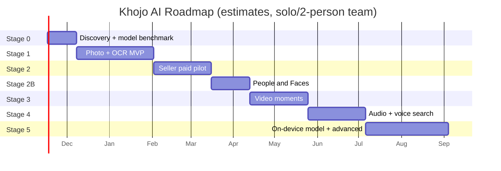

*(Dates sirf planning ke liye — team size aur benchmark results se badlenge.)*

### Stage 0 — Discovery + model proof (~2–3 hafte)
- [ ] 10–15 sellers/creators ke interviews (kaise search karte hain, kitna time jaata hai, kitna denge)
- [ ] Trademark check: "Khojo AI" (domain ✅ already hai)
- [ ] AWS credits: balance + expiry + eligible services note karo
- [ ] Mumbai mein **GPU (G-instance) + Spot vCPU quota increase** request daalo
- [ ] 1,000 image dataset + 100 queries + labels banana
- [ ] SigLIP 2 **Base vs So400m** benchmark (Recall@5, MRR, latency, RAM, ₹/1000)
- [ ] Lambda vs EC2 vs GPU cold start + cost test
- [ ] Hinglish dictionary v0 (~500 words) + test
- [ ] Consent UX + retention policy final

**Exit:** Top-5 relevance + latency target users ke liye acceptable; backend budget mein.

### Stage 1 — Photo + OCR MVP (~6–8 hafte)
- [ ] Compose shell, navigation, onboarding, consent
- [ ] Photo Picker, URI lifecycle, import state
- [ ] ObjectBox entities + HNSW + migrations
- [ ] FastAPI inference service + Docker + Lambda deploy
- [ ] Presign upload + image job + batch worker
- [ ] ML Kit OCR + number normalization
- [ ] QueryNormalizer + VectorSearcher + RRF ranker
- [ ] Results grid, detail, share/copy, multi-select
- [ ] Failure handling, log redaction, privacy settings
- [ ] Opt-in aggregate telemetry (raw media kabhi nahi)
- [ ] OTA beta channel (team + pilot keys)

**Exit:** Bina caption wali photos import karke users useful results paa rahe hain.

### Stage 2 — Seller-focused paid pilot (~4–6 hafte)
- [ ] Collections + batch share + catalogue mode
- [ ] Firebase anon auth + activation keys + key admin web app + key emails
- [ ] Plans, limits, usage meters, key sales (payment link → key)
- [ ] Growth infra: always-on text server + SQS + GPU Spot worker
- [ ] 30–50 seller pilot + weekly feedback calls
- [ ] Clothing/color/pattern + Hinglish relevance tuning
- [ ] Price experiments (₹79 vs ₹99, ₹149 vs ₹199)

**Exit:** Weekly repeat use + willingness-to-pay ka credible saboot → **public launch (website download + paid keys)**.

### Stage 2B — People & Faces 👤 (~3–4 hafte)
- [ ] AuraFace INT8 conversion + phone benchmark (speed, RAM, accuracy vs FP32)
- [ ] License final check (AuraFace Apache 2.0; InsightFace weights avoid)
- [ ] ML Kit face detection + quality filter + alignment
- [ ] `Person` + `FaceInstance` entities, HNSW (512-d)
- [ ] Bulk clustering + incremental assignment + thresholds tuning
- [ ] People grid, naming, merge, suggestions, hide
- [ ] PersonQueryParser ("Ram ki kurta photo") + filtered search
- [ ] Consent screen, OFF = delete, privacy policy update
- [ ] Fairness + purity tests on Indian family photo set
- [ ] Model as on-demand download (S3 + checksum)

### Stage 3 — Video moments (~4–6 hafte)
- [ ] Video import + scene/keyframe extraction
- [ ] Frame embeddings, timestamp index, group-by-video
- [ ] Thumbnail strip + seek-to-match (Media3)
- [ ] Video quotas + cost protection

### Stage 4 — Audio + voice search (~4–6 hafte)
- [ ] Audio import, VAD, Whisper ASR jobs, timestamped chunks
- [ ] multilingual-e5 transcript retrieval
- [ ] Audio player jump-to-passage
- [ ] Voice query (SpeechRecognizer) with confirm/edit
- [ ] Media Pro plan launch

### Stage 5 — Advanced (~2 mahine+)
- [ ] **On-device SigLIP 2 Base INT8** (indexing cost ≈ 0, max privacy)
- [ ] On-device text encoder → fully offline search
- [ ] CLAP sound search evaluation
- [ ] Dedup / smart albums
- [ ] Encrypted cross-device sync (sirf demand + economics ho to)
- [ ] Reranker / temporal models (sirf measured need par)

---

## 21. Team, timeline aur tools

### 21.1 Team options

| Setup | Kaun | Stage 2 (paid pilot) tak estimate |
|---|---|---|
| **Solo** | 1 full-stack dev (Android + Python) | ~5–7 mahine |
| **Lean team** ⭐ | 1 Android dev + 1 ML/backend dev (+ part-time designer) | ~3–4 mahine |
| **Fast** | 2 Android + 1 ML + 1 backend + designer + PM | ~2–3 mahine |

### 21.2 Daily tools

| Kaam | Tool |
|---|---|
| Code | Android Studio, VS Code / PyCharm |
| Version control | GitHub (private repo) + GitHub Actions |
| Design | Figma |
| Tasks | GitHub Projects / Notion / Linear |
| ML experiments | Jupyter / Colab + experiment log CSV |
| Infra | Terraform + AWS Console (read-only debugging) |
| Monitoring | CloudWatch, Firebase Crashlytics |
| Beta + release | AWS OTA (S3 + `khojo-updates`), key admin web app |

### 21.3 Repo deliverables (Stage 0 ke end tak)
- `README.md` — setup, architecture overview
- `docs/adr/` — Architecture Decision Records (ADR-001 Hybrid architecture, ADR-002 ObjectBox, ADR-003 Model choice, ADR-004 Lambda vs EC2)
- `docs/openapi.yaml` — formal API contract
- `app/` — Android skeleton
- `inference-service/` — FastAPI + SigLIP 2 worker
- `eval/` — dataset manifest, `queries.csv`, `run_eval.py`
- `infrastructure/` — Terraform

---

## 22. Risks aur mitigations

| Risk | Impact | Mitigation |
|---|---|---|
| Google Photos/Ente pehle se AI search dete hain | Log paise nahi denge | Seller workflow + actions + Hinglish par focus |
| So400m CPU par slow/mehenga | Latency + bill | Base vs So400m benchmark, GPU batch, on-device Base |
| Hinglish queries fail | Bura experience | Normalizer + dual embedding + language-wise tests + "Did you mean" |
| Bina samjhe photos upload | Trust/privacy failure | Explicit opt-in, clear copy, auto-upload nahi |
| Video mein short action miss | Galat moment | Scene detection, dense re-sampling |
| Speech naam/noise par fail | Passage miss | ASR benchmark, language hints, keyword search |
| Model version mismatch | Search corrupt | Version fields, dimension enforcement, full reindex |
| AWS bill shock | Paisa doob | Budgets, quotas, kill switch, Spot, cache, no unlimited media |
| URI revoked | File gayab | Stale detect + re-select prompt |
| Key sharing / abuse | Revenue leak | Ek key ek phone, 1 move/day, server-side quota, revoke/reissue |
| Sideload friction / Play Protect warning / Android developer verification | Kam installs, install block | Ek signing key hamesha, developer verification registration, website install guide |
| Kam paid conversion | Business fail | Interviews + pilot pehle, marketing baad mein |
| Fake confidence UI | Distrust | Ranking dikhao, fake % nahi |
| Payment/refund/GST khud handle karna | Ops load, legal | Pehle manual keys, phir gateway webhook; CA se GST setup |
| Brand/trademark conflict | Rename cost | Stage 0 mein search + filing |
| Face model license galat (non-commercial weights) | Legal notice / app removal | Sirf AuraFace (Apache 2.0) ya paid license; har model ka license file repo mein |
| Face data privacy / biometric laws | Trust + legal risk | 100% on-device, default OFF, delete on OFF, region-wise disable option, lawyer review |
| Galat face merge (do log ek group) | Galat search results, embarrassment | Strict auto-assign threshold, suggestion mode, easy split/remove |
| Face model battery/heat | Bure reviews | Sirf charging + idle par scan, batch limits, light SDK option |

---

## 23. Launch checklist aur KPIs

### 23.1 Engineering
- [ ] Signed production build (OTA key, offline backup 2 jagah); crash/ANR monitoring
- [ ] License: activate/status/move/expiry/offline grace tested; admin revoke/reissue tested
- [ ] Model files pinned + checksums; license notices app mein
- [ ] Import → embedding → ObjectBox → search pipeline fully tested
- [ ] DB migration + index rebuild tested
- [ ] Load test: concurrent users + largest supported media
- [ ] S3 temp files expire + delete verified; logs redacted
- [ ] Entitlement records ka backup (media ka nahi)
- [ ] Budget alerts + emergency rate-limit switch

### 23.2 Policy & trust
- [ ] Privacy policy + terms (saare processing modes)
- [ ] Permission flows minimum (Photo Picker, install permission sirf updates ke liye)
- [ ] Account/data deletion flow + website par refund policy
- [ ] Key terms (validity, renew, move, refund) website + app par
- [ ] Android developer verification: package `com.khojoai.app` + signing key registered
- [ ] Download page + install guide live, APK SHA-256 published
- [ ] Trademark final (domain ✅ already hai; DNS, HTTPS certificate, privacy policy URL live)

### 23.3 KPIs

| KPI | Matlab | Pilot target (hypothesis) |
|---|---|---|
| Activation | Pehla import + successful search | ≥ 60% installs |
| Search success | Search ke baad result open/share | ≥ 50% searches |
| Time-to-find | Gallery scroll ke comparison mein | ≥ 3x faster |
| D7 / D30 retention | Wapas aaye | D7 ≥ 30%, D30 ≥ 15% |
| Free → Paid | Conversion | 3–8% |
| Churn | Monthly cancel | < 10% |
| Infra cost / active user | Margin health | < 30% of ARPU |
| Language-wise success | En / Hi / Hinglish | Har group ≥ 80% of English |

### 23.4 Go / No-go gate
30–50 real testers se poochho "paise denge?" — aur **unka recurring use observe karo**. Search success + willingness-to-pay ke saboot ke bina infra scale ya paid marketing nahi.

---

## 24. Final decisions

v1 ke 12 open questions — meri recommended default decisions (Stage 0 data se badal sakti hain):

| # | Sawal | Decision |
|---|---|---|
| 1 | Pehla audience? | **Sellers first.** Personal users Free/Plus par allowed, lekin features seller ke liye optimize |
| 2 | Cloud consent kis level par? | **Account-wide setting (default OFF)** onboarding par poocho + har import par toggle |
| 3 | Kaun sa SigLIP 2? | **Benchmark decide karega.** Rule: So400m tabhi jab Recall@5 mein ≥5 points better. Warna **Base** (sasta, tez, phone-ready) |
| 4 | Business/customer media cloud par? | Consent ke saath allowed, 24h auto-delete; **local-only mode** hamesha available |
| 5 | Fully offline search chahiye? | MVP: cloud query embedding OK, OCR offline. **Stage 5: on-device** |
| 6 | 1,000 images = pilot ya limit? | **Pilot dataset total.** Product limits Section 15 ke plans se |
| 7 | Hinglish method? | **Dictionary normalizer + dual embedding (original + rewrite) + RRF.** LLM rewrite sirf proven gain par |
| 8 | Latency targets? | Text search **p95 < 1.5s (4G)**; indexing **≥ 300 images/min** batch (validate) |
| 9 | Video/audio limits? | **Media Pro: 5 hrs video + 20 hrs audio / month** |
| 10 | Key expire hone par? | Phone ka local index **delete nahi**; app "renew karo" dikhati hai, cloud calls band; server data already temporary; account deletion request par 30 din mein |
| 11 | Domain/trademark? | **Domain already hai ✅** — `api.`, `www.` subdomains use karo; privacy policy bhi isi domain par. Trademark Class **9 + 42** filing Stage 0 mein |
| 12 | Backup/sync? | Sirf **end-to-end encrypted** design + alag pricing ke saath, Stage 5+ |
| 13 | Face grouping kahan aur kaise? | **100% on-device, default OFF, Free plan mein bhi (3 named people), Plus+ unlimited.** Model: AuraFace-v1 INT8 (benchmark ke baad) |

---

## 25. v1 se v2 mein kya badla

- ➕ **TL;DR summary** aur Hinglish "kya/kyu" tables
- ➕ Poora **tech stack with reasoning + alternatives** (Hilt, FastAPI, SQS, DynamoDB, Terraform etc.)
- ➕ **7 architecture diagrams**: system, data placement, indexing sequence, search sequence, AWS deployment, video/audio pipeline, billing flow + ER diagram + roadmap Gantt
- 🔧 Cost model **₹95/USD** par update (pehle ₹93.70); **growth aur scale stage** ke monthly costs add; per-unit costs add
- 🔧 Architecture: growth stage par **always-on text server + GPU Spot batch worker** (Lambda cold-start problem solve)
- ➕ **Final pricing table** — 4 plans, yearly prices, limits, trial; Media Pro ₹299 → **₹349** (video/audio margin ke liye)
- ➕ **Unit economics + break-even + scenarios**
- ➕ SigLIP 2 implementation rules (same checkpoint, `max_length=64` padding, L2 norm, Base = 768 dim)
- ➕ Team options, tools, repo deliverables, one-time launch costs
- ➕ Saare 12 open decisions ke **recommended answers**
- 🔧 Typo fix: "uncaptained" → "uncaptioned"

**v2.2 — AWS credits + domain:**
- ➕ Section 14.0: credits runway formula, dhyan rakhne wali baatein, GPU quota tip
- 🔧 One-time cost, pilot cost, API base URL, decision #11, roadmap aur launch checklist update

**v2.1 — People & Faces update:**
- ➕ Naya **Section 10A**: face detection → grouping → naming → "Ram ki kurte wali photo" search (3 naye diagrams)
- ➕ Feature F20, Journey 6, People UI screens, `Person` + `FaceInstance` entities
- ➕ Face model license analysis (AuraFace ✅, InsightFace weights ❌)
- ➕ Face privacy rules, risks, Stage 2B roadmap, decision #13
- 🔧 TL;DR mein Media Pro price ₹299 → ₹349 (Section 15 ke saath match)

---

## 26. Reference links

> 10 November 2026 ko planning ke liye check kiye. Prices, quotas, licenses aur policies badalte rehte hain — implementation aur launch ke time dobara confirm karo.

**AI models**
- SigLIP 2 So400m: https://huggingface.co/google/siglip2-so400m-patch14-384
- SigLIP 2 Base: https://huggingface.co/google/siglip2-base-patch16-384
- SigLIP 2 docs: https://huggingface.co/docs/transformers/model_doc/siglip2
- Whisper: https://github.com/openai/whisper
- LAION CLAP: https://github.com/LAION-AI/CLAP
- Multilingual E5: https://huggingface.co/intfloat/multilingual-e5-base
- AuraFace-v1 (Apache 2.0 face recognition): https://huggingface.co/fal/AuraFace-v1
- ML Kit Face Detection: https://developers.google.com/ml-kit/vision/face-detection
- YuNet face detector (OpenCV Zoo): https://github.com/opencv/opencv_zoo
- InsightFace model licensing (non-commercial weights): https://www.insightface.ai/solutions/face-recognition-licensing
- Google Photos BIPA settlement: https://www.diyphotography.net/?p=189324
- Texas lawsuit on Google face grouping: https://www.courthousenews.com/texas-sues-google-over-its-collection-of-biometric-data/

**Android + ObjectBox**
- ObjectBox vector search: https://docs.objectbox.io/on-device-vector-search
- ObjectBox HNSW API: https://objectbox.io/docfiles/java/current/io/objectbox/annotation/HnswIndex.html
- Photo Picker: https://developer.android.com/training/data-storage/shared/photo-picker
- Shared media permissions: https://developer.android.com/training/data-storage/shared/media
- ML Kit languages: https://developers.google.com/ml-kit/vision/text-recognition/v2/languages
- ML Kit Android: https://developers.google.com/ml-kit/vision/text-recognition/v2/android
- WorkManager: https://developer.android.com/topic/libraries/architecture/workmanager

**AWS**
- Lambda pricing: https://aws.amazon.com/lambda/pricing/
- Lambda quotas: https://docs.aws.amazon.com/lambda/latest/dg/gettingstarted-limits.html
- API Gateway pricing: https://aws.amazon.com/api-gateway/pricing/
- ECR pricing: https://aws.amazon.com/ecr/pricing/
- Free Tier changes (July 2025): https://aws.amazon.com/about-aws/whats-new/2025/07/aws-free-tier-credits-month-free-plan/
- g4dn.xlarge Mumbai pricing snapshot: https://www.doit.com/compute/spot/ap-south-1/g4dn.xlarge
- AWS India indicative EC2/S3 INR rates: https://precisiontech.in/cloud/amazon-aws-cloud/aws-pricing/
- AWS Pricing Calculator: https://calculator.aws/

**Billing + competitors**
- Google Play service fees (ab lagu nahi, sirf comparison): https://support.google.com/googleplay/android-developer/answer/112622
- Android developer verification: https://developer.android.com/developer-verification/guides
- Ente: https://ente.io/ · Immich: https://immich.app/ · Google Photos: https://www.google.com/photos/about/

---

## ✅ Final recommendation

**Khojo AI ko "privacy-first search + action app" ki tarah banao, ek aur gallery ki tarah nahi.**

1. **Pehle 3 hafte:** sellers se baat + SigLIP 2 Base vs So400m benchmark.
2. **Agle 2 mahine:** Photo + Screenshot (OCR) search MVP.
3. **Phir:** 30–50 sellers ke saath paid pilot — Seller Pro ₹199.
4. **Saboot milne par:** public launch → **People & Faces** → Video → Audio → on-device model.

Original media phone par, vectors ObjectBox mein, AWS sirf optional aur temporary. Paid plans tab jab real customers value dikhayein.

*— Khojo AI Blueprint v2.0 · Bas bolo. Khojo. 🔎*
